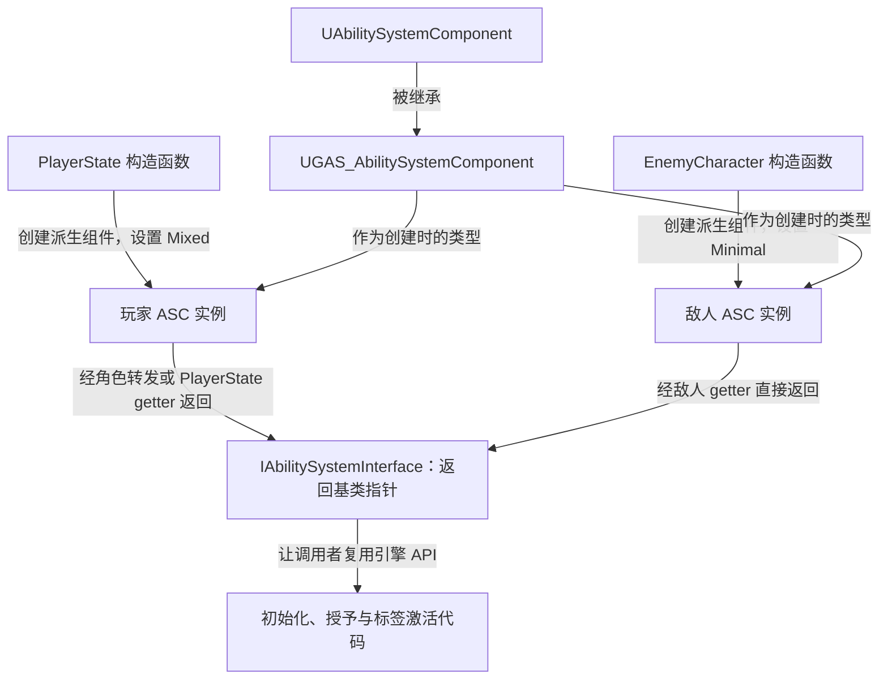

# 自定义 ASC：统一组件类型

项目已增加 `UGAS_AbilitySystemComponent`，供玩家和敌人创建 ASC 时共用。当前它是扩展入口，没有新增自定义运行逻辑。

源码：`Source/GAS_Acquaintance/AbilitySystem/GAS_AbilitySystemComponent.h`、`GAS_AbilitySystemComponent.cpp`。核对日期：2026-10-29。

## 类声明与当前实现

摘自 `GAS_AbilitySystemComponent.h`，保留类声明，省略空行：

```cpp
UCLASS(ClassGroup=(Custom), meta=(BlueprintSpawnableComponent))
class GAS_ACQUAINTANCE_API UGAS_AbilitySystemComponent : public UAbilitySystemComponent
{
    GENERATED_BODY()
public:
};
```

`BlueprintSpawnableComponent` 将该组件标记为可在蓝图中添加；当前项目 C++ 通过 `CreateDefaultSubobject` 创建它。`.cpp` 目前只有本类头文件的包含，没有构造函数实现、能力授予回调或自动激活代码。

现有 `GiveAbility()`、`InitAbilityActorInfo()`、`TryActivateAbilitiesByTag()` 等仍使用继承的引擎逻辑。增加一个派生类不会自动改变这些 API 的行为。

## 创建类型、保存类型与接口返回类型

玩家端的实例创建见 `Source/GAS_Acquaintance/Player/GAS_PlayerState.cpp`。以下摘录 `AGAS_PlayerState()` 完整构造函数，省略空行和注释：

```cpp
AGAS_PlayerState::AGAS_PlayerState()
{
    SetNetUpdateFrequency(100.f);
    AbilitySystemComponent = CreateDefaultSubobject<UGAS_AbilitySystemComponent>(TEXT("AbilitySystemComponent"));
    AbilitySystemComponent->SetIsReplicated(true);
    AbilitySystemComponent->SetReplicationMode(EGameplayEffectReplicationMode::Mixed);
}
```

| 层次 | 当前类型 | 含义 |
| --- | --- | --- |
| 创建实例的模板参数 | `UGAS_AbilitySystemComponent` | 决定实际创建的组件类型 |
| 两个持有者的成员 | `TObjectPtr<UAbilitySystemComponent>` | 以引擎基类类型保存组件 |
| GAS 接口返回值 | `UAbilitySystemComponent*` | 调用者通过统一接口访问 |



以后若派生类增加专属方法，调用点需要明确如何取得派生类型；当前调用的都是基类 API，不需要额外转型。

## 配置职责没有移入自定义 ASC

| 配置或逻辑 | 当前实际位置 |
| --- | --- |
| 创建组件、开启复制、选择复制模式 | PlayerState / EnemyCharacter 构造函数 |
| 设置 OwnerActor / AvatarActor | PlayerCharacter 回调 / EnemyCharacter.BeginPlay |
| 保存 `StartupAbilities`、构造 Spec 并授予 | BaseCharacters |
| 将输入 Tag 交给 ASC 检索激活 | PlayerController |
| `ActivateOnGiven` 标签定义 | GAS_Tags；自定义 ASC 尚未消费该标签 |

不要把标签的注释当作 ASC 已有的功能。当前 `ActivateOnGiven` 没有触发自定义授予回调，具体边界见 [标签说明](../Tags/GameplayTags.md)。

参见：[PlayerState](../Player/PlayerState.md)、[敌人角色](../Characters/EnemyCharacter.md)、[启动能力](StartupAbilities.md)。
