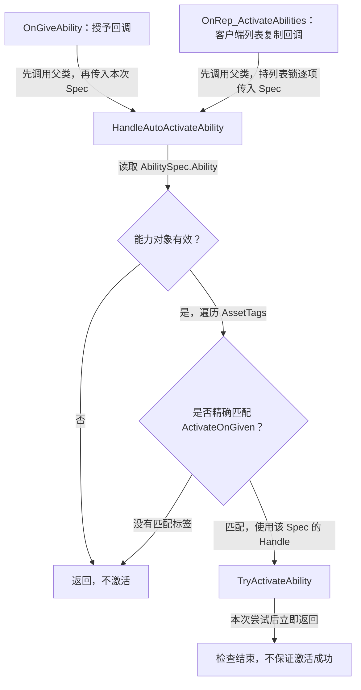

# UGAS_AbilitySystemComponent

继承 `UAbilitySystemComponent`，供玩家和敌人共用，负责在能力授予和能力列表复制回调中检查自动激活标签。

源码：`Source/GAS_Acquaintance/AbilitySystem/GAS_AbilitySystemComponent.h`、`GAS_AbilitySystemComponent.cpp`。核对日期：2026-11-03。

## 头文件：函数声明

类标记为 `UCLASS(ClassGroup=(Custom), meta=(BlueprintSpawnableComponent))`，没有自定义成员变量。

| 可见性 | 函数 | 作用 |
| --- | --- | --- |
| public override | `OnGiveAbility(FGameplayAbilitySpec&)` | 先执行父类授予回调，再检查本次 Spec |
| public override | `OnRep_ActivateAbilities()` | 先执行父类复制回调，再遍历本端可激活能力列表 |
| private | `HandleAutoActivateAbility(const FGameplayAbilitySpec&)` | 根据能力 AssetTags 判断是否尝试激活 |

## OnGiveAbility：本次授予的能力

摘自 `GAS_AbilitySystemComponent.cpp`，保留完整函数，省略空行：

```cpp
void UGAS_AbilitySystemComponent::OnGiveAbility(FGameplayAbilitySpec& AbilitySpec)
{
    Super::OnGiveAbility(AbilitySpec);
    HandleAutoActivateAbility(AbilitySpec);
}
```

启动能力的来源是 [AGAS_BaseCharacters](../Characters/CharacterBase.md) 的 `GiveStartupAbilities()`；组件在授予回调中检查这个 Spec。

## OnRep_ActivateAbilities：复制到本端的能力列表

摘自同一 `.cpp`，保留完整函数，省略空行：

```cpp
void UGAS_AbilitySystemComponent::OnRep_ActivateAbilities()
{
    Super::OnRep_ActivateAbilities();
    FScopedAbilityListLock ActiveScopeLock(*this);
    for (const FGameplayAbilitySpec& AbilitySpec : GetActivatableAbilities())
    {
        HandleAutoActivateAbility(AbilitySpec);
    }
}
```

能力列表复制到客户端后，回调在作用域列表锁内遍历 `GetActivatableAbilities()`。它会检查整个列表，而非只检查变化的一项；源码没有额外记录“已经自动激活过”的集合。

## HandleAutoActivateAbility：精确匹配并尝试激活

函数先将 `AbilitySpec.Ability` 保存为 `const UGameplayAbility* CurAbility`，为空则返回。以下摘自同一 `.cpp`，仅保留遍历标签的部分：

```cpp
for (const FGameplayTag& Tag : CurAbility->GetAssetTags())
{
    if (Tag.MatchesTagExact(GAS_Tags::GAS_Abilities::ActivateOnGiven))
    {
        TryActivateAbility(AbilitySpec.Handle);
        return;
    }
}
```

`MatchesTagExact()` 要求完整匹配 `GAS_Tags.GAS_Abilities.ActivateOnGiven`。找到后使用当前 Spec 的 Handle 调用 `TryActivateAbility()` 并立即返回，不检查返回值，也没有失败重试队列。



两个入口不表示固定的跨端时序。函数没有自行检查 `HasAuthority()`；实际执行端和成功条件还受引擎能力生命周期、ActorInfo 就绪情况、能力网络策略及激活条件约束。

## 类间职责

| 职责 | 所属类 |
| --- | --- |
| 创建组件并设置 Mixed | [AGAS_PlayerState](../Player/PlayerState.md) |
| 创建组件并设置 Minimal | [AGAS_EnemyCharacter](../Characters/EnemyCharacter.md) |
| 初始化 OwnerActor / AvatarActor | [AGAS_PlayerCharacter](../Characters/PlayerCharacter.md)、AGAS_EnemyCharacter |
| 保存能力类数组、构造 Spec、调用 GiveAbility | AGAS_BaseCharacters |
| 输入 Tag 检索激活 | [AGAS_PlayerController](../Player/PlayerController.md) |
| 按自动激活标签检查 Spec | 本类 |

持有者的成员类型为 `TObjectPtr<UAbilitySystemComponent>`，getter 返回 `UAbilitySystemComponent*`；实际对象为本类，通过基类接口仍会进入重写的回调。
