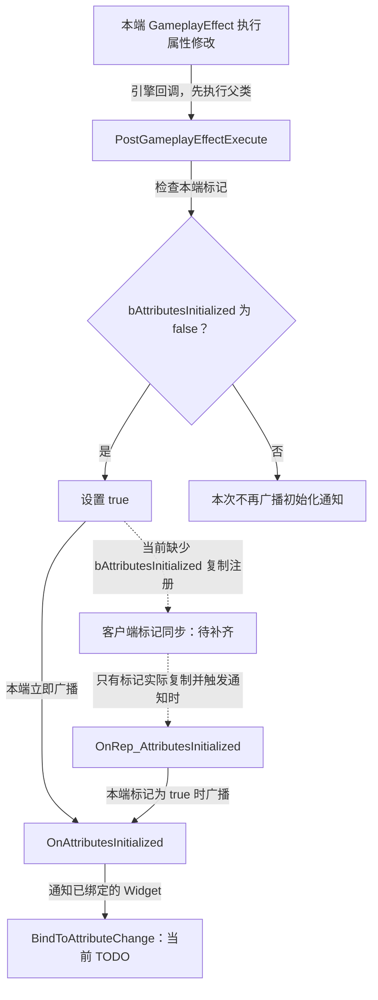
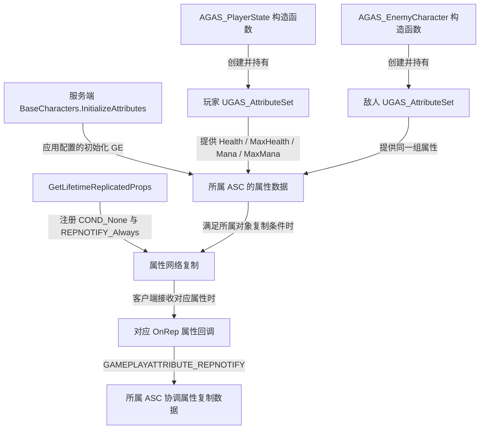

# UGAS_AttributeSet

继承 `UAttributeSet`，定义生命与法力属性、访问器、数值复制通知，以及首次效果执行时的初始化标记与本端通知。

源码：`Source/GAS_Learning/AbilitySystem/GAS_AttributeSet.h`、`GAS_AttributeSet.cpp`。核对日期：2026-11-05。

## 头文件：属性与函数

四个属性均为 public、`FGameplayAttributeData`、BlueprintReadOnly，各自使用 ReplicatedUsing 指定通知函数。

| 属性 | 复制回调 | 访问器宏调用 |
| --- | --- | --- |
| Health | OnRep_Health | ATTRIBUTE_ACCESSORS(ThisClass,Health) |
| MaxHealth | OnRep_MaxHealth | ATTRIBUTE_ACCESSORS(ThisClass,MaxHealth) |
| Mana | OnRep_Mana | ATTRIBUTE_ACCESSORS(ThisClass,Mana) |
| MaxMana | OnRep_MaxMana | ATTRIBUTE_ACCESSORS(ThisClass,MaxMana) |

`GetLifetimeReplicatedProps(TArray<class FLifetimeProperty>&) const` 重写复制注册。四个 OnRep 均为 UFUNCTION，接收 `const FGameplayAttributeData& OldData`。

| 其他 public 声明 | 标记 / 类型 | 职责 |
| --- | --- | --- |
| OnAttributesInitialized | FAttributesInitialized，BlueprintAssignable | 无参数动态多播委托 |
| bAttributesInitialized | bool，默认 false，ReplicatedUsing = OnRep_AttributesInitialized | 记录本端是否经历首次效果执行回调 |
| PostGameplayEffectExecute(const FGameplayEffectModCallbackData&) | override | 先调用父类，首次执行时设置标记并广播 |
| OnRep_AttributesInitialized() | UFUNCTION | 标记复制回调；为 true 时广播 |

`FAttributesInitialized` 在类外通过 `DECLARE_DYNAMIC_MULTICAST_DELEGATE` 声明。本类没有自定义构造函数、固定初始数值、范围钳制、死亡判断或伤害结算；属性名称不会自动建立 Health / MaxHealth 或 Mana / MaxMana 的数值约束。

## ATTRIBUTE_ACCESSORS：属性访问器

摘自 `GAS_AttributeSet.h` 的完整宏定义，保持原有续行：

```cpp
#define ATTRIBUTE_ACCESSORS(ClassName,PropertyName) \
    GAMEPLAYATTRIBUTE_PROPERTY_GETTER(ClassName, PropertyName) \
    GAMEPLAYATTRIBUTE_VALUE_GETTER(PropertyName) \
    GAMEPLAYATTRIBUTE_VALUE_SETTER(PropertyName) \
    GAMEPLAYATTRIBUTE_VALUE_INITTER(PropertyName)
```

宏对四个属性各生成四种函数；以下语义已对照本机 UE 5.6 的 `AttributeSet.h`：

| 生成函数，以 Health 为例 | 行为 |
| --- | --- |
| GetHealthAttribute() | 返回标识属性的 FGameplayAttribute |
| GetHealth() | 读取 CurrentValue |
| SetHealth(float) | 经所属 ASC 设置 NumericAttributeBase |
| InitHealth(float) | 直接设置 BaseValue 与 CurrentValue |

MaxHealth、Mana、MaxMana 对应生成 `GetMaxHealthAttribute / GetMaxHealth / SetMaxHealth / InitMaxHealth`、`GetManaAttribute / GetMana / SetMana / InitMana`、`GetMaxManaAttribute / GetMaxMana / SetMaxMana / InitMaxMana`。当前角色初始化入口使用 GE 应用路径，并未在自定义 C++ 中调用这些 Init 函数赋值。

## GetLifetimeReplicatedProps：复制注册

摘自 `GAS_AttributeSet.cpp`，保留完整函数，省略空行：

```cpp
void UGAS_AttributeSet::GetLifetimeReplicatedProps(TArray<class FLifetimeProperty>& OutLifetimeProps) const
{
    Super::GetLifetimeReplicatedProps(OutLifetimeProps);
    DOREPLIFETIME_CONDITION_NOTIFY(ThisClass,Health,COND_None,REPNOTIFY_Always);
    DOREPLIFETIME_CONDITION_NOTIFY(ThisClass,MaxHealth,COND_None,REPNOTIFY_Always);
    DOREPLIFETIME_CONDITION_NOTIFY(ThisClass,Mana,COND_None,REPNOTIFY_Always);
    DOREPLIFETIME_CONDITION_NOTIFY(ThisClass,MaxMana,COND_None,REPNOTIFY_Always);
}
```

`COND_None` 不附加属性级复制条件，实际传输仍受所属对象的网络复制约束。`REPNOTIFY_Always` 表示属性被复制接收时总是执行通知，不表示每帧主动广播。

这些属性有独立的复制声明，不能由 ASC 的 Mixed / Minimal GameplayEffect 复制模式直接推断它们不复制。

**当前注册表只包含上述四项数值，没有包含 `bAttributesInitialized`。** 该布尔值虽然声明了 ReplicatedUsing，但缺少这里的复制注册，不能仅凭头文件认定客户端会接收到该标记并触发对应回调。四项数值复制成功也不等于此标记已经同步。

## PostGameplayEffectExecute：首次效果执行标记

摘自 `GAS_AttributeSet.cpp`，保留完整函数，省略空行：

```cpp
void UGAS_AttributeSet::PostGameplayEffectExecute(const struct FGameplayEffectModCallbackData& Data)
{
    Super::PostGameplayEffectExecute(Data);
    if (!bAttributesInitialized)
    {
        bAttributesInitialized = true;
        OnAttributesInitialized.Broadcast();
    }
}
```

代码不筛选是哪一种 GE 或哪一项属性，也没有逐项检查四个数值。它表达的是“本端首次进入效果执行后的回调”，不是“指定初始化 GE 已完整执行、全部属性已可用于显示”。广播发生在这个回调内部；若一个效果依次执行多个属性修改，不能据首次广播推断其余修改已全部完成。

本机 UE 5.6 的 `AttributeSet.h` 明确将此回调限定为效果执行对属性 BaseValue 的修改；仅应用持续修饰型效果不保证进入该回调。因此不能只凭 `ApplyGameplayEffectSpecToSelf()` 已调用，就认定本标记一定会置为 true；还需核验初始化 GE 的配置。

标记一旦为 true，本函数后续执行不再广播；它不承担持续的属性变化监听。角色当前在服务端调用初始化 GE，但本函数自身没有权限分支，读取规则以本端实际执行为准。

## OnRep_AttributesInitialized：标记复制通知

摘自同一 `.cpp`，保留完整函数：

```cpp
void UGAS_AttributeSet::OnRep_AttributesInitialized()
{
    if (bAttributesInitialized)
    {
        OnAttributesInitialized.Broadcast();
    }
}
```

它在标记为 true 时广播同一个本端委托。当前标记没有加入 `GetLifetimeReplicatedProps()`，因此本页把这条客户端路径标为复制注册待补齐的关系；当前源码没有在四个数值 OnRep 中替代触发这个初始化通知。



实线是函数内已确认的处理；虚线说明复制声明与实际注册之间的缺口，不表示可靠的跨端完成顺序。

## OnRep_Health、OnRep_MaxHealth、OnRep_Mana、OnRep_MaxMana

每个回调执行 `GAMEPLAYATTRIBUTE_REPNOTIFY(ThisClass, 对应属性, OldData)`。以下摘自同一 `.cpp`，保留连续的 Health 和 MaxHealth 回调，省略空行及注释：

```cpp
void UGAS_AttributeSet::OnRep_Health(const FGameplayAttributeData& OldData)
{
    GAMEPLAYATTRIBUTE_REPNOTIFY(ThisClass,Health,OldData);
}
void UGAS_AttributeSet::OnRep_MaxHealth(const FGameplayAttributeData& OldData)
{
    GAMEPLAYATTRIBUTE_REPNOTIFY(ThisClass,MaxHealth,OldData);
}
```

Mana / MaxMana 使用相同结构。引擎宏把新旧属性数据交给所属 ASC 的 `SetBaseAttributeValueFromReplication()`，用于 GAS 属性复制及预测值协调；本类没有在 OnRep 中更新 Widget 或自行绘制血条。



具体初值由 `InitializeAttributesEffect` 指向的 GE 内容决定，资产数值和角色默认引用待编辑器核验。相关函数见 [AGAS_BaseCharacters](../Characters/CharacterBase.md)，UI 的引用缓存与属性通知衔接见 [UGAS_WidgetComponent](../UI/WidgetComponent.md)。
