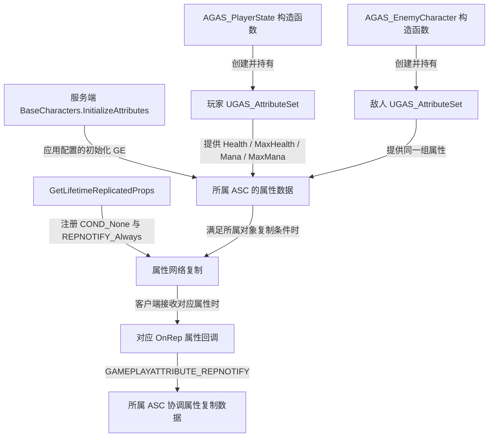

# UGAS_AttributeSet

继承 `UAttributeSet`，定义生命与法力属性、访问器及属性复制通知。

源码：`Source/GAS_Learning/AbilitySystem/GAS_AttributeSet.h`、`GAS_AttributeSet.cpp`。核对日期：2026-11-05。

## 头文件：属性与函数

四个属性均为 public、`FGameplayAttributeData`、BlueprintReadOnly，各自使用 ReplicatedUsing 指定通知函数。

| 属性 | 复制回调 | 访问器宏调用 |
| --- | --- | --- |
| Health | OnRep_Health | ATTRIBUTE_ACCESSORS(ThisClass,Health) |
| MaxHealth | OnRep_MaxHealth | ATTRIBUTE_ACCESSORS(ThisClass,MaxHealth) |
| Mana | OnRep_Mana | ATTRIBUTE_ACCESSORS(ThisClass,Mana) |
| MaxMana | OnRep_MaxMana | ATTRIBUTE_ACCESSORS(ThisClass,MaxMana) |

`GetLifetimeReplicatedProps(TArray<class FLifetimeProperty>&) const` 重写复制注册。四个 OnRep 均为 UFUNCTION，接收 `const FGameplayAttributeData& OldData`。

本类没有自定义构造函数、固定初始数值、范围钳制、死亡判断或伤害结算重写。属性名称不意味着 Health 与 MaxHealth、Mana 与 MaxMana 会自动保持数值约束。

## ATTRIBUTE_ACCESSORS：属性访问器

摘自 `GAS_AttributeSet.h` 的完整宏定义，保持原有续行：

```cpp
#define ATTRIBUTE_ACCESSORS(ClassName,PropertyName) \
    GAMEPLAYATTRIBUTE_PROPERTY_GETTER(ClassName, PropertyName) \
    GAMEPLAYATTRIBUTE_VALUE_GETTER(PropertyName) \
    GAMEPLAYATTRIBUTE_VALUE_SETTER(PropertyName) \
    GAMEPLAYATTRIBUTE_VALUE_INITTER(PropertyName)
```

宏对四个属性各生成四种函数；以下语义已对照本机 UE 5.6 的 `AttributeSet.h`：

| 生成函数，以 Health 为例 | 行为 |
| --- | --- |
| GetHealthAttribute() | 返回标识属性的 FGameplayAttribute |
| GetHealth() | 读取 CurrentValue |
| SetHealth(float) | 经所属 ASC 设置 NumericAttributeBase |
| InitHealth(float) | 直接设置 BaseValue 与 CurrentValue |

MaxHealth、Mana、MaxMana 对应生成 `GetMaxHealthAttribute / GetMaxHealth / SetMaxHealth / InitMaxHealth`、`GetManaAttribute / GetMana / SetMana / InitMana`、`GetMaxManaAttribute / GetMaxMana / SetMaxMana / InitMaxMana`。当前角色初始化入口使用 GE 应用路径，并未在自定义 C++ 中调用这些 Init 函数赋值。

## GetLifetimeReplicatedProps：复制注册

摘自 `GAS_AttributeSet.cpp`，保留完整函数，省略空行：

```cpp
void UGAS_AttributeSet::GetLifetimeReplicatedProps(TArray<class FLifetimeProperty>& OutLifetimeProps) const
{
    Super::GetLifetimeReplicatedProps(OutLifetimeProps);
    DOREPLIFETIME_CONDITION_NOTIFY(ThisClass,Health,COND_None,REPNOTIFY_Always);
    DOREPLIFETIME_CONDITION_NOTIFY(ThisClass,MaxHealth,COND_None,REPNOTIFY_Always);
    DOREPLIFETIME_CONDITION_NOTIFY(ThisClass,Mana,COND_None,REPNOTIFY_Always);
    DOREPLIFETIME_CONDITION_NOTIFY(ThisClass,MaxMana,COND_None,REPNOTIFY_Always);
}
```

`COND_None` 不附加属性级复制条件，实际传输仍受所属对象的网络复制约束。`REPNOTIFY_Always` 表示属性被复制接收时总是执行通知，不表示每帧主动广播。

这些属性有独立的复制声明，不能由 ASC 的 Mixed / Minimal GameplayEffect 复制模式直接推断它们不复制。

## OnRep_Health、OnRep_MaxHealth、OnRep_Mana、OnRep_MaxMana

每个回调执行 `GAMEPLAYATTRIBUTE_REPNOTIFY(ThisClass, 对应属性, OldData)`。以下摘自同一 `.cpp`，保留连续的 Health 和 MaxHealth 回调，省略空行及注释：

```cpp
void UGAS_AttributeSet::OnRep_Health(const FGameplayAttributeData& OldData)
{
    GAMEPLAYATTRIBUTE_REPNOTIFY(ThisClass,Health,OldData);
}
void UGAS_AttributeSet::OnRep_MaxHealth(const FGameplayAttributeData& OldData)
{
    GAMEPLAYATTRIBUTE_REPNOTIFY(ThisClass,MaxHealth,OldData);
}
```

Mana / MaxMana 使用相同结构。引擎宏把新旧属性数据交给所属 ASC 的 `SetBaseAttributeValueFromReplication()`，用于 GAS 属性复制及预测值协调；本类没有在 OnRep 中更新 Widget 或自行绘制血条。



具体初值由 `InitializeAttributesEffect` 指向的 GE 内容决定，资产数值和角色默认引用待编辑器核验。相关函数见 [AGAS_BaseCharacters](../Characters/CharacterBase.md)，UI 缓存见 [UGAS_WidgetComponent](../UI/WidgetComponent.md)。
