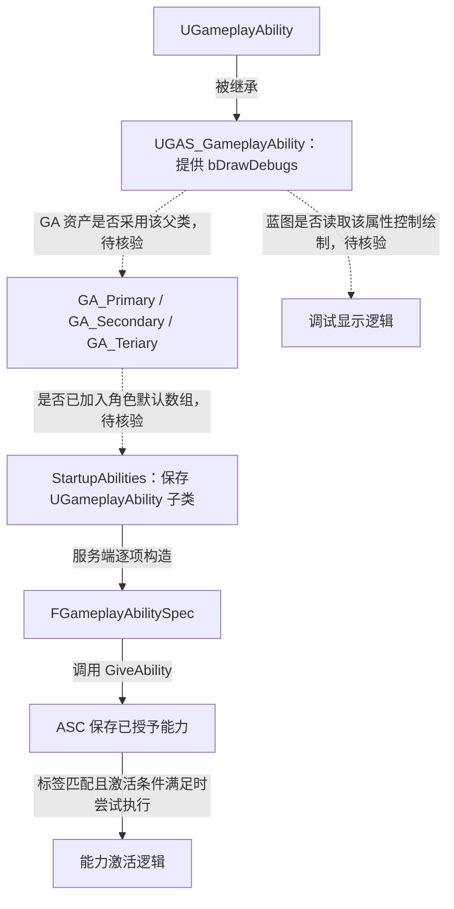
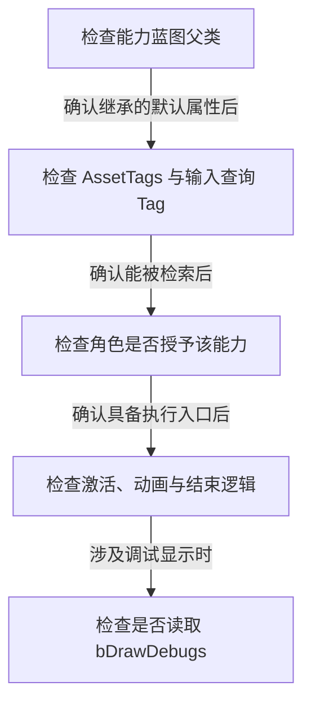

# 能力基类：共用调试开关

`UGAS_GameplayAbility` 继承 `UGameplayAbility`，当前只增加一个调试属性，为能力蓝图提供共用入口。

源码：`Source/GAS_Acquaintance/AbilitySystem/Abilities/GAS_GameplayAbility.h`、`GAS_GameplayAbility.cpp`。核对日期：2026-10-29。

## 当前类定义

摘自 `GAS_GameplayAbility.h`，保留完整类声明，省略空行：

```cpp
UCLASS()
class GAS_ACQUAINTANCE_API UGAS_GameplayAbility : public UGameplayAbility
{
    GENERATED_BODY()
public:
    UPROPERTY(EditDefaultsOnly, BlueprintReadOnly, Category = "GAS|Debug")
    bool bDrawDebugs = false;
};
```

| 标记 / 默认值 | 对使用者的含义 |
| --- | --- |
| `EditDefaultsOnly` | 在类默认值中配置调试开关 |
| `BlueprintReadOnly` | 蓝图可以读取；此属性未开放蓝图写入 |
| `Category = "GAS|Debug"` | 将属性归入对应详情分类 |
| `false` | 默认关闭；派生类默认值是否覆盖需核验 |

源码变量名是 `bDrawDebugs`。当前 `.cpp` 只包含头文件，没有重写激活、结束、费用或冷却逻辑，也没有绘制调试图形。只有消费这个布尔值的代码或蓝图逻辑存在时，开关才会影响表现。

## 能力类如何进入授予流程

`BaseCharacters` 的启动数组仍是 `TArray<TSubclassOf<UGameplayAbility>>`，没有收窄为 `UGAS_GameplayAbility`。因此数组接受的能力类不一定使用该自定义基类；具体能力资产的父类要在编辑器中核验。



实线表示源码继承和授予关系；虚线表示尚未读取的蓝图父类、默认数组与属性消费关系。

## 为什么不能只看类名推断效果

当前 `UGAS_GameplayAbility` 没有具体技能实现。三项 GA 资产存在，但它们的父类、AssetTags、动画调用、网络执行策略和结束条件未通过编辑器核验。

阅读能力时应依次确认以下关系：



这是编辑器阅读顺序，不是引擎运行时的能力生命周期顺序。

参见：[启动能力](StartupAbilities.md)、[Gameplay Tags](../Tags/GameplayTags.md)、[动画与事件线索](GameplayEvents.md)。
