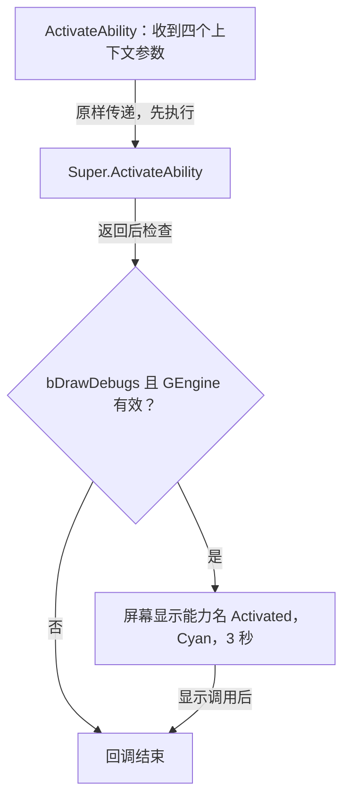
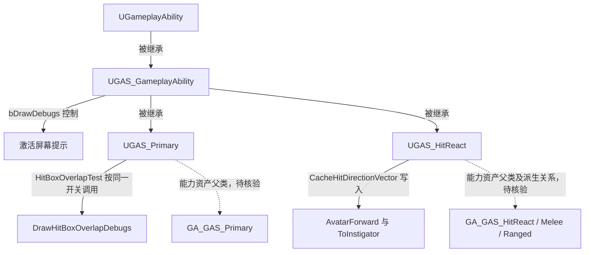

# UGAS_GameplayAbility

继承 `UGameplayAbility`，提供公共调试开关，并在激活回调中输出屏幕提示。

源码：`Source/GAS_Learning/AbilitySystem/Abilities/GAS_GameplayAbility.h`、`GAS_GameplayAbility.cpp`。核对日期：2026-11-05。

## 头文件：成员与重写函数

| 声明 | 可见性 / 标记 | 职责 |
| --- | --- | --- |
| `bool bDrawDebugs = false` | public，EditDefaultsOnly，BlueprintReadOnly，GAS\|Debug | 类默认值中配置，蓝图可读，默认关闭 |
| `ActivateAbility(...)` | public override | 先调用父类激活，再按开关输出提示 |

重写函数的四个参数为 `const FGameplayAbilitySpecHandle Handle`、`const FGameplayAbilityActorInfo* ActorInfo`、`const FGameplayAbilityActivationInfo ActivationInfo`、`const FGameplayEventData* TriggerEventData`。当前实现原样传给父类，不自行读取事件 Payload。

## ActivateAbility：屏幕提示与执行顺序

摘自 `GAS_GameplayAbility.cpp` 的 `ActivateAbility()`，仅保留函数体，省略空行：

```cpp
Super::ActivateAbility(Handle, ActorInfo, ActivationInfo, TriggerEventData);
if (bDrawDebugs && GEngine)
{
    GEngine->AddOnScreenDebugMessage(-1,3.f,FColor::Cyan,FString::Printf(TEXT("%s Activated"),*GetName()));
}
```

提示内容为当前能力对象名加 Activated，颜色 Cyan，持续 3 秒，消息键为 -1。父类激活逻辑先执行；开关和 GEngine 检查只控制这段显示，不构成激活条件。这里未检查能力是否已结束，也没有追加费用、冷却或结束处理。



## 派生类与调试属性使用者



本类输出屏幕提示，[Primary](Primary.md) 输出球形范围和结果调试图；它们读取同名继承属性。[HitReact](HitReact.md) 本身没有额外的方向绘制逻辑。派生蓝图是否保留父类激活调用及开关值，需要在编辑器核验。

## 与授予和自动激活的关系

[AGAS_BaseCharacters](../Characters/CharacterBase.md) 的启动数组为 `TArray<TSubclassOf<UGameplayAbility>>`，没有强制限定为本类。自动激活标签检查归于 [UGAS_AbilitySystemComponent](AbilitySystemComponent.md)，本类负责实际激活回调中的公共显示逻辑。
