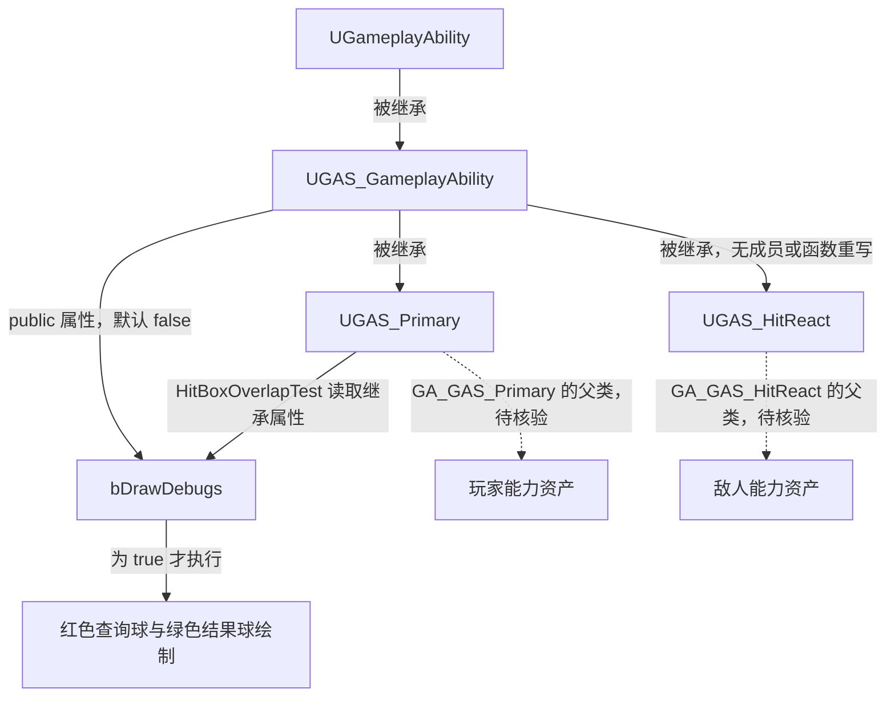

# UGAS_GameplayAbility

继承 `UGameplayAbility`，为派生能力提供公共调试属性。

源码：`Source/GAS_Acquaintance/AbilitySystem/Abilities/GAS_GameplayAbility.h`、`GAS_GameplayAbility.cpp`。核对日期：2026-11-03。

## 头文件：类声明与成员

摘自 `GAS_GameplayAbility.h`，保留完整类声明，省略空行：

```cpp
UCLASS()
class GAS_ACQUAINTANCE_API UGAS_GameplayAbility : public UGameplayAbility
{
    GENERATED_BODY()
public:
    UPROPERTY(EditDefaultsOnly, BlueprintReadOnly, Category = "GAS|Debug")
    bool bDrawDebugs = false;
};
```

| 成员 | 可见性与标记 | 含义 |
| --- | --- | --- |
| `bDrawDebugs` | public，EditDefaultsOnly | 类默认值中设置，默认 false |
| 同一属性 | BlueprintReadOnly | 蓝图可读取，未开放蓝图写入 |
| 同一属性 | `GAS\|Debug` | 详情面板分类 |

## 源文件：实现范围

`.cpp` 只有本类头文件的包含。本类没有声明或实现构造函数、激活 / 结束重写、费用 / 冷却处理，也没有绘制调用。调试属性的直接 C++ 使用者是 [UGAS_Primary](Primary.md) 的 `HitBoxOverlapTest()`。

## 派生类与属性使用



基类属性只控制明确读取它的代码。Primary 的查询在绘制分支之前执行，关闭开关不取消查询。`UGAS_HitReact` 本身没有读取此属性的逻辑。

## 与启动数组的类型关系

[AGAS_BaseCharacters](../Characters/CharacterBase.md) 使用 `TArray<TSubclassOf<UGameplayAbility>>` 保存能力类，并未限制为本类。因此数组允许引擎能力基类的其他子类；具体资产父类和角色默认数组仍需在编辑器核验。

自动激活标签由 [UGAS_AbilitySystemComponent](AbilitySystemComponent.md) 检查，不是本类实现的授予回调。
