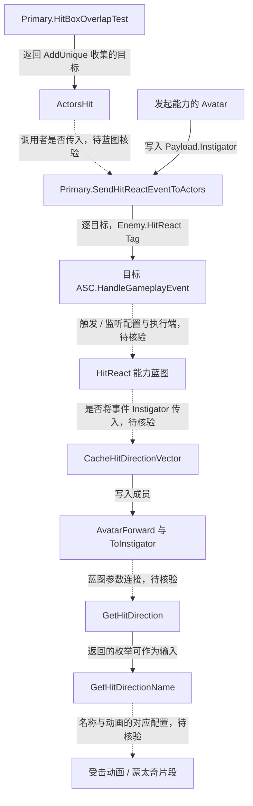

# 跨文件关系索引：Gameplay Event 与受击方向

本页串联所属类的事件与方向数据关系，成员和函数实现归入各类页面。核对日期：2026-11-05。

## 文件与类职责

| 所属文件 / 类 | 已确认内容 | 详细说明 |
| --- | --- | --- |
| GAS_Tags.h / .cpp | 注册 Primary 与 Enemy.HitReact 事件标签 | [GAS_Tags](../Tags/GameplayTags.md) |
| AGAS_PlayerController | 按能力 Tag 尝试激活，没有在输入回调发送 Gameplay Event | [Controller](../Player/PlayerController.md) |
| UGAS_Primary | 返回去重后的查询结果，按传入数组发送受击事件 | [Primary](Primary.md) |
| UGAS_HitReact | 从传入 Instigator 与当前 Avatar 缓存方向 | [HitReact](HitReact.md) |
| UGAS_BlueprintLibrary | 按点积 / 叉积判定方向，将枚举映射为名称 | [方向工具](../Utils/BlueprintLibrary.md) |
| UGAS_GameplayAbility | 转交激活参数，按开关显示能力名，不自行解析 Payload | [能力基类](GameplayAbility.md) |

Primary 输入标签与事件标签不同。当前 C++ 发送的是 `GAS_Tags.GAS_Events.Enemy.HitReact`，通过独立 Tag 参数传递；Payload 显式填写 `Instigator` 为发起能力的 Avatar。Player.Primary 的事件字符串为 `GAS_Tags.GAS_Events.Primary`，不含 `.Player`，当前没有直接发送该标签的自定义 C++ 调用。

## 已实现与待核验连接

实线表示函数内已确认的调用、输出或参数类型关系；虚线表示当前 C++ 没有直接连接的调用点。查询函数不自行发送事件，发送函数不自行调用方向缓存；这些边界保留在图上，避免把若干可调用函数当作已经自动串联的完整流程。

发送 API 的本机引擎实现取得目标 ASC 后调用 `HandleGameplayEvent()`。项目代码没有为此封装 RPC，也没有伤害结算调用；不能由单次发送推断所有端都接收或受击能力必定激活。

## 业务资产入口

路径以 `Content/GAS_Acquaintance/Blueprints` 为根：

| 目录 | 文件 | 待编辑器核验内容 |
| --- | --- | --- |
| Notifies | AN_SendEventToActor.uasset | 父类、目标、Tag、Payload 与通知执行端 |
| Characters/Player/Anim | AM_GAS_Primary_A / B、Primary_A / B | 动画引用、通知轨道和时机 |
| AbilitySystem/PlayerAbilities | GA_GAS_Primary | 父类、检测调用、发送调用及结束逻辑 |
| AbilitySystem/EnemyAbilities | GA_GAS_HitReact、GA_GAS_HitReact_Melee / Ranged | 继承关系、触发 Tag、Payload 读取、方向缓存与工具调用 |
| Characters/Enemy/Anim | AM_HitReact_Melee / Ranged | 方向名称与动画片段对应、播放和结束行为 |

这些文件已确认存在，内部蓝图和动画设置未在本次通过编辑器核验。
