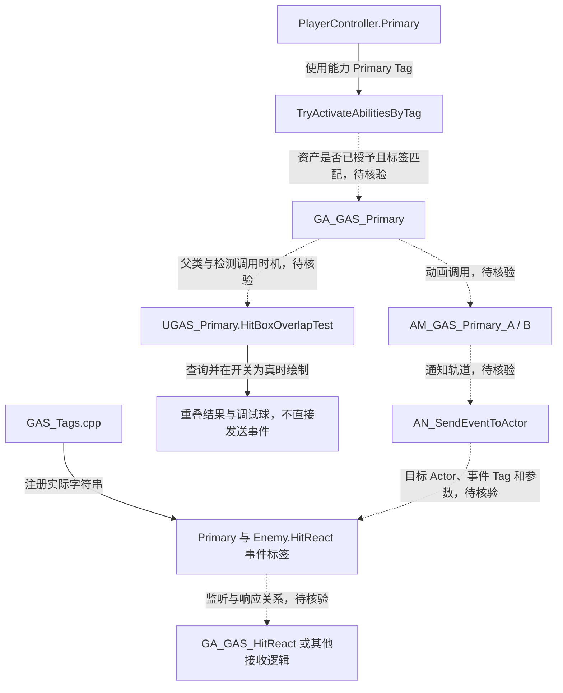

# 跨文件关系索引：Gameplay Event

本页索引事件标识、能力类及动画通知资产；函数细节归入所属类。核对日期：2026-11-03。

## 文件与类的职责

| 所属文件 / 类 | 已确认内容 | 对应笔记 |
| --- | --- | --- |
| GAS_Tags.h / .cpp | 声明并注册 Player.Primary 与 Enemy.HitReact 事件标签 | [GAS_Tags](../Tags/GameplayTags.md) |
| AGAS_PlayerController | 按能力 Tag 尝试激活，没有发送事件的调用 | [PlayerController](../Player/PlayerController.md) |
| UGAS_Primary | 球形查询和调试绘制，没有发送受击事件 | [Primary](Primary.md) |
| UGAS_HitReact | 仅类声明，没有事件监听重写 | [HitReact](HitReact.md) |
| UGAS_AbilitySystemComponent | 检查 ActivateOnGiven，没有事件发送或监听代码 | [ASC](AbilitySystemComponent.md) |

事件变量 `GAS_Tags::GAS_Events::Player::Primary` 的注册字符串为 `GAS_Tags.GAS_Events.Primary`，不含 `.Player`；Enemy.HitReact 字符串为 `GAS_Tags.GAS_Events.Enemy.HitReact`。它们和 `GAS_Abilities` 下的能力检索标签是不同标识。

## 业务资产入口

路径以 `Content/GAS_Acquaintance/Blueprints` 为根：

| 目录 | 文件 | 内部关系核验范围 |
| --- | --- | --- |
| Notifies | AN_SendEventToActor.uasset | 父类、目标 Actor、事件参数及执行端 |
| Characters/Player/Anim | AM_GAS_Primary_A / B.uasset | 动画引用及通知轨道 |
| Characters/Player/Anim | Primary_A / B.uasset | 资源类型、骨骼与引用关系 |
| AbilitySystem/PlayerAbilities | GA_GAS_Primary.uasset | 父类、动画播放、HitBoxOverlapTest 调用、事件接收及结束逻辑 |
| AbilitySystem/EnemyAbilities | GA_GAS_HitReact.uasset | 父类、事件监听、受击响应及结束逻辑 |

文件已确认存在，内部引用及蓝图逻辑尚未通过编辑器核验。

## 源码与待核验资产的关系

实线表示已读源码中的调用或注册；虚线只表示需要核验的资产连接。事件是否转发、哪一端发送及接收、是否重复处理，都需要实际蓝图和运行行为的证据。
