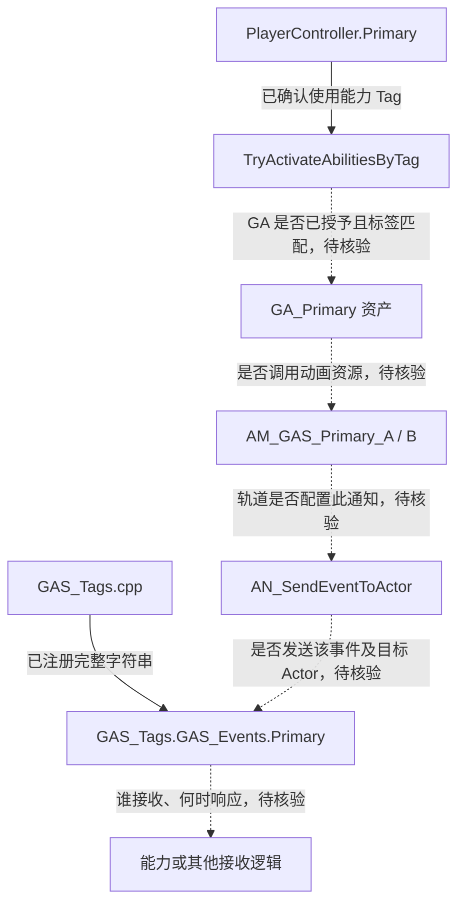

# Gameplay Event：动画与事件的核对入口

参考项目新增了事件标签、动画资源和 `AN_SendEventToActor` 资产。本页记录已确认的源码与资源入口，并标出需要在编辑器中继续核验的连接。

核对日期：2026-10-29。当前自定义 C++ 没有 Gameplay Event 发送或等待逻辑，因此不能把下面的资源线索视为已经跑通的事件流程。

## 事件 Tag 与能力检索 Tag 不同

摘自 `Source/GAS_Acquaintance/GameplayTags/GAS_Tags.cpp`，仅保留外层 `GAS_Tags` 命名空间内部的 `GAS_Events` 定义，省略空行：

```cpp
namespace GAS_Events
{
    namespace Player
    {
        UE_DEFINE_GAMEPLAY_TAG_COMMENT(Primary, "GAS_Tags.GAS_Events.Primary", "Tag for the primary Gameplay Ability");
    }
}
```

| 项目项 | 当前值 |
| --- | --- |
| C++ 变量 | `GAS_Tags::GAS_Events::Player::Primary` |
| 注册字符串 | `GAS_Tags.GAS_Events.Primary` |
| 输入检索变量 | `GAS_Tags::GAS_Abilities::Primary` |
| 输入检索字符串 | `GAS_Tags.GAS_Abilities.Primary` |

尤其注意：C++ 命名空间有 `Player` 这一层，但注册的标签字符串**没有 `.Player`**。蓝图中应按实际字符串查找，不能由命名空间自行拼出另一个标签。

当前 Controller 使用能力检索 Tag 调用 `TryActivateAbilitiesByTag()`，没有改成发送上述事件。事件 Tag 的定义本身也不会自动建立发送者、接收者或网络转发。

## 已确认存在的资源

以 `Content/GAS_Acquaintance/Blueprints` 为根：

| 目录 | 已确认文件 | 尚需核验 |
| --- | --- | --- |
| `Notifies` | `AN_SendEventToActor.uasset` | 父类、通知回调、目标 Actor 与事件参数 |
| `Characters/Player/Anim` | `AM_GAS_Primary_A.uasset`、`AM_GAS_Primary_B.uasset` | 资源类型、动画引用及通知轨道 |
| `Characters/Player/Anim` | `Primary_A.uasset`、`Primary_B.uasset` | 资源类型、骨骼与上层资源的引用 |
| `AbilitySystem/PlayerAbilities` | `GA_Primary.uasset` | 是否播放上述动画、是否接收事件、何时结束 |

文件名用于定位，不能单独证明资源类型、相互引用或事件图行为。

## 待验证的关系图



实线只有源码已确认的注册和输入调用；动画、通知、事件发送与接收之间均为核对线索，没有固定完成顺序或自动网络传播的含义。

## 在编辑器中应确认什么

| 位置 | 需要回答的问题 |
| --- | --- |
| `GA_Primary` | 能力在何处激活？是否调用动画？是否等待该事件或通过事件触发？ |
| 动画资源 | 通知是否真的在被播放的资源中？通知时间点能否到达？ |
| `AN_SendEventToActor` | 发给哪个 Actor？Tag 是否为实际注册字符串？携带什么数据？ |
| 接收逻辑 | 接收目标是否就是发送目标？等待或监听逻辑是否已就绪？ |
| 网络设置 | 哪一端播放动画、执行通知、处理事件？是否存在重复处理？ |

这些是待核验问题，当前没有可直接从参考项目 C++ 摘录的事件发送示例，因此不在笔记中编写一个示例冒充现有实现。

参见：[能力基类](GameplayAbility.md)、[Gameplay Tags](../Tags/GameplayTags.md)、[玩家输入](../Player/PlayerController.md)。
