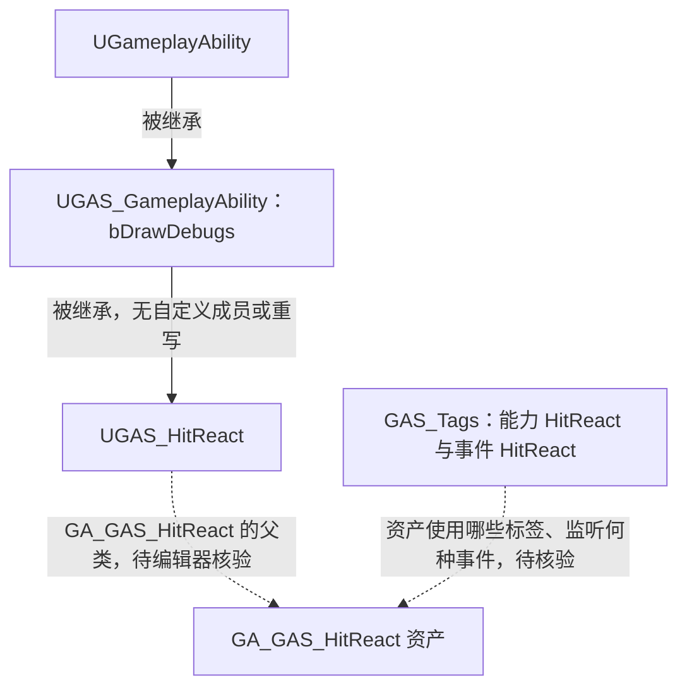

# UGAS_HitReact

继承 [UGAS_GameplayAbility](GameplayAbility.md)。

源码：`Source/GAS_Acquaintance/AbilitySystem/Abilities/Enemy/GAS_HitReact.h`、`GAS_HitReact.cpp`。核对日期：2026-11-03。

## 头文件：类声明

摘自 `GAS_HitReact.h`，保留完整类声明：

```cpp
UCLASS()
class GAS_ACQUAINTANCE_API UGAS_HitReact : public UGAS_GameplayAbility
{
    GENERATED_BODY()
};
```

本类没有声明成员变量、构造函数或重写函数，继承能力基类的 `bDrawDebugs` 和引擎能力接口。`.cpp` 只有本类头文件的包含，没有受击响应、动画播放、事件监听、伤害计算或能力结束代码。

## 继承与外部标识



对应资源为 `Blueprints/AbilitySystem/EnemyAbilities/GA_GAS_HitReact.uasset`。能力标签 `GAS_Tags.GAS_Abilities.Enemy.HitReact` 与事件标签 `GAS_Tags.GAS_Events.Enemy.HitReact` 均已注册，但类名及标签名不能证明受击事件已经发送或被监听。

参见：[AGAS_EnemyCharacter](../Characters/EnemyCharacter.md)、[GAS_Tags](../Tags/GameplayTags.md)、[事件关系索引](GameplayEvents.md)。
