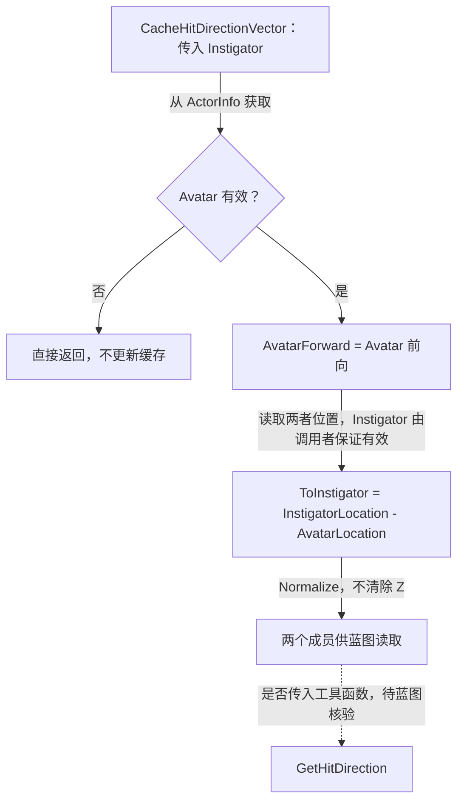

# UGAS_HitReact

继承 [UGAS_GameplayAbility](GameplayAbility.md)，缓存当前受击角色的前向和指向事件发起者的单位方向，供外部逻辑读取。

源码：`Source/GAS_Acquaintance/AbilitySystem/Abilities/Enemy/GAS_HitReact.h`、`GAS_HitReact.cpp`。核对日期：2026-11-03。

## 头文件：成员与函数

| 可见性 | 声明 | 标记 | 职责 |
| --- | --- | --- | --- |
| public | `CacheHitDirectionVector(AActor* Instigator)` | BlueprintCallable | 根据当前 Avatar 和参数 Actor 缓存方向 |
| public | `FVector AvatarForward` | BlueprintReadOnly | 当前 Avatar 的前向 |
| public | `FVector ToInstigator` | BlueprintReadOnly | 从当前 Avatar 指向 Instigator 的归一化方向 |

函数及两个成员均归入 `GAS|Abilities`。头文件没有为两个向量写出显式初始值；它们是本能力对象的成员，不是静态全局缓存。

## CacheHitDirectionVector：向量来源与归一化

摘自 `GAS_HitReact.cpp`，保留完整函数，省略空行：

```cpp
void UGAS_HitReact::CacheHitDirectionVector(AActor* Instigator)
{
    const AActor* AvatarActor = GetAvatarActorFromActorInfo();
    if (!AvatarActor) return;
    AvatarForward = AvatarActor->GetActorForwardVector();
    const FVector AvatarLocation = AvatarActor->GetActorLocation();
    const FVector InstigatorLocation = Instigator->GetActorLocation();
    ToInstigator = InstigatorLocation - AvatarLocation;
    ToInstigator.Normalize();
}
```

差值方向是“从受击 Avatar 指向发起者”，不是发起者朝向，也不是相反的入射方向。函数使用完整三维坐标，没有清除 Z 分量。

只检查了 Avatar，没有检查传入 `Instigator`；调用者必须提供有效 Actor。Avatar 为空时提前返回，已有缓存不会被此分支清空。同位置产生零差值，源码未检查 `Normalize()` 的返回值或额外标记方向是否有效。



## 与事件、方向工具和资产的关系

[UGAS_Primary](Primary.md) 的发送函数把发起 Avatar 写入 `Payload.Instigator`。这为缓存函数提供了可能的数据来源，但本类没有自己监听 Gameplay Event，也没有重写激活函数将 Payload 自动传入缓存函数。

[UGAS_BlueprintLibrary](../Utils/BlueprintLibrary.md) 提供方向判定与名称映射。本类不直接调用这些工具，不选择动画、不播放蒙太奇、不结算伤害，也不自行结束能力。

业务资源包括 `GA_GAS_HitReact`、`GA_GAS_HitReact_Melee`、`GA_GAS_HitReact_Ranged`，以及 `AM_HitReact_Melee`、`AM_HitReact_Ranged`。它们的父类、事件触发条件、方向与动画的对应关系、网络执行端和结束逻辑仍需编辑器核验。详见 [事件关系索引](GameplayEvents.md)。
