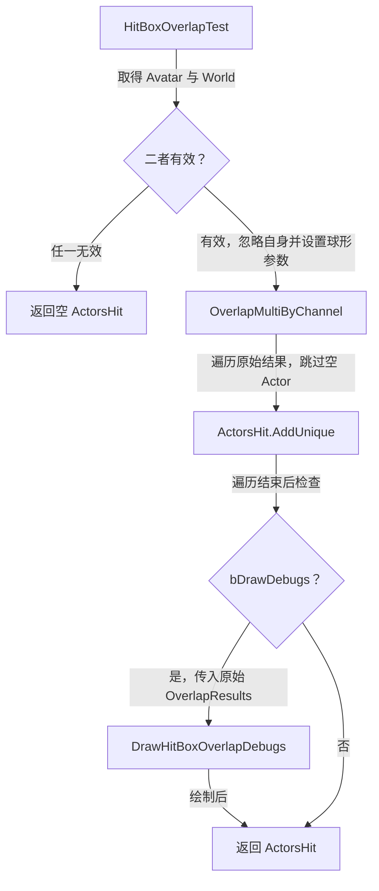
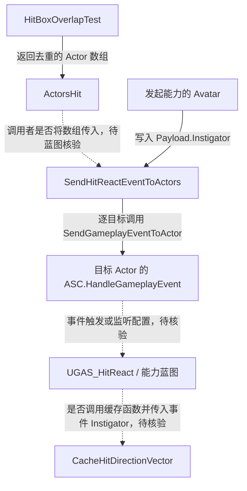

# UGAS_Primary

继承 [UGAS_GameplayAbility](GameplayAbility.md)，负责球形重叠查询、命中 Actor 收集、受击事件发送和命中范围调试绘制。

源码：`Source/GAS_Learning/AbilitySystem/Abilities/Player/GAS_Primary.h`、`GAS_Primary.cpp`。核对日期：2026-11-05。

## 头文件：成员与函数

| 可见性 | 声明 | 标记 / 默认值 | 职责 |
| --- | --- | --- | --- |
| public | `TArray<AActor*> HitBoxOverlapTest()` | BlueprintCallable | 查询并返回去重后的 Actor 数组 |
| public | `SendHitReactEventToActors(const TArray<AActor*>&)` | BlueprintCallable | 按传入数组逐个发送 Enemy.HitReact 事件 |
| private | `DrawHitBoxOverlapDebugs(... ) const` | 无蓝图调用标记 | 绘制查询球与原始结果球 |
| private | `HitBoxRadius` | EditDefaultsOnly，100.f | 球体半径 |
| private | `HitBoxForwardOffset` | EditDefaultsOnly，200.f | 沿 Avatar 前向的偏移 |
| private | `HitBoxElevationOffset` | EditDefaultsOnly，20.f | 世界 Z 轴偏移 |

三个浮点属性和两个蓝图可调用函数均归入 `GAS|Abilities`。绘制函数的参数依次是 `const TArray<FOverlapResult>& OverlapResults`、`const FVector& HitBoxLocation` 和 `const UWorld* InWorld`。

## HitBoxOverlapTest：查询参数与球心

函数先建立空的 `ActorsHit`。Avatar 或 World 无效时返回此空数组。Avatar 来自 `GetAvatarActorFromActorInfo()`，并被加入忽略列表以排除自身。

摘自 `GAS_Primary.cpp` 的 `HitBoxOverlapTest()`，仅保留响应参数和球体创建部分，省略空行：

```cpp
FCollisionResponseParams ResponseParams;
ResponseParams.CollisionResponse.SetAllChannels(ECR_Ignore);
ResponseParams.CollisionResponse.SetResponse(ECC_Pawn,ECR_Block);
TArray<FOverlapResult> OverlapResults;
FCollisionShape CollisionShape = FCollisionShape::MakeSphere(HitBoxRadius);
```

响应参数仅为 Pawn 通道设置 Block；实际查询通道是 `ECC_Visibility`。查询结果还取决于目标组件的碰撞设置，不能据此认定所有敌人都会被检出。

以下摘自同一函数的 World 检查、位置计算和查询部分，省略空行：

```cpp
const UWorld* LocalWorld = GetWorld();
if (!LocalWorld) return ActorsHit;
const FVector Forward = AvatarActor->GetActorForwardVector() * HitBoxForwardOffset;
const FVector HitBoxLocation = AvatarActor->GetActorLocation() + Forward + FVector(0.f,0.f,HitBoxElevationOffset);
LocalWorld->OverlapMultiByChannel(OverlapResults, HitBoxLocation, FQuat::Identity, ECC_Visibility,
    CollisionShape, QueryParams, ResponseParams);
```

球心使用 Avatar 的位置和前向，再叠加世界 Z 轴偏移；没有读取 Controller 或摄像机朝向。调用将结果写入局部 `OverlapResults`，未使用布尔返回值。

## HitBoxOverlapTest：有效 Actor、去重与返回值

摘自同一函数，仅保留结果收集循环，省略空行：

```cpp
for (const FOverlapResult& Result : OverlapResults)
{
    if (!Result.GetActor()) continue;
    ActorsHit.AddUnique(Result.GetActor());
}
```

同一 Actor 的多个组件可能对应多条原始结果；返回数组使用 `AddUnique()` 去重。收集完成后，函数按 `bDrawDebugs` 决定是否调用绘制函数，最后返回 `ActorsHit`。关闭调试不会关闭查询或结果收集。



## SendHitReactEventToActors：事件目标与 Payload

摘自 `GAS_Primary.cpp`，保留完整函数，省略空行：

```cpp
void UGAS_Primary::SendHitReactEventToActors(const TArray<AActor*>& ActorsHit)
{
    for (AActor* Result : ActorsHit)
    {
        FGameplayEventData Payload;
        Payload.Instigator = GetAvatarActorFromActorInfo();
        UAbilitySystemBlueprintLibrary::SendGameplayEventToActor(Result, GAS_Tags::GAS_Events::Enemy::HitReact, Payload);
    }
}
```

事件目标是每个 `Result`，显式填写的 Payload 字段只有 `Instigator`，值为发起能力的 Avatar。代码没有手动填写 `Payload.Target`、`Payload.EventTag` 或伤害数值；事件 Tag 通过发送 API 的独立参数传入。

函数本身不检查目标有效性、不去重、不检查权限或发送结果。传入本类查询结果时数组已去重；其他调用者传入重复项则会重复调用发送 API。引擎 `AbilitySystemBlueprintLibrary.cpp` 的该 API 检查目标与 ASC，再调用目标 ASC 的 `HandleGameplayEvent()`，不应将函数名视为项目已实现跨端广播或伤害结算的证据。

## DrawHitBoxOverlapDebugs：绘制参数

函数先检查 `InWorld`，无效则返回。红球表示查询范围：球心为 HitBoxLocation、半径 HitBoxRadius、16 段、持续 3 秒。绿色球表示原始重叠结果中的有效 Actor：位置上移 100、半径 30、10 段、持续 3 秒。

绘制遍历的是原始 `OverlapResults`，因此同一 Actor 的多个结果可能重复绘制；这不影响返回数组的去重。

## 函数之间与接收类的关系



本类没有重写 `ActivateAbility()`，也没有在 C++ 内把查询函数直接连接到发送函数。业务资产 `GA_GAS_Primary.uasset` 的父类、调用时机和事件接收配置仍需在编辑器核验。

参见：[UGAS_HitReact](HitReact.md)、[GAS_Tags](../Tags/GameplayTags.md)、[事件关系索引](GameplayEvents.md)。
