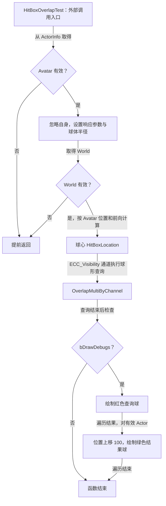

# UGAS_Primary

继承 [UGAS_GameplayAbility](GameplayAbility.md)，提供蓝图可调用的球形重叠检测函数，使用继承的 `bDrawDebugs` 控制调试绘制。

源码：`Source/GAS_Acquaintance/AbilitySystem/Abilities/Player/GAS_Primary.h`、`GAS_Primary.cpp`。核对日期：2026-11-03。

## 头文件：成员与函数

| 可见性 | 声明 | 标记 / 默认值 | 职责 |
| --- | --- | --- | --- |
| public | `void HitBoxOverlapTest()` | BlueprintCallable，GAS\|Abilities | 查询角色前方球形范围的重叠结果 |
| private | `float HitBoxRadius` | EditDefaultsOnly，100.f | 球体半径 |
| private | `float HitBoxForwardOffset` | EditDefaultsOnly，200.f | 沿 Avatar 前向的偏移 |
| private | `float HitBoxElevationOffset` | EditDefaultsOnly，20.f | 世界 Z 轴偏移 |

## HitBoxOverlapTest：查询参数

函数取得 `GetAvatarActorFromActorInfo()`，Avatar 为空则返回。`ActorsToIgnore` 加入 Avatar，再写入 `FCollisionQueryParams`，避免查询自身。

摘自 `GAS_Primary.cpp` 的 `HitBoxOverlapTest()`，仅保留响应参数和球形创建部分，省略空行：

```cpp
FCollisionResponseParams ResponseParams;
ResponseParams.CollisionResponse.SetAllChannels(ECR_Ignore);
ResponseParams.CollisionResponse.SetResponse(ECC_Pawn,ECR_Block);
TArray<FOverlapResult> OverlapResults;
FCollisionShape CollisionShape = FCollisionShape::MakeSphere(HitBoxRadius);
```

响应参数仅为 Pawn 通道设置 Block，其他通道为 Ignore；实际查询使用的通道是下方的 `ECC_Visibility`。结果也取决于场景组件本身的碰撞配置，不能直接理解为“必然命中所有敌人”。

## HitBoxOverlapTest：位置计算与查询

摘自同一函数，仅保留 World 检查、位置计算和重叠查询部分，省略空行：

```cpp
const UWorld* LocalWorld = GetWorld();
if (!LocalWorld) return;
const FVector Forward = LocalActor->GetActorForwardVector() * HitBoxForwardOffset;
const FVector HitBoxLocation = LocalActor->GetActorLocation() + Forward + FVector(0.f,0.f,HitBoxElevationOffset);
LocalWorld->OverlapMultiByChannel(OverlapResults, HitBoxLocation, FQuat::Identity, ECC_Visibility,
    CollisionShape, QueryParams, ResponseParams);
```

球心为 Avatar 位置、Avatar 前向偏移和世界 Z 轴偏移的和；方向取自 Avatar，非 Controller 或摄像机。调用把结果写入局部 `OverlapResults`，没有使用其布尔返回值。

## HitBoxOverlapTest：调试分支

`bDrawDebugs` 为真时，函数绘制红色查询球：半径为 `HitBoxRadius`，分段数 16，持续 3 秒。随后遍历 `OverlapResults`，对有效 Actor 的位置加 100 的 Z 偏移，绘制半径 30、分段数 10、持续 3 秒的绿色球。



查询在调试开关检查之前执行，关闭绘制不会关闭查询。函数没有返回结果、去重 Actor、应用伤害、发送 HitReact 事件或施加 GameplayEffect。本类没有重写 `ActivateAbility()`；检测由何处、何时调用，需核验调用者或蓝图事件图。

## 类与资产关系

业务资源为 `Blueprints/AbilitySystem/PlayerAbilities/GA_GAS_Primary.uasset`；父类和 `HitBoxOverlapTest()` 调用时机尚未通过编辑器核验。Controller 的 `Primary()` 使用能力标签激活；事件标签的关系见 [GAS_Tags](../Tags/GameplayTags.md) 与 [事件关系索引](GameplayEvents.md)。
