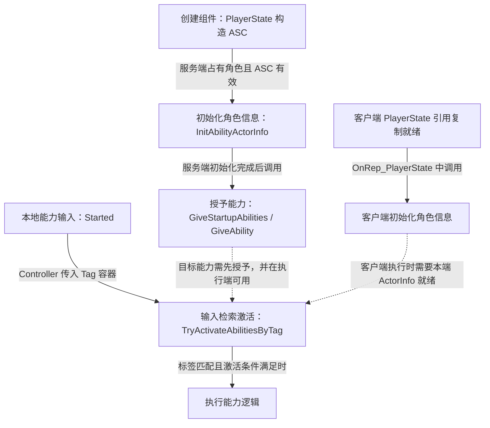
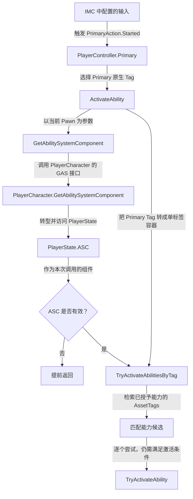

# 启动能力与激活流程

本项目的 GAS 接入分为组件创建、角色信息初始化、能力授予和输入检索激活。它们的前置依赖如下；虚线表示可用条件，不是直接的函数调用。



源码入口：

- `Player/GAS_PlayerState.cpp`：创建、复制 ASC。
- `Characters/GAS_PlayerCharacter.cpp`：初始化 ActorInfo。
- `Characters/GAS_BaseCharacters.cpp`：授予启动能力。
- `Player/GAS_PlayerController.cpp`：按 Tag 尝试激活能力。

以上路径均相对于 `Source/GAS_Acquaintance`。

## 1. 创建组件

PlayerState 构造时创建 `UAbilitySystemComponent`，开启组件复制，设置 `Mixed` 复制模式。角色本身不创建 ASC，而是通过 `GetAbilitySystemComponent()` 转发到 PlayerState。

## 2. 初始化能力上下文

服务端 `PossessedBy()` 和客户端 `OnRep_PlayerState()` 都会初始化 ActorInfo。以下摘自 `Source/GAS_Acquaintance/Characters/GAS_PlayerCharacter.cpp` 的 `PossessedBy()` 函数体，仅保留父类调用之后的 ASC 检查、初始化与授予部分，省略原注释，保留一处空行以区分检查和调用：

```cpp
UAbilitySystemComponent* LocalAbilitySystemCom = GetAbilitySystemComponent();
if (!LocalAbilitySystemCom || !HasAuthority()) return;

LocalAbilitySystemCom->InitAbilityActorInfo(GetPlayerState(),this);
GiveStartupAbilities();
```

| 角色信息 | 本项目传入的对象 |
| --- | --- |
| OwnerActor | 当前 PlayerState |
| AvatarActor | 当前 PlayerCharacter |

ActorInfo 负责关联 ASC 与当前角色上下文；创建了 ASC 并不意味着已经完成这层关联。两个回调的具体时机见 [玩家角色](../Characters/PlayerCharacter.md)。

## 3. 在服务端授予启动能力

`PossessedBy()` 完成初始化后调用 `GiveStartupAbilities()`。函数遍历 `StartupAbilities`，为每个能力类构造 `FGameplayAbilitySpec`，再调用 `GiveAbility()`。

摘自 `Source/GAS_Acquaintance/Characters/GAS_BaseCharacters.cpp` 的 `GiveStartupAbilities()`，仅保留遍历与授予部分，省略原注释：

```cpp
for (const auto& Ability : StartupAbilities)
{
    FGameplayAbilitySpec AbilitySpec = FGameplayAbilitySpec(Ability);
    LocalAbilitySystemCom->GiveAbility(AbilitySpec);
}
```

这五行对应总览图的“授予能力”节点；进入循环前，函数已经取得并检查了 `LocalAbilitySystemCom`。

当前代码没有保存 `GiveAbility()` 返回的 Handle，没有设置输入 ID，也没有给 Spec 动态添加输入 Tag。用于后续检索的能力标识需要在能力资产中核对。

业务目录有 `GA_Primary`、`GA_Secondary`、`GA_Teriary` 三项资产，但角色数组是否引用它们尚未通过编辑器确认；数组为空时本次循环不会授予任何能力。

## 4. 由输入尝试激活

以 Primary 为例：



这条路径把输入资源、原生标签和能力实现解耦：Controller 只选择标签，能力资产负责具体行为。当前没有 C++ 能力实现，不能从这条调用链推断 Primary 一定是攻击、Secondary 一定是冲刺等具体效果。

## 能力无响应时按层排查

| 现象 / 检查点 | 对照位置 |
| --- | --- |
| 没进入输入回调 | GameMode 的 Controller 类、Controller 默认值、IMC 键位、Action 事件 |
| 取得 ASC 为空 | 当前 Pawn 类型、PlayerState 类型、PlayerState 是否就绪 |
| ASC 存在但上下文不对 | `PossessedBy()` / `OnRep_PlayerState()` 是否执行、OwnerActor / AvatarActor 参数 |
| ASC 没有目标能力 | 服务端是否调用 `GiveStartupAbilities()`、角色数组是否包含该能力类 |
| 有能力但标签不匹配 | 原生 Tag 完整字符串与能力自身标识标签 |
| 标签匹配仍未激活 | 能力的激活条件、阻止标签、费用 / 冷却和网络执行设置（若资产使用了这些机制） |
| 能力无法再次触发 | 能力是否正常结束、是否仍处于激活状态；需检查蓝图逻辑 |

当前 Controller 未记录激活结果，需要调试时可在这些入口设置断点。授予函数也没有去重，重复占有同一角色或复用同一个 ASC 时，应留意是否重复授予。

## 后续可补充的主题

当项目实现后再补充 AttributeSet 与属性复制、GameplayEffect 与费用 / 冷却、伤害计算、GameplayCue、能力输入松开事件、重生与能力清理。当前 C++ 不能证明这些功能已经存在。

参见：[角色基类](../Characters/CharacterBase.md)、[PlayerState](../Player/PlayerState.md)、[Gameplay Tags](../Tags/GameplayTags.md)、[PlayerController](../Player/PlayerController.md)。
