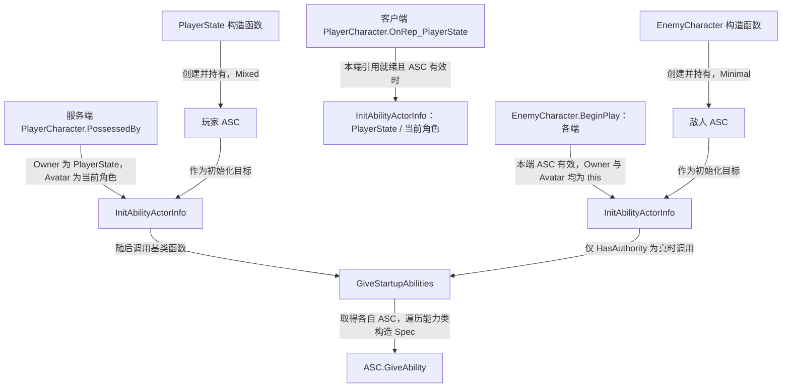
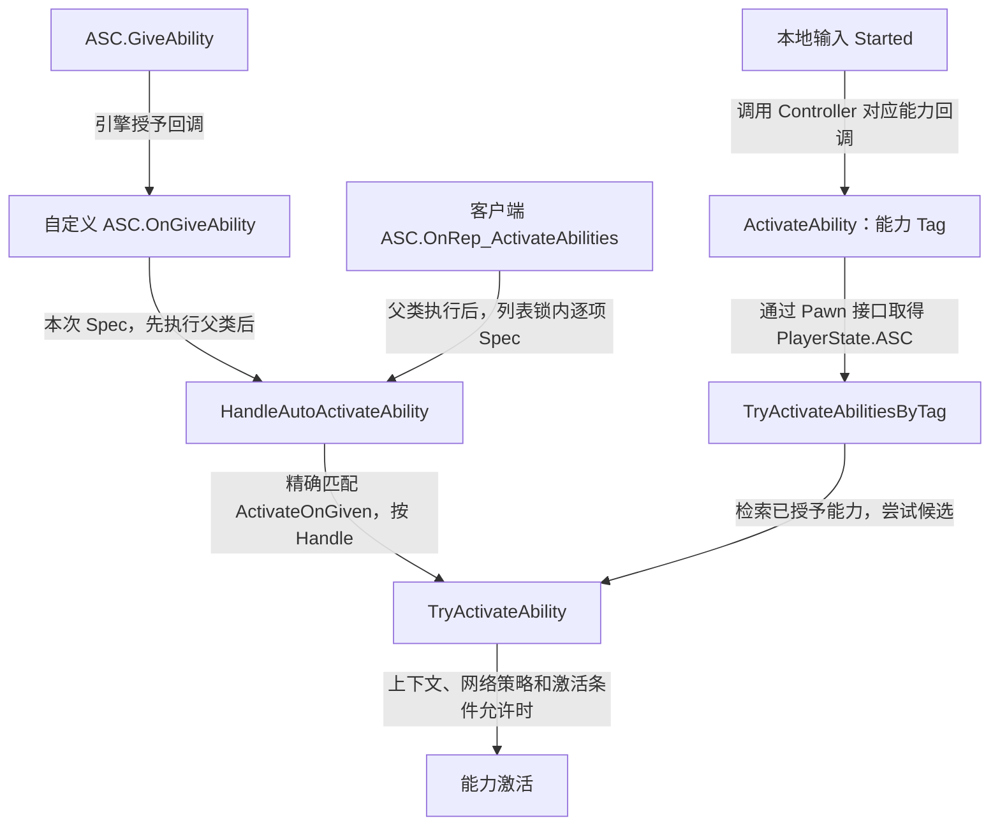

# 跨类关系索引：授予与激活

本页按所属类串联关系，成员和函数实现归入各类页面。核对日期：2026-11-03。

## 组件与 ActorInfo 所属关系

| 类 | 本类负责的内容 | 详细说明 |
| --- | --- | --- |
| AGAS_PlayerState | 创建自定义 ASC，复制模式 Mixed | [PlayerState](../Player/PlayerState.md) |
| AGAS_PlayerCharacter | getter 转发、PossessedBy / OnRep_PlayerState 初始化 | [玩家角色](../Characters/PlayerCharacter.md) |
| AGAS_EnemyCharacter | 自身创建 ASC，Minimal，BeginPlay 初始化 | [敌人角色](../Characters/EnemyCharacter.md) |
| AGAS_BaseCharacters | StartupAbilities、Spec 构造、GiveAbility | [角色基类](../Characters/CharacterBase.md) |

客户端的角色初始化回调不再授予能力；它和 ASC 的能力列表复制回调是不同事件，不能视为固定串行的两个步骤。

## 自动激活与输入激活的类边界

| 路径 | 入口所属类 | 传递信息 | 后续调用 |
| --- | --- | --- | --- |
| 授予回调 | UGAS_AbilitySystemComponent.OnGiveAbility | 本次 Spec | HandleAutoActivateAbility |
| 能力列表复制 | UGAS_AbilitySystemComponent.OnRep_ActivateAbilities | 锁内逐项 Spec | HandleAutoActivateAbility |
| 玩家输入 | AGAS_PlayerController.Primary / Secondary / Tertiary | 能力检索 Tag | ActivateAbility / TryActivateAbilitiesByTag |

这里存在自动激活的实际 C++ 处理代码，但尝试调用不保证成功。组件没有“一次性激活”记录或失败队列；具体实现见 [自定义 ASC](AbilitySystemComponent.md)。输入路径见 [PlayerController](../Player/PlayerController.md)。

## 能力类之间的关系

[UGAS_GameplayAbility](GameplayAbility.md) 在激活回调中按 `bDrawDebugs` 显示提示；[UGAS_Primary](Primary.md) 查询并返回去重 Actor，另由 `SendHitReactEventToActors()` 发送事件。[UGAS_HitReact](HitReact.md) 缓存 AvatarForward 与 ToInstigator，[方向工具类](../Utils/BlueprintLibrary.md) 判定枚举并映射名称。各函数的蓝图连接及接收端配置见 [事件关系索引](GameplayEvents.md)。

## 排查位置索引

| 检查对象 | 所属类或文件 |
| --- | --- |
| 实际玩家对象类型 | GameMode 蓝图默认类与地图覆盖 |
| 输入资源引用、事件绑定 | PlayerController.h / SetupInputComponent |
| ASC getter 返回值、Owner / Avatar | PlayerState、PlayerCharacter、EnemyCharacter |
| 启动能力类数组 | BaseCharacters.h 与角色蓝图默认值 |
| 自动激活标签匹配与尝试结果 | AbilitySystemComponent.cpp |
| 查询条件、球心与碰撞参数 | Primary.cpp |
| 事件发送 | Primary.SendHitReactEventToActors，目标数组及 Payload.Instigator |
| 事件接收与缓存调用 | 目标 ASC 与能力蓝图；HitReact.CacheHitDirectionVector 调用时机待核验 |
| 前后左右与名称 | BlueprintLibrary.GetHitDirection / GetHitDirectionName |
