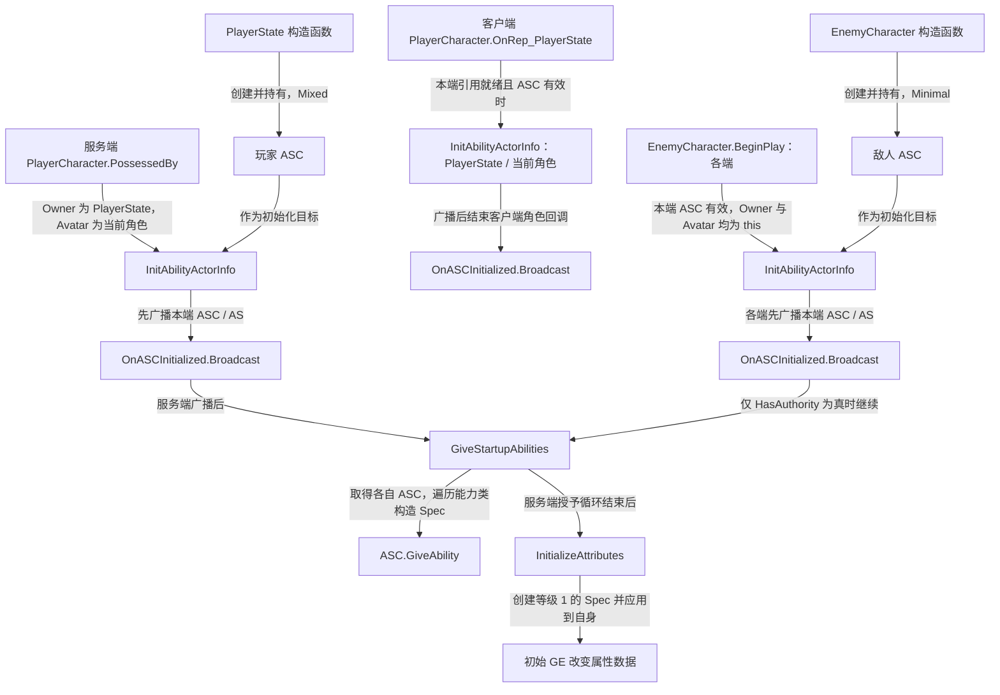
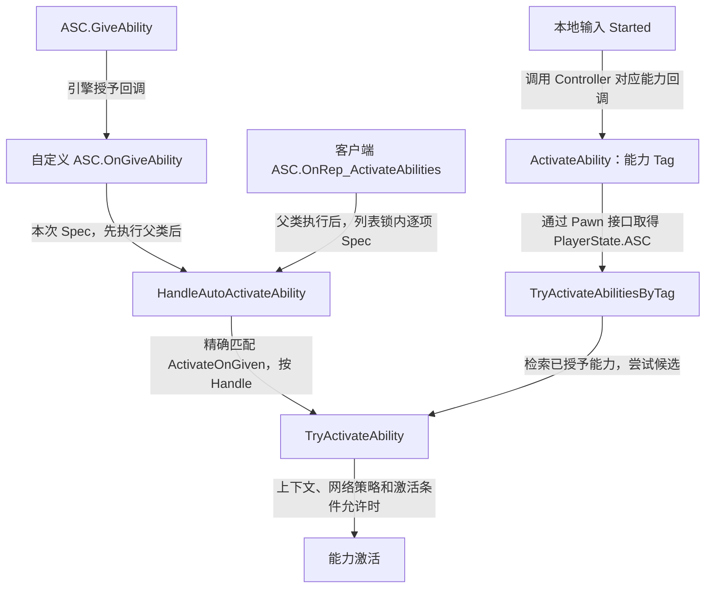
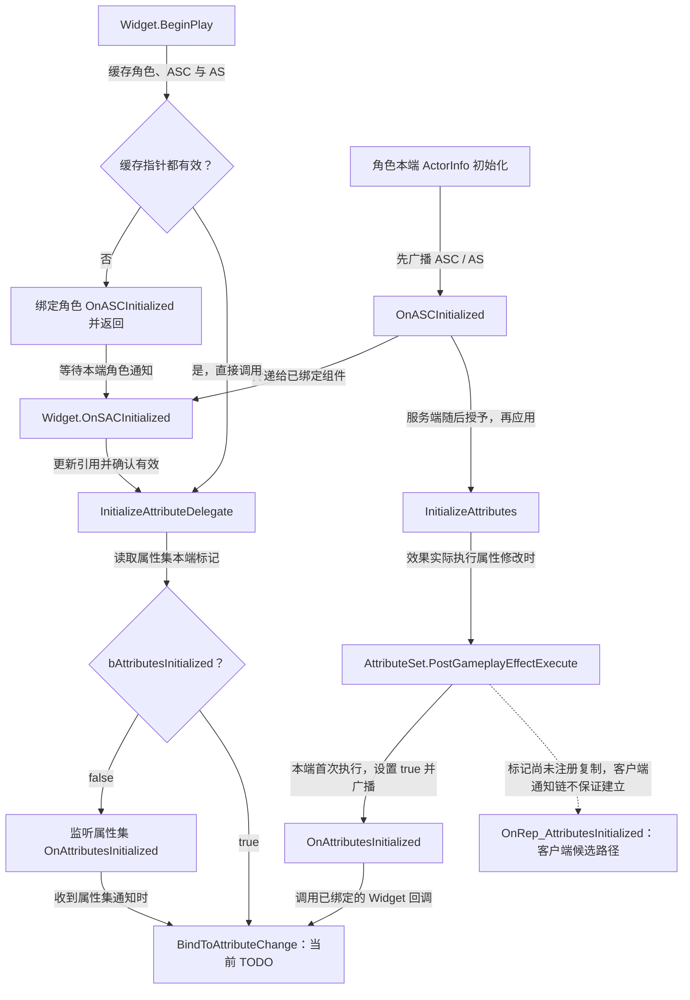

# 跨类关系索引：授予与激活

本页按所属类串联关系，成员和函数实现归入各类页面。核对日期：2026-11-05。

## 组件与 ActorInfo 所属关系

| 类 | 本类负责的内容 | 详细说明 |
| --- | --- | --- |
| AGAS_PlayerState | 创建自定义 ASC 与属性集，ASC 复制模式 Mixed | [PlayerState](../Player/PlayerState.md) |
| AGAS_PlayerCharacter | 两个 getter 转发、ActorInfo 初始化与本端广播，服务端授予及初值应用 | [玩家角色](../Characters/PlayerCharacter.md) |
| AGAS_EnemyCharacter | 自身创建 ASC / AS，BeginPlay 初始化及广播，服务端授予并应用初始 GE | [敌人角色](../Characters/EnemyCharacter.md) |
| AGAS_BaseCharacters | 委托声明、StartupAbilities、GiveAbility、InitializeAttributes | [角色基类](../Characters/CharacterBase.md) |

客户端的角色初始化回调不授予能力或调用 `InitializeAttributes()`；它和 ASC 的能力列表复制回调是不同事件，不能视为固定串行的两个步骤。

## 自动激活与输入激活的类边界

| 路径 | 入口所属类 | 传递信息 | 后续调用 |
| --- | --- | --- | --- |
| 授予回调 | UGAS_AbilitySystemComponent.OnGiveAbility | 本次 Spec | HandleAutoActivateAbility |
| 能力列表复制 | UGAS_AbilitySystemComponent.OnRep_ActivateAbilities | 锁内逐项 Spec | HandleAutoActivateAbility |
| 玩家输入 | AGAS_PlayerController.Primary / Secondary / Tertiary | 能力检索 Tag | ActivateAbility / TryActivateAbilitiesByTag |

这里存在自动激活的实际 C++ 处理代码，但尝试调用不保证成功。组件没有“一次性激活”记录或失败队列；具体实现见 [自定义 ASC](AbilitySystemComponent.md)。输入路径见 [PlayerController](../Player/PlayerController.md)。

## 属性初始化通知与 Widget 绑定入口

| 类 / 函数 | 实际完成的事情 | 所属说明 |
| --- | --- | --- |
| BaseCharacters.InitializeAttributes | 在服务端应用配置的初始 GE | [角色基类](../Characters/CharacterBase.md) |
| AttributeSet.PostGameplayEffectExecute | 本端首次执行回调时设置标记并广播 | [属性集](AttributeSet.md) |
| AttributeSet.OnRep_AttributesInitialized | 标记为 true 时广播；当前标记缺少复制注册 | 同上 |
| WidgetComponent.InitAbilitySystemData / OnSACInitialized | 取得或更新角色、ASC、属性集弱引用 | [Widget 组件](../UI/WidgetComponent.md) |
| WidgetComponent.InitializeAttributeDelegate | 根据标记等待属性集通知，或直接进入绑定入口 | 同上 |
| WidgetComponent.BindToAttributeChange | 函数体当前只有 TODO，尚未监听或刷新 | 同上 |

角色引用通知和属性集首次执行通知承担不同职责：前者传递 ASC / AS，后者记录一次本端效果执行。Widget 现在会衔接这两个阶段，但真正的数值变化监听与刷新仍未实现。

服务端角色广播早于本次初始 GE 应用，授予回调的自动激活尝试也可能先于属性初值应用。属性集的首次广播不筛选初始化效果或检查全部属性，不能等同于完整初值就绪。客户端四项数值的复制与初始化布尔标记的复制也必须分别核对。

## 能力类之间的关系

[UGAS_GameplayAbility](GameplayAbility.md) 在激活回调中按 `bDrawDebugs` 显示提示；[UGAS_Primary](Primary.md) 查询并返回去重 Actor，另由 `SendHitReactEventToActors()` 发送事件。[UGAS_HitReact](HitReact.md) 缓存 AvatarForward 与 ToInstigator，[方向工具类](../Utils/BlueprintLibrary.md) 判定枚举并映射名称。各函数的蓝图连接及接收端配置见 [事件关系索引](GameplayEvents.md)。

## 排查位置索引

| 检查对象 | 所属类或文件 |
| --- | --- |
| 实际玩家对象类型 | GameMode 蓝图默认类与地图覆盖 |
| 输入资源引用、事件绑定 | PlayerController.h / SetupInputComponent |
| ASC getter 返回值、Owner / Avatar | PlayerState、PlayerCharacter、EnemyCharacter |
| 启动能力类数组 | BaseCharacters.h 与角色蓝图默认值 |
| 自动激活标签匹配与尝试结果 | AbilitySystemComponent.cpp |
| 查询条件、球心与碰撞参数 | Primary.cpp |
| 事件发送 | Primary.SendHitReactEventToActors，目标数组及 Payload.Instigator |
| 事件接收与缓存调用 | 目标 ASC 与能力蓝图；HitReact.CacheHitDirectionVector 调用时机待核验 |
| 前后左右与名称 | BlueprintLibrary.GetHitDirection / GetHitDirectionName |

初始化属性效果未配置时，检查 BaseCharacters 的 `InitializeAttributesEffect`；界面没有数值变化时，检查 Widget 的引用与属性通知两个阶段；BindToAttributeChange 仍未实现数值监听和刷新，客户端还需核对属性集标记的复制注册。
