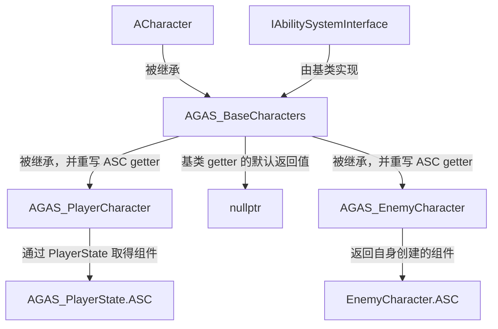
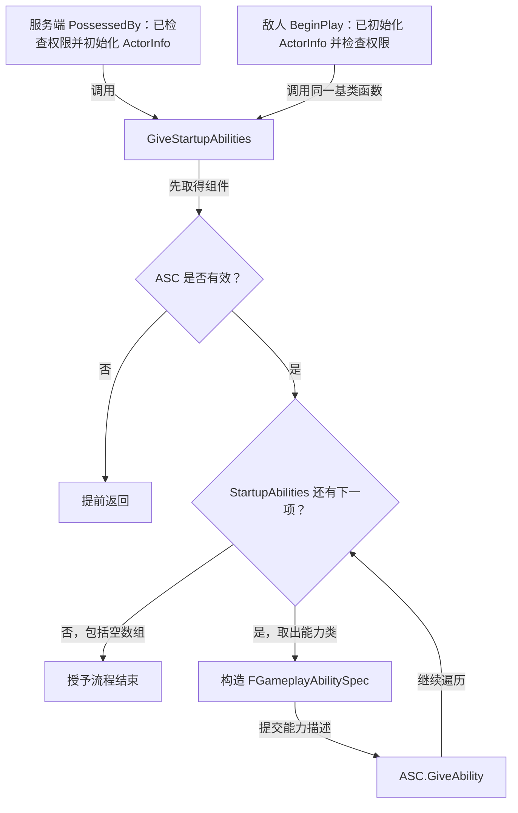
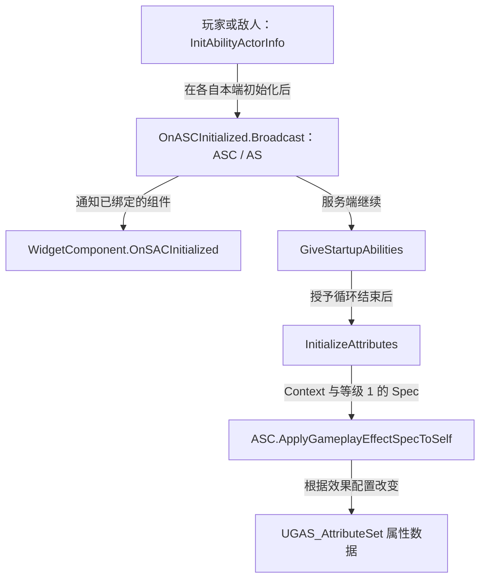
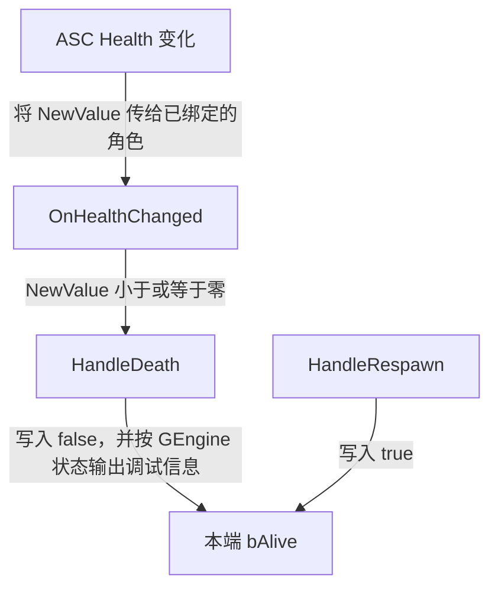

# AGAS_BaseCharacters

`AGAS_BaseCharacters` 继承 `ACharacter`，集中管理 GAS 访问接口、能力授予、初始属性效果与数据就绪委托，供具体角色子类复用。

源码：`Source/GAS_Learning/Characters/GAS_BaseCharacters.h`、`GAS_BaseCharacters.cpp`。

## 头文件：成员与函数

| 可见性 | 声明 | 职责 |
| --- | --- | --- |
| public | `AGAS_BaseCharacters()` | 公共 Actor Tick 与骨骼更新设置 |
| public override | `GetAbilitySystemComponent() const` | GAS 接口；基类默认返回空 |
| public virtual | `GetAttributeSet() const` | 头文件内联默认返回 nullptr，派生类提供属性集 |
| public | `FASCInitialized OnASCInitialized` | ASC 与属性集的本端动态多播通知 |
| protected | `GiveStartupAbilities()` | 取得派生类提供的 ASC，逐项授予 |
| protected | `InitializeAttributes()` | 创建初始化 GE Spec 并对自身应用 |
| private | `TSubclassOf<UGameplayEffect> InitializeAttributesEffect` | EditDefaultsOnly，GAS\|Effects；初始属性效果类 |
| private | `StartupAbilities` | EditDefaultsOnly，GAS\|Abilities；保存 UGameplayAbility 子类数组 |


类标记为 `UCLASS(Abstract)`，不直接作为关卡中的具体角色；这不是通过纯虚函数形成的 C++ 抽象类。当前派生类为 [AGAS_PlayerCharacter](PlayerCharacter.md) 和 [AGAS_EnemyCharacter](EnemyCharacter.md)。

## AGAS_BaseCharacters：公共构造设置

摘自 `GAS_BaseCharacters.cpp` 的构造函数，保留完整函数，省略空行及注释：

```cpp
AGAS_BaseCharacters::AGAS_BaseCharacters()
{
    PrimaryActorTick.bCanEverTick = false;
    GetMesh()->VisibilityBasedAnimTickOption = EVisibilityBasedAnimTickOption::AlwaysTickPoseAndRefreshBones;
}
```

当前没有角色逐帧逻辑，因此关闭 Actor Tick。骨骼网格组件使用单独的动画 Tick 设置，源码注释说明其目的是让 Dedicated Server 在模型未被渲染时仍更新姿态和骨骼变换。不能把关闭 Actor Tick 理解为关闭骨骼动画更新。

## GetAbilitySystemComponent、GetAttributeSet：数据来源

基类实现 `IAbilitySystemInterface`，但 `GetAbilitySystemComponent()` 当前只返回 `nullptr`，也没有创建 ASC。具体子类负责重写：玩家从 [PlayerState](../Player/PlayerState.md) 返回 ASC，敌人返回自身创建的 ASC。

基类的 `GetAttributeSet()` 在头文件内联返回 `nullptr`。它不持有 ASC 或属性集；玩家通过 PlayerState 取得两者，敌人返回自身对象。



## GiveStartupAbilities：启动能力数组与授予

```cpp
UPROPERTY(EditDefaultsOnly, Category = "GAS|Abilities")
TArray<TSubclassOf<UGameplayAbility>> StartupAbilities;
```

数组保存能力**类**，在类默认值中编辑；它不是运行中的能力实例列表。以下摘自 `Source/GAS_Learning/Characters/GAS_BaseCharacters.cpp` 的 `GiveStartupAbilities()` 函数体，省略函数外壳、空行及注释：

```cpp
UAbilitySystemComponent* CurAbilitySystemCom = GetAbilitySystemComponent();
if (!CurAbilitySystemCom) return;
for (const auto& Ability : StartupAbilities)
{
    FGameplayAbilitySpec AbilitySpec = FGameplayAbilitySpec(Ability);
    CurAbilitySystemCom->GiveAbility(AbilitySpec);
}
```

`FGameplayAbilitySpec` 描述一次能力授予，`GiveAbility` 将其交给 ASC 管理。本函数没有显式激活调用；实际组件的 `OnGiveAbility()` 会检查自动激活标签，详见 [UGAS_AbilitySystemComponent](../AbilitySystem/AbilitySystemComponent.md)。当前调用点包括玩家的 `PossessedBy()` 与敌人的 `BeginPlay()`，两处均先初始化 ActorInfo 并检查 `HasAuthority()`，再进入授予函数。



函数自身没有权限检查、空能力类检查和重复授予保护。权限由当前两个调用点检查；重复占有时可能重复进入授予流程。

启动数组接受 `UGameplayAbility` 的子类，没有强制要求使用 [UGAS_GameplayAbility](../AbilitySystem/GameplayAbility.md)。是否采用自定义能力基类取决于具体资产父类。

## InitializeAttributes：应用初始属性效果

以下摘自 `GAS_BaseCharacters.cpp` 的 `InitializeAttributes()`，保留 Spec 校验、应用和标记部分，省略空行及注释。

```cpp
if (!SpecHandle.IsValid()) return;
CurAbilitySystemCom->ApplyGameplayEffectSpecToSelf(*SpecHandle.Data.Get());
if (UGAS_AttributeSet* Attributes = Cast<UGAS_AttributeSet>(GetAttributeSet()))
{
    Attributes->MarkAttributesInitialized();
}
```

函数要求 `InitializeAttributesEffect` 是有效效果类，构造等级 1 的 Spec，再应用到当前 ASC。检查 ASC 之前先执行 `checkf`；函数检查 `SpecHandle.IsValid()` 后才解引用 Data。应用调用返回后，若属性集可转型为 `UGAS_AttributeSet`，则调用 `MarkAttributesInitialized()`。

函数自身没有权限分支；当前玩家和敌人的调用点均在服务端，并在 `GiveStartupAbilities()` 之后调用。由于授予回调可尝试自动激活能力，当前顺序不保证这些自动激活尝试发生前已有 GE 初始属性值。具体属性数值取决于效果资产及角色默认类引用，文件存在不能证明配置正确。

## OnASCInitialized：数据引用通知

头文件通过 `DECLARE_DYNAMIC_MULTICAST_DELEGATE_TwoParams(FASCInitialized,UAbilitySystemComponent*,ASC,UAttributeSet*,AS)` 声明委托类型；公开成员 `OnASCInitialized` 传递 ASC 与属性集两个指针，标记为 BlueprintAssignable。



角色先广播 ASC 与属性集引用，再在服务端应用初始 GE。已绑定的控件会先读取本端快照，并通过 ASC 数值变化委托接收随后发生的更新。

## 生命值监听与存活状态

头文件将 `bAlive` 定义为默认 true 的私有布尔值。`IsAlive()` 与 `SetAlive(bool)` 是公开内联访问入口。受保护的 `OnHealthChanged()` 在新值小于或等于零时调用 `HandleDeath()`。后者将 `bAlive` 置为 false，并在 GEngine 有效时显示三秒的红色调试文字。公开的 BlueprintCallable `HandleRespawn()` 将 `bAlive` 恢复为 true。



`bAlive` 由本端代码写入。重复收到非正生命值回调会再次执行死亡处理。`HandleRespawn()` 的实现范围是存活标志，实际重生行为取决于调用者。

参见：[属性集](../AbilitySystem/AttributeSet.md)、[Widget 组件](../UI/WidgetComponent.md)、[初始化关系索引](../AbilitySystem/StartupAbilities.md)。
