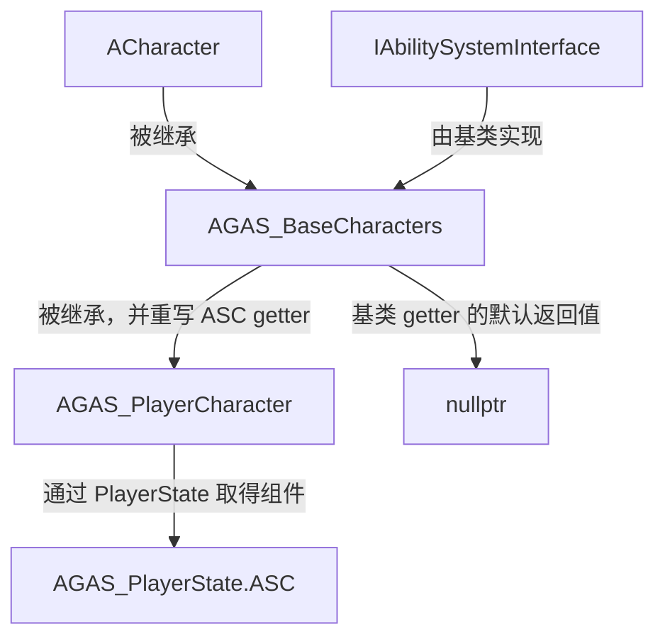
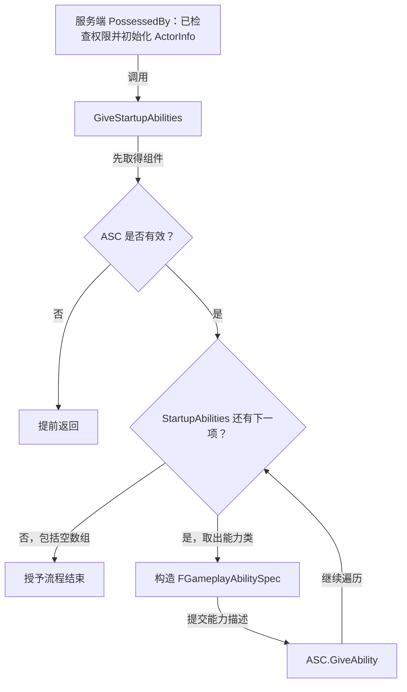

# 角色基类

`AGAS_BaseCharacters` 继承 `ACharacter`，集中管理角色的 GAS 接口和启动能力授予逻辑，供具体角色子类复用。

源码：`Source/GAS_Acquaintance/Characters/GAS_BaseCharacters.h`、`GAS_BaseCharacters.cpp`。

使用 `UCLASS(Abstract)` 将其标记为抽象类，避免直接在场景中放置该基类；实际对象应使用具体子类。

```cpp
UCLASS(Abstract)
class GAS_ACQUAINTANCE_API AGAS_BaseCharacters : public ACharacter, public IAbilitySystemInterface
{
    GENERATED_BODY()

public:
    AGAS_BaseCharacters();

    virtual UAbilitySystemComponent* GetAbilitySystemComponent() const override;
};
```

`UCLASS(Abstract)` 是 UE 的类标记；该类本身没有通过纯虚函数成为 C++ 抽象类。派生的具体玩家角色见 [PlayerCharacter](PlayerCharacter.md)。

## 公共构造设置

```cpp
PrimaryActorTick.bCanEverTick = false;
GetMesh()->VisibilityBasedAnimTickOption =
    EVisibilityBasedAnimTickOption::AlwaysTickPoseAndRefreshBones;
```

当前没有角色逐帧逻辑，因此关闭 Actor Tick。骨骼网格组件使用单独的动画 Tick 设置，源码注释说明其目的是让 Dedicated Server 在模型未被渲染时仍更新姿态和骨骼变换。不能把关闭 Actor Tick 理解为关闭骨骼动画更新。

## GAS 接口与 ASC 所在位置

基类实现 `IAbilitySystemInterface`，但 `GetAbilitySystemComponent()` 当前只返回 `nullptr`，也没有创建 ASC。它提供统一接口，真正的取得逻辑由玩家角色重写：从 [PlayerState](../Player/PlayerState.md) 返回 ASC。

因此，新增角色子类时需要明确 ASC 的创建位置并实现取得逻辑；只继承基类还无法授予或激活能力。



## 启动能力数组与授予

```cpp
UPROPERTY(EditDefaultsOnly, Category = "GAS|Abilities")
TArray<TSubclassOf<UGameplayAbility>> StartupAbilities;
```

数组保存能力**类**，在类默认值中编辑；它不是运行中的能力实例列表。以下摘自 `Source/GAS_Acquaintance/Characters/GAS_BaseCharacters.cpp` 的 `GiveStartupAbilities()` 函数体，省略函数外壳、空行及注释：

```cpp
UAbilitySystemComponent* LocalAbilitySystemCom = GetAbilitySystemComponent();
if (!LocalAbilitySystemCom) return;
for (const auto& Ability : StartupAbilities)
{
    FGameplayAbilitySpec AbilitySpec = FGameplayAbilitySpec(Ability);
    LocalAbilitySystemCom->GiveAbility(AbilitySpec);
}
```

`FGameplayAbilitySpec` 描述一次能力授予，`GiveAbility` 将其交给 ASC 管理；这里没有立即激活能力。当前服务端调用点位于玩家角色的 `PossessedBy()`，调用前检查了 `HasAuthority()`。



函数自身没有权限检查、空能力类检查和重复授予保护。后续若从其他入口调用，或发生重复占有，需要相应处理；不能假设它是可重复执行且无副作用的初始化函数。

参见：[启动能力与激活流程](../AbilitySystem/StartupAbilities.md)。
