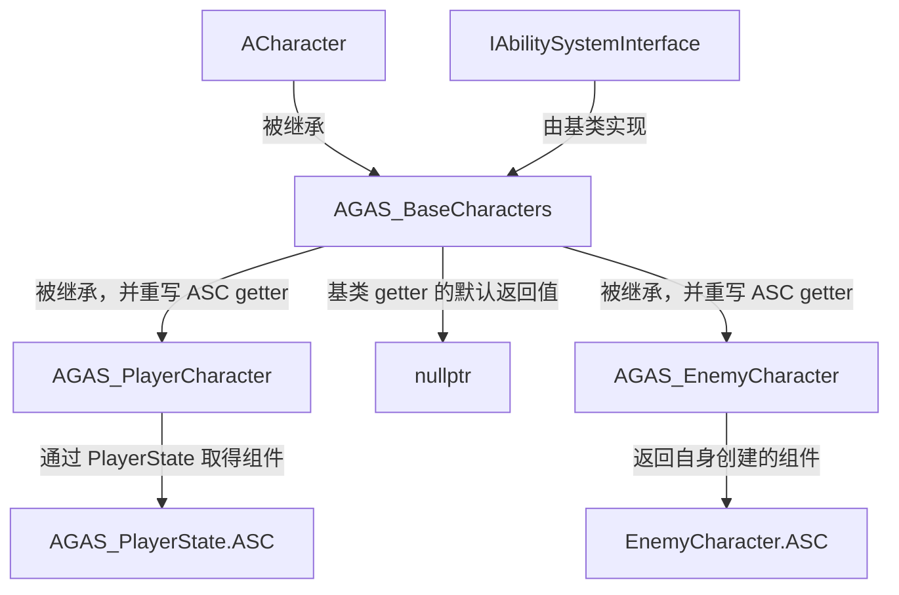
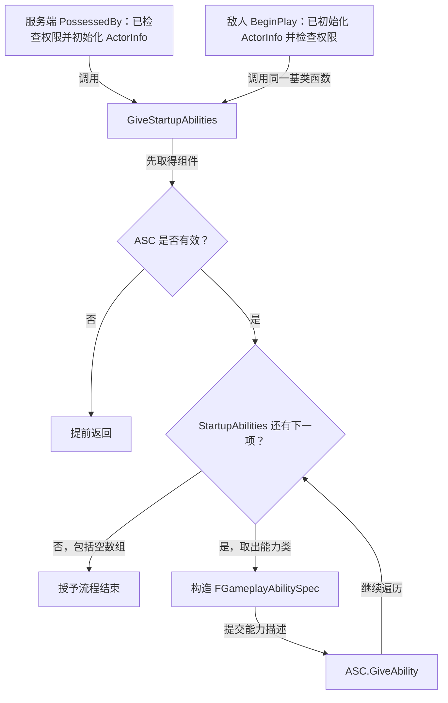

# AGAS_BaseCharacters

`AGAS_BaseCharacters` 继承 `ACharacter`，集中管理角色的 GAS 接口和启动能力授予逻辑，供具体角色子类复用。

源码：`Source/GAS_Acquaintance/Characters/GAS_BaseCharacters.h`、`GAS_BaseCharacters.cpp`。

## 头文件：成员与函数

| 可见性 | 声明 | 职责 |
| --- | --- | --- |
| public | `AGAS_BaseCharacters()` | 公共 Actor Tick 与骨骼更新设置 |
| public override | `GetAbilitySystemComponent() const` | GAS 接口；基类默认返回空 |
| protected | `GiveStartupAbilities()` | 取得派生类提供的 ASC，逐项授予 |
| private | `StartupAbilities` | EditDefaultsOnly，GAS\|Abilities；保存 UGameplayAbility 子类数组 |


类标记为 `UCLASS(Abstract)`，不直接作为关卡中的具体角色；这不是通过纯虚函数形成的 C++ 抽象类。当前派生类为 [AGAS_PlayerCharacter](PlayerCharacter.md) 和 [AGAS_EnemyCharacter](EnemyCharacter.md)。

## AGAS_BaseCharacters：公共构造设置

摘自 `GAS_BaseCharacters.cpp` 的构造函数，保留完整函数，省略空行及注释：

```cpp
AGAS_BaseCharacters::AGAS_BaseCharacters()
{
    PrimaryActorTick.bCanEverTick = false;
    GetMesh()->VisibilityBasedAnimTickOption = EVisibilityBasedAnimTickOption::AlwaysTickPoseAndRefreshBones;
}
```

当前没有角色逐帧逻辑，因此关闭 Actor Tick。骨骼网格组件使用单独的动画 Tick 设置，源码注释说明其目的是让 Dedicated Server 在模型未被渲染时仍更新姿态和骨骼变换。不能把关闭 Actor Tick 理解为关闭骨骼动画更新。

## GetAbilitySystemComponent：接口与组件来源

基类实现 `IAbilitySystemInterface`，但 `GetAbilitySystemComponent()` 当前只返回 `nullptr`，也没有创建 ASC。具体子类负责重写：玩家从 [PlayerState](../Player/PlayerState.md) 返回 ASC，敌人返回自身创建的 ASC。

基类不持有组件；玩家通过 PlayerState 访问，敌人返回自身组件。接口的实际返回值由派生类实现决定。



## GiveStartupAbilities：启动能力数组与授予

```cpp
UPROPERTY(EditDefaultsOnly, Category = "GAS|Abilities")
TArray<TSubclassOf<UGameplayAbility>> StartupAbilities;
```

数组保存能力**类**，在类默认值中编辑；它不是运行中的能力实例列表。以下摘自 `Source/GAS_Acquaintance/Characters/GAS_BaseCharacters.cpp` 的 `GiveStartupAbilities()` 函数体，省略函数外壳、空行及注释：

```cpp
UAbilitySystemComponent* LocalAbilitySystemCom = GetAbilitySystemComponent();
if (!LocalAbilitySystemCom) return;
for (const auto& Ability : StartupAbilities)
{
    FGameplayAbilitySpec AbilitySpec = FGameplayAbilitySpec(Ability);
    LocalAbilitySystemCom->GiveAbility(AbilitySpec);
}
```

`FGameplayAbilitySpec` 描述一次能力授予，`GiveAbility` 将其交给 ASC 管理。本函数没有显式激活调用；实际组件的 `OnGiveAbility()` 会检查自动激活标签，详见 [UGAS_AbilitySystemComponent](../AbilitySystem/AbilitySystemComponent.md)。当前调用点包括玩家的 `PossessedBy()` 与敌人的 `BeginPlay()`，两处均先初始化 ActorInfo 并检查 `HasAuthority()`，再进入授予函数。



函数自身没有权限检查、空能力类检查和重复授予保护。权限由当前两个调用点检查；重复占有时可能重复进入授予流程。

启动数组接受 `UGameplayAbility` 的子类，没有强制要求使用 [UGAS_GameplayAbility](../AbilitySystem/GameplayAbility.md)。是否采用自定义能力基类取决于具体资产父类。

参见：[启动能力与激活流程](../AbilitySystem/StartupAbilities.md)。
