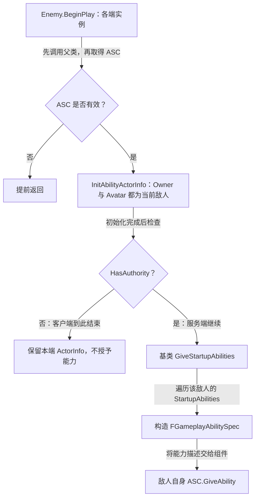

# 敌人角色：自身持有 ASC

`AGAS_EnemyCharacter` 继承 `AGAS_BaseCharacters`，与玩家复用启动能力授予函数，但将 ASC 放在敌人角色自身，不从 PlayerState 获取。

源码：`Source/GAS_Acquaintance/Characters/Enemy/GAS_EnemyCharacter.h`、`GAS_EnemyCharacter.cpp`。核对日期：2026-10-29。

## 创建组件与复制设置

摘自 `GAS_EnemyCharacter.cpp` 的构造函数，省略空行，保留完整函数逻辑：

```cpp
AGAS_EnemyCharacter::AGAS_EnemyCharacter()
{
    PrimaryActorTick.bCanEverTick = false;
    AbilitySystemComponent = CreateDefaultSubobject<UGAS_AbilitySystemComponent>("AbilitySystemComponent");
    AbilitySystemComponent->SetIsReplicated(true);
    AbilitySystemComponent->SetReplicationMode(EGameplayEffectReplicationMode::Minimal);
}
```

实际创建的是 [自定义 ASC](../AbilitySystem/AbilitySystemComponent.md)，成员则声明为 `TObjectPtr<UAbilitySystemComponent>`。getter 直接返回该成员；保存为基类指针不会改变创建出来的组件类型。

`Minimal` 指 GameplayEffect 只复制最少信息。它与玩家的 `Mixed` 不同，不表示关闭整个 ASC 的复制，也不决定敌人如何选择目标或发动攻击。含义已对照本机 UE 5.6 的 `AbilitySystemComponent.h` 枚举注释。

## BeginPlay：各端初始化，服务端授予

摘自 `GAS_EnemyCharacter.cpp` 的 `BeginPlay()`，仅省略空行：

```cpp
void AGAS_EnemyCharacter::BeginPlay()
{
    Super::BeginPlay();
    UAbilitySystemComponent* LocalAbilitySystemCom = GetAbilitySystemComponent();
    if (!LocalAbilitySystemCom) return;
    LocalAbilitySystemCom->InitAbilityActorInfo(this,this);
    if (!HasAuthority()) return;
    GiveStartupAbilities();
}
```

权限检查位于 `InitAbilityActorInfo()` **之后**。因此，在执行此回调且 ASC 有效的各端实例上都会先初始化上下文，只有权威端继续授予能力。



当前流程中没有能力激活调用；启动数组用于授予，不等于自动发动攻击。

## 与玩家角色对照

| 比较项 | 玩家 | 敌人 |
| --- | --- | --- |
| ASC 持有者 | PlayerState | EnemyCharacter 自身 |
| 实际组件类型 | `UGAS_AbilitySystemComponent` | `UGAS_AbilitySystemComponent` |
| GameplayEffect 复制模式 | `Mixed` | `Minimal` |
| OwnerActor | PlayerState | 当前敌人 |
| AvatarActor | 当前玩家角色 | 当前敌人 |
| 服务端初始化入口 | `PossessedBy()` | `BeginPlay()` |
| 客户端初始化入口 | `OnRep_PlayerState()` | `BeginPlay()` |
| 启动能力授予入口 | 服务端 `PossessedBy()` | `BeginPlay()` 初始化后的权限分支 |

玩家的 PlayerState 与角色是不同对象，所以要等待适当回调建立关联；敌人在当前实现中直接关联自身组件与自身角色。

## 业务资产与核对点

已确认以下文件存在于 `Content/GAS_Acquaintance/Blueprints/Characters/Enemy`：

- `BP_Enemy_Melee.uasset`、`BP_Enemy_Ranged.uasset`。
- `Anim/ABP_Enemy_Melee.uasset`、`Anim/ABP_Enemy_Ranged.uasset`。

这些是资源入口。蓝图是否派生自该 C++ 类、填入哪些启动能力、是否设置 Actor 复制及动画类，需要在编辑器核验。组件的 `SetIsReplicated(true)` 不能单独作为整套联网行为已验证的依据。

当前敌人 C++ 没有 AI 决策、感知、寻路、目标选择、伤害或死亡逻辑。排查时先确认 `BeginPlay()` 初始化和服务端授予，再检查蓝图中的激活入口，不应从 Melee / Ranged 文件名推断这些功能已经实现。

参见：[角色基类](CharacterBase.md)、[玩家角色](PlayerCharacter.md)、[启动能力](../AbilitySystem/StartupAbilities.md)。
