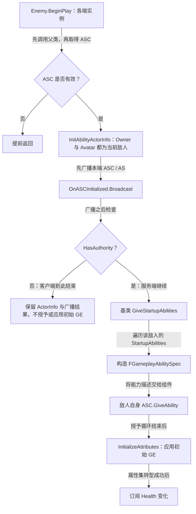

# AGAS_EnemyCharacter

`AGAS_EnemyCharacter` 继承 `AGAS_BaseCharacters`，与玩家复用启动能力授予函数，但将 ASC 与属性集放在敌人角色自身，通过两个 getter 提供给能力系统和 Widget。

源码：`Source/GAS_Learning/Characters/Enemy/GAS_EnemyCharacter.h`、`GAS_EnemyCharacter.cpp`。核对日期：2026-11-05。

## 头文件：成员与函数

| 可见性 | 声明 | 职责 |
| --- | --- | --- |
| public | `AGAS_EnemyCharacter()` | 创建自定义 ASC，启用复制并设置 Minimal |
| public override | `GetAbilitySystemComponent() const` | 返回自身组件 |
| public override | `GetAttributeSet() const` | 返回自身属性集 |
| protected override | `BeginPlay()` | 各端初始化并广播，权威端授予能力后初始化属性 |
| private | `TObjectPtr<UAbilitySystemComponent> AbilitySystemComponent` | VisibleAnywhere；以基类类型保存自定义组件 |
| private | `TObjectPtr<UAttributeSet> AttributeSet` | UPROPERTY；以基类类型保存自定义属性集 |


## AGAS_EnemyCharacter：组件与复制设置

摘自 `GAS_EnemyCharacter.cpp` 的构造函数，省略空行，保留完整函数逻辑：

```cpp
AGAS_EnemyCharacter::AGAS_EnemyCharacter()
{
    PrimaryActorTick.bCanEverTick = false;
    AbilitySystemComponent = CreateDefaultSubobject<UGAS_AbilitySystemComponent>("AbilitySystemComponent");
    AbilitySystemComponent->SetIsReplicated(true);
    AbilitySystemComponent->SetReplicationMode(EGameplayEffectReplicationMode::Minimal);
    AttributeSet = CreateDefaultSubobject<UGAS_AttributeSet>(FName("AttributeSet"));
}
```

实际创建的是 [自定义 ASC](../AbilitySystem/AbilitySystemComponent.md)，成员则声明为 `TObjectPtr<UAbilitySystemComponent>`。getter 直接返回该成员；保存为基类指针不会改变创建出来的组件类型。

`Minimal` 指 GameplayEffect 只复制最少信息。它与玩家的 `Mixed` 不同，不表示关闭整个 ASC 的复制，也不决定敌人如何选择目标或发动攻击。含义已对照本机 UE 5.6 的 `AbilitySystemComponent.h` 枚举注释。

## GetAttributeSet：返回自身属性集

构造函数创建 `UGAS_AttributeSet`，成员以 `TObjectPtr<UAttributeSet>` 保存。`GAS_EnemyCharacter.cpp` 的 `GetAttributeSet() const` 直接返回 `AttributeSet`，不负责设置初值。

## BeginPlay：各端初始化与广播，服务端授予及初值应用

摘自 `GAS_EnemyCharacter.cpp` 的 `BeginPlay()` 函数体，省略函数外壳、空行与注释：

```cpp
Super::BeginPlay();
UAbilitySystemComponent* CurAbilitySystemCom = GetAbilitySystemComponent();
if (!CurAbilitySystemCom) return;
CurAbilitySystemCom->InitAbilityActorInfo(this,this);
OnASCInitialized.Broadcast(CurAbilitySystemCom,GetAttributeSet());
if (!HasAuthority()) return;
GiveStartupAbilities();
InitializeAttributes();
```

权限检查位于 `InitAbilityActorInfo()` **之后**。因此，在执行此回调且 ASC 有效的各端实例上都会先初始化上下文，先广播 ASC 与属性集指针，只有权威端继续授予能力并应用初始属性效果。



`BeginPlay()` 没有显式调用能力激活 API；其授予会进入 [自定义 ASC](../AbilitySystem/AbilitySystemComponent.md) 的 `OnGiveAbility()`，匹配 ActivateOnGiven 的能力会被尝试激活。是否发动具体攻击还取决于能力资产和激活结果。

## 与玩家角色对照

| 比较项 | 玩家 | 敌人 |
| --- | --- | --- |
| ASC 与属性集持有者 | PlayerState | EnemyCharacter 自身 |
| 实际组件类型 | `UGAS_AbilitySystemComponent` | `UGAS_AbilitySystemComponent` |
| GameplayEffect 复制模式 | `Mixed` | `Minimal` |
| OwnerActor | PlayerState | 当前敌人 |
| AvatarActor | 当前玩家角色 | 当前敌人 |
| 服务端初始化入口 | `PossessedBy()` | `BeginPlay()` |
| 客户端初始化入口 | `OnRep_PlayerState()` | `BeginPlay()` |
| 启动能力与属性初值入口 | 服务端 `PossessedBy()` | `BeginPlay()` 广播后的权限分支 |

玩家的 PlayerState 与角色是不同对象，所以要等待适当回调建立关联；敌人在当前实现中直接关联自身组件与自身角色。

## 业务资产与核对点

已确认以下文件存在于 `Content/GAS_Learning/Blueprints/Characters/Enemy`：

- `BP_GAS_EnemyBase.uasset`、`BP_Enemy_Melee.uasset`、`BP_Enemy_Ranged.uasset`。
- `Anim/ABP_Enemy_Melee.uasset`、`Anim/ABP_Enemy_Ranged.uasset`。

这些是资源入口。蓝图是否派生自该 C++ 类、填入哪些启动能力、是否设置 Actor 复制及动画类，需要在编辑器核验。组件的 `SetIsReplicated(true)` 不能单独作为整套联网行为已验证的依据。

敌人的生命值回调复用基类存活状态处理。AI 行为与动画由对应资产配置，需在编辑器核验。

参见：[角色基类](CharacterBase.md)、[玩家角色](PlayerCharacter.md)、[启动能力](../AbilitySystem/StartupAbilities.md)。

## Health 委托的绑定位置

`BeginPlay()` 在服务端初始属性应用之后绑定，客户端在权限分支处结束。 两条角色实现均要求属性集能转型为 `UGAS_AttributeSet`。成功后用 `AddUObject` 将 ASC 的 Health 变化委托交给基类 `OnHealthChanged()`。该绑定接收之后发生的变化，建立时没有主动读取当前 Health 执行死亡判断。参见 [角色基类](CharacterBase.md)。
