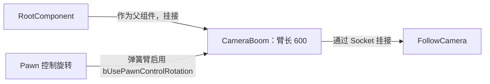
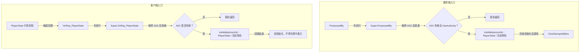

# 玩家角色：连接 PlayerState 与场景中的角色

`AGAS_PlayerCharacter` 继承 `AGAS_BaseCharacters`。它不创建第二个 ASC，而是返回 PlayerState 上的组件，并负责把当前角色设为 AvatarActor。

源码：`Source/GAS_Acquaintance/Characters/GAS_PlayerCharacter.h`、`GAS_PlayerCharacter.cpp`。

## 胶囊体与第三人称摄像机

摘自 `Source/GAS_Acquaintance/Characters/GAS_PlayerCharacter.cpp` 的构造函数，仅保留摄像机创建和挂接部分，省略空行：

```cpp
CameraBoom = CreateDefaultSubobject<USpringArmComponent>(FName("CameraBoom"));
CameraBoom->SetupAttachment(GetRootComponent());
CameraBoom->TargetArmLength = 600.f;
CameraBoom->bUsePawnControlRotation = true;
FollowCamera = CreateDefaultSubobject<UCameraComponent>(FName("FollowCamera"));
FollowCamera->SetupAttachment(CameraBoom,USpringArmComponent::SocketName);
FollowCamera->bUsePawnControlRotation = false;
```

前四行对应下方流程图中的弹簧臂节点，后三行对应跟随摄像机节点。

| 设置 | 当前值 | 作用 |
| --- | --- | --- |
| 胶囊体 | 半径 `42.f`，半高 `96.f` | 调用 `InitCapsuleSize` 设置碰撞胶囊尺寸 |
| Controller 旋转 | Pitch / Yaw / Roll 均为 `false` | 不直接使用这些开关驱动角色旋转 |
| `CameraBoom` | 挂到 RootComponent，臂长 `600.f` | 提供弹簧臂摄像机距离 |
| 弹簧臂控制旋转 | `bUsePawnControlRotation = true` | 使用 Pawn 的控制旋转 |
| `FollowCamera` | 挂到弹簧臂 Socket | 跟随弹簧臂 |
| 摄像机控制旋转 | `bUsePawnControlRotation = false` | 不在摄像机上重复使用 Pawn 控制旋转 |

构造函数也关闭了 Actor Tick。当前 C++ 没有设置 `bOrientRotationToMovement` 或角色转向速度，不能仅据摄像机代码推断角色必然朝移动方向旋转；如需确认，应检查角色蓝图与 CharacterMovement 默认值。



前两条边表示组件挂接关系，最后一条表示旋转数据来源；摄像机本身的 `bUsePawnControlRotation` 为 `false`。

## 从 PlayerState 取得 ASC

```cpp
UAbilitySystemComponent* AGAS_PlayerCharacter::GetAbilitySystemComponent() const
{
    const AGAS_PlayerState* LocalPlayerState =
        Cast<AGAS_PlayerState>(GetPlayerState());
    if (!LocalPlayerState) return nullptr;

    return LocalPlayerState->GetAbilitySystemComponent();
}
```

角色接口与 PlayerState 接口最终返回同一个 ASC。PlayerState 尚未就绪或类型不符时返回空，调用者必须处理这种情况。

## 服务端：初始化后授予能力

摘自 `Source/GAS_Acquaintance/Characters/GAS_PlayerCharacter.cpp` 的 `PossessedBy()`，省略空行和原注释，保留完整函数逻辑：

```cpp
void AGAS_PlayerCharacter::PossessedBy(AController* NewController)
{
    Super::PossessedBy(NewController);
    UAbilitySystemComponent* LocalAbilitySystemCom = GetAbilitySystemComponent();
    if (!LocalAbilitySystemCom || !HasAuthority()) return;
    LocalAbilitySystemCom->InitAbilityActorInfo(GetPlayerState(), this);
    GiveStartupAbilities();
}
```

调用顺序与客户端初始化的区别见下方流程图。

`InitAbilityActorInfo(OwnerActor, AvatarActor)` 的第一个参数是 PlayerState，第二个参数是当前角色；不是把 Controller 当作能力的 OwnerActor。授予能力并不等于激活能力。

## 客户端：等待 PlayerState 复制后初始化

```cpp
void AGAS_PlayerCharacter::OnRep_PlayerState()
{
    Super::OnRep_PlayerState();

    UAbilitySystemComponent* LocalAbilitySystemCom = GetAbilitySystemComponent();
    if (!LocalAbilitySystemCom) return;

    LocalAbilitySystemCom->InitAbilityActorInfo(GetPlayerState(), this);
}
```

`OnRep_PlayerState()` 是 PlayerState 引用复制后的回调，不是手动复制整个 PlayerState 的函数。这里在客户端补齐 ActorInfo，不再次调用 `GiveStartupAbilities()`。

两个入口分别处理服务端占有和客户端 PlayerState 就绪。只读服务端的 `PossessedBy()`，会漏掉客户端初始化这一步。



两端流程独立展示，不代表 `PossessedBy()` 直接调用客户端回调。

## 当前实现的边界

当前没有保存授予返回的 Spec Handle，也没有实现重占有时防止重复授予、换 Pawn 时取消旧能力或重生重置的逻辑。这些属于后续扩展内容。

参见：[角色基类](CharacterBase.md)、[PlayerState](../Player/PlayerState.md)、[启动能力与激活流程](../AbilitySystem/StartupAbilities.md)。
