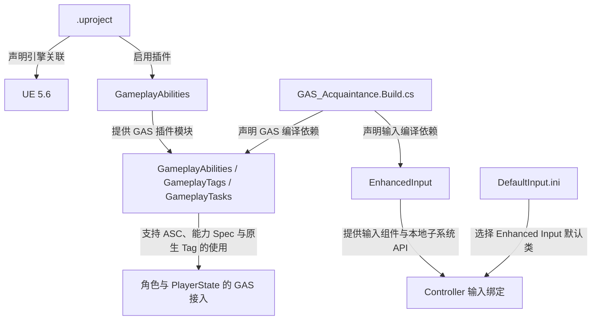
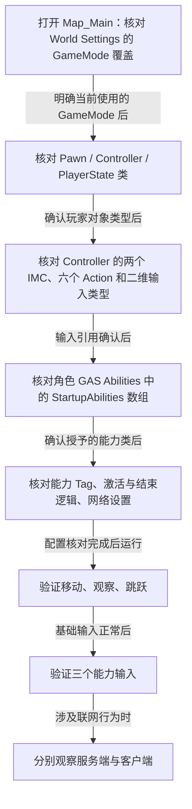

# 项目配置与资源入口

本页记录本地 UE 项目已确认的接入条件，便于复习或重新搭建工程。

## 引擎、插件与模块

`GAS_Acquaintance.uproject` 声明 `EngineAssociation: "5.6"`，运行时模块名为 `GAS_Acquaintance`，启用了 `GameplayAbilities` 插件。

`Source/GAS_Acquaintance/GAS_Acquaintance.Build.cs` 的公开依赖包括：

```csharp
"Core", "CoreUObject", "Engine", "InputCore",
"EnhancedInput", "GameplayAbilities", "GameplayTags", "GameplayTasks"
```

| 依赖 | 当前源码中的用途 |
| --- | --- |
| `EnhancedInput` | 输入 Action、Mapping Context、输入组件和本地玩家子系统 |
| `GameplayAbilities` | ASC、GAS 接口、Gameplay Ability 与 Spec |
| `GameplayTags` | 原生标签声明 / 定义、Tag 容器 |
| `GameplayTasks` | 已列入 GAS 相关模块依赖；当前自定义 C++ 没有编写 Task |

插件启用和 C++ 模块依赖是两个检查点。当前 Game / Editor 两个 Target 均使用 `BuildSettingsVersion.V5` 和 `EngineIncludeOrderVersion.Unreal5_6`。



这里的边表示配置和编译依赖，不表示运行时初始化的先后顺序。

## 默认地图与输入类型

`Config/DefaultEngine.ini` 将启动地图和默认游戏地图设为 `Map_Main`，默认 GameMode 设为 `BP_GAS_Gamemode`，详情见 [GameMode](GameMode.md)。

`Config/DefaultInput.ini` 包含：

```ini
DefaultPlayerInputClass=/Script/EnhancedInput.EnhancedPlayerInput
DefaultInputComponentClass=/Script/EnhancedInput.EnhancedInputComponent
```

这与 Controller 将 `InputComponent` 转型为 `UEnhancedInputComponent` 的实现对应。具体输入键位在 IMC 资产中，本页不根据 Action 名推测按键。

## 业务资源目录

以下路径以 `Content/GAS_Acquaintance` 为根：

```text
Maps/Map_Main.umap
Blueprints/
  Game/BP_GAS_Gamemode.uasset
  Characters/BP_GAS_PlayerCharacter.uasset
  Player/BP_GAS_PlayerController.uasset
  Player/BP_GAS_PlayerState.uasset
  Input/
    IMC_Movement.uasset
    IMC_Abilities.uasset
    MovementActions/IA_Jump.uasset
    MovementActions/IA_Move.uasset
    MovementActions/IA_Look.uasset
    AbilityActions/IA_Primary.uasset
    AbilityActions/IA_Secondary.uasset
    AbilityActions/IA_Tertiary.uasset
  AbilitySystem/PlayerAbilities/
    GA_Primary.uasset
    GA_Secondary.uasset
    GA_Teriary.uasset
```

`/Game/...` 是 UE 资源路径，对应磁盘上的 `Content/...`。GameMode 的配置路径以 `_C` 结尾，指向蓝图生成类；不要将它当作另一个磁盘文件。

## 在编辑器中的核对顺序



该图是建议的人工核对顺序，不是引擎自动执行流程。

以上是复现和验证步骤，本次文档整理没有执行 UE 编辑器运行验证。
