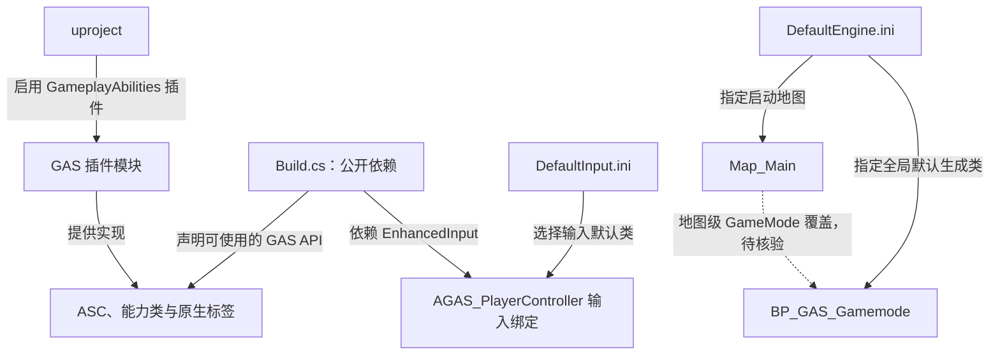

# 配置文件、构建类与资源索引

本页按实际文件归档非玩法类内容。参考项目为 `..\GAS_Acquaintance`，核对日期：2026-11-03。

## GAS_Acquaintance.uproject

引擎关联为 `5.6`；运行时模块为 `GAS_Acquaintance`，加载阶段 Default。`GameplayAbilities` 插件已启用，`ModelingToolsEditorMode` 仅面向 Editor 启用。

## GAS_Acquaintance.Build.cs：GAS_Acquaintance

构建规则类继承 `ModuleRules`。构造函数设置 `PCHUsageMode.UseExplicitOrSharedPCHs`；公开依赖为 Core、CoreUObject、Engine、InputCore、EnhancedInput、GameplayAbilities、GameplayTags、GameplayTasks，私有依赖数组为空。

| 模块 | 项目中的使用者 |
| --- | --- |
| EnhancedInput | AGAS_PlayerController 的输入 Action、Mapping Context 和子系统 API |
| GameplayAbilities | 自定义 ASC、能力类、GAS 接口和 Spec |
| GameplayTags | GAS_Tags 命名空间及 Tag 查询 |
| GameplayTasks | GAS 相关依赖；当前没有自定义 Task 类 |

## Target.cs：游戏与编辑器目标类

| 文件 / 类 | 基类 | 构造设置 |
| --- | --- | --- |
| `Source/GAS_Acquaintance.Target.cs` / GAS_AcquaintanceTarget | TargetRules | TargetType.Game |
| `Source/GAS_AcquaintanceEditor.Target.cs` / GAS_AcquaintanceEditorTarget | TargetRules | TargetType.Editor |

两个构造函数均使用 BuildSettingsVersion.V5、EngineIncludeOrderVersion.Unreal5_6，并将 `GAS_Acquaintance` 加入 ExtraModuleNames。

## GAS_Acquaintance.h / .cpp：模块入口

头文件只包含 `CoreMinimal.h`，不定义玩法类；源文件通过 `IMPLEMENT_PRIMARY_GAME_MODULE(FDefaultGameModuleImpl, GAS_Acquaintance, "GAS_Acquaintance")` 注册主游戏模块。

## Config：地图、GameMode 与输入类型

`DefaultEngine.ini` 的 GameMapsSettings 指定：

```ini
GameDefaultMap=/Game/GAS_Acquaintance/Maps/Map_Main.Map_Main
EditorStartupMap=/Game/GAS_Acquaintance/Maps/Map_Main.Map_Main
GlobalDefaultGameMode=/Game/GAS_Acquaintance/Blueprints/Game/BP_GAS_Gamemode.BP_GAS_Gamemode_C
```

`DefaultInput.ini` 指定：

```ini
DefaultPlayerInputClass=/Script/EnhancedInput.EnhancedPlayerInput
DefaultInputComponentClass=/Script/EnhancedInput.EnhancedInputComponent
```



图中是配置依赖，不表示运行时调用顺序。GameMode 类配置见 [BP_GAS_Gamemode](GameMode.md)。

## Content：业务资产

以下路径以 `Content/GAS_Acquaintance` 为根：

```text
Maps/Map_Main.umap
Blueprints/
  Game/BP_GAS_Gamemode.uasset
  Player/BP_GAS_PlayerController.uasset
  Player/BP_GAS_PlayerState.uasset
  Characters/
    Player/
      BP_GAS_PlayerCharacter.uasset
      Anim/AM_GAS_Primary_A.uasset
      Anim/AM_GAS_Primary_B.uasset
      Anim/Primary_A.uasset
      Anim/Primary_B.uasset
    Enemy/
      BP_GAS_EnemyBase.uasset
      BP_Enemy_Melee.uasset
      BP_Enemy_Ranged.uasset
      Anim/ABP_Enemy_Melee.uasset
      Anim/ABP_Enemy_Ranged.uasset
      Anim/AM_HitReact_Melee.uasset
      Anim/AM_HitReact_Ranged.uasset
  Notifies/AN_SendEventToActor.uasset
  Input/
    IMC_Movement.uasset
    IMC_Abilities.uasset
    MovementActions/IA_Jump.uasset
    MovementActions/IA_Move.uasset
    MovementActions/IA_Look.uasset
    AbilityActions/IA_Primary.uasset
    AbilityActions/IA_Secondary.uasset
    AbilityActions/IA_Tertiary.uasset
  AbilitySystem/
    PlayerAbilities/GA_GAS_Primary.uasset
    PlayerAbilities/GA_Secondary.uasset
    PlayerAbilities/GA_Teriary.uasset
    EnemyAbilities/GA_GAS_HitReact.uasset
    EnemyAbilities/GA_GAS_HitReact_Melee.uasset
    EnemyAbilities/GA_GAS_HitReact_Ranged.uasset
```

`/Game/...` 对应磁盘 `Content/...`；GameMode 路径的 `_C` 指蓝图生成类。上述文件存在已核对，蓝图父类、默认引用、动画通知轨道和能力事件图没有经过本次编辑器核验。

玩法类的完整文件索引见 [README](../README.md)，成员与函数说明保留在各类笔记中。
