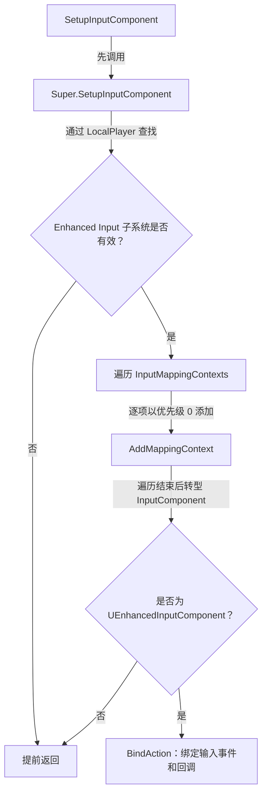
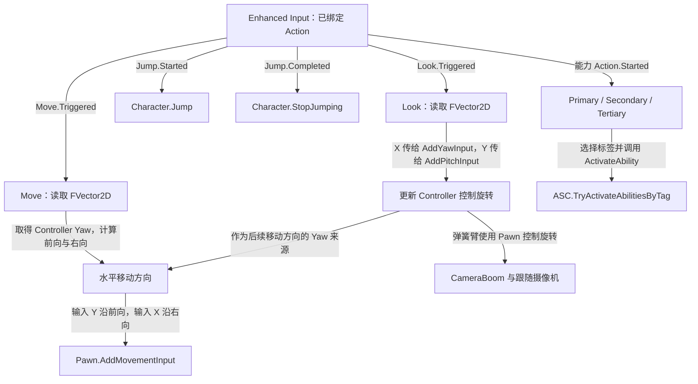

# PlayerController：输入与能力激活入口

`AGAS_PlayerController` 继承 `APlayerController`，把 Enhanced Input 事件转换成角色移动、视角更新、跳跃和按 Gameplay Tag 激活能力的调用。

源码：`Source/GAS_Acquaintance/Player/GAS_PlayerController.h`、`GAS_PlayerController.cpp`。

## 输入配置与初始化

所有输入资源属性均为 `EditDefaultsOnly`，需要在类默认值中配置：

| 属性 | 对应业务资源 | 用途 |
| --- | --- | --- |
| `InputMappingContexts` | `IMC_Movement`、`IMC_Abilities` | 映射上下文数组 |
| `JumpAction` | `IA_Jump` | 跳跃 |
| `MoveAction` | `IA_Move` | 二维移动输入 |
| `LookAction` | `IA_Look` | 二维视角输入 |
| `PrimaryAction` | `IA_Primary` | 主能力入口 |
| `SecondaryAction` | `IA_Secondary` | 次能力入口 |
| `TertiaryAction` | `IA_Tertiary` | 第三能力入口 |

上述资源已确认存在于 `Content/GAS_Acquaintance/Blueprints/Input`，属性的实际引用、Action 值类型、具体键位和 Modifier 需在编辑器核验。

`SetupInputComponent()` 先调用父类，然后取得 `UEnhancedInputLocalPlayerSubsystem`，将数组中的每个 Context 以优先级 `0` 加入，再把 `InputComponent` 转型为 `UEnhancedInputComponent` 并绑定输入。取得子系统或转型失败都会提前返回。

摘自 `Source/GAS_Acquaintance/Player/GAS_PlayerController.cpp` 的 `SetupInputComponent()`，仅保留取得子系统与添加 Context 的部分，省略空行：

```cpp
UEnhancedInputLocalPlayerSubsystem* InputSystem = ULocalPlayer::GetSubsystem<UEnhancedInputLocalPlayerSubsystem>(GetLocalPlayer());
if (!InputSystem) return;
for (UInputMappingContext* Context : InputMappingContexts)
{
    InputSystem->AddMappingContext(Context,0);
}
```

这段代码对应下图的子系统检查和映射添加；转型输入组件与 `BindAction` 在它之后执行。



Context 数组为空时仍会继续转型和绑定；图中“遍历结束”也包含没有任何项的情况。

`Config/DefaultInput.ini` 已指定 `EnhancedPlayerInput` 和 `EnhancedInputComponent`。当前 C++ 没有逐项检查 Context / Action 是否为空，编辑器赋值是排查输入无响应的重点。

## 输入事件与回调

| Action | 事件 | 回调 |
| --- | --- | --- |
| Jump | `Started` | `Jump()` |
| Jump | `Completed` | `StopJumping()` |
| Move | `Triggered` | `Move(Value)` |
| Look | `Triggered` | `Look(Value)` |
| Primary / Secondary / Tertiary | `Started` | 各自的能力入口 |

源码没有为 Jump 绑定 `Canceled`，也没有为能力输入绑定松开事件或持续按住事件。需要蓄力、引导或能力内等待松开的交互时，应另外设计输入传递逻辑。

## 移动、观察与跳跃

`Move()` 读取 `FVector2D`，使用 Controller 的 Yaw 构造水平旋转，从旋转矩阵取得 X 轴前向和 Y 轴右向：

```cpp
const FRotator YawRotation(0.f, GetControlRotation().Yaw, 0.f);
const FVector ForwardDirection = FRotationMatrix(YawRotation).GetUnitAxis(EAxis::X);
const FVector RightDirection = FRotationMatrix(YawRotation).GetUnitAxis(EAxis::Y);

LocalPawn->AddMovementInput(ForwardDirection, MovementVector.Y);
LocalPawn->AddMovementInput(RightDirection, MovementVector.X);
```

因此输入 Y 对应前后、X 对应左右，方向由控制器的水平朝向决定。实际键位到这两个轴的转换由 Input Mapping Context 决定。

`Look()` 将输入 X 交给 `AddYawInput()`，Y 交给 `AddPitchInput()`。`Jump()` 和 `StopJumping()` 取得当前 `ACharacter` 后直接调用角色跳跃 API；当前跳跃没有走 GAS 能力路径。



移动和跳跃节点均以取得有效 Pawn / Character 为前提。能力分支的 ASC 查找与标签匹配详见 [完整激活流程](../AbilitySystem/StartupAbilities.md)。

## 按 Tag 激活能力

三个能力回调仅选择标签，例如 `Primary()` 调用 `ActivateAbility(GAS_Tags::GAS_Abilities::Primary)`，之后复用同一个函数。

摘自 `Source/GAS_Acquaintance/Player/GAS_PlayerController.cpp` 的 `ActivateAbility()`，省略原注释，保留完整函数；仅调整空白排版：

```cpp
void AGAS_PlayerController::ActivateAbility(const FGameplayTag& AbilityTag) const
{
    UAbilitySystemComponent* ASC =
        UAbilitySystemBlueprintLibrary::GetAbilitySystemComponent(GetPawn());
    if (!ASC) return;

    ASC->TryActivateAbilitiesByTag(AbilityTag.GetSingleTagContainer());
}
```

Controller 从当前 Pawn 查找 ASC，而玩家角色通过 GAS 接口返回 PlayerState 的 ASC，因而无需在 Controller 中再持有一份 ASC。

`TryActivateAbilitiesByTag()` 是尝试激活匹配能力，不是根据资源名创建能力。能力必须先被授予；标签匹配后仍可能因能力自身的激活条件而失败。当前函数没有检查返回值，也没有打印失败原因。

网络执行和预测还取决于能力的 Net Execution Policy、实例化和其他设置，不能仅凭本地输入调用就判断能力会在所有客户端执行。

参见：[Gameplay Tags](../Tags/GameplayTags.md)、[启动能力与激活流程](../AbilitySystem/StartupAbilities.md)。
