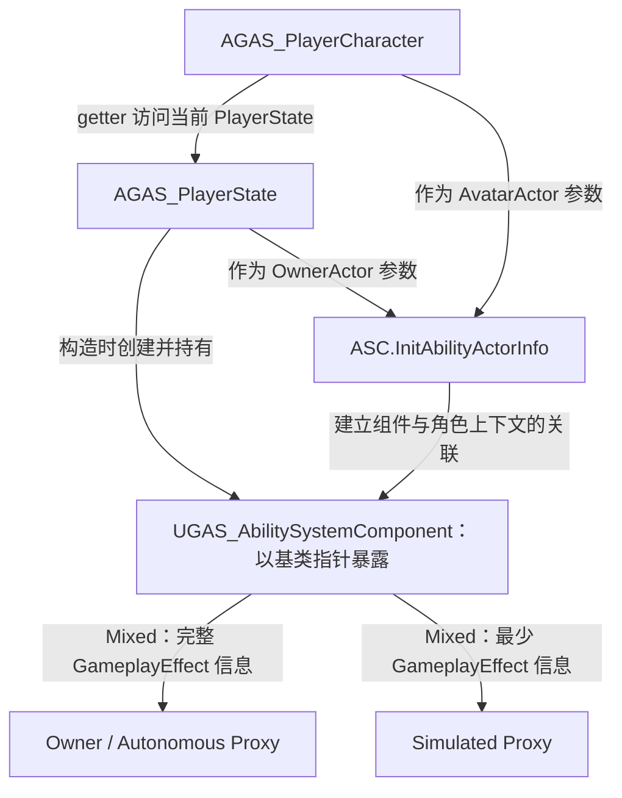

# PlayerState：持有能力系统组件

`AGAS_PlayerState` 继承 `APlayerState` 并实现 `IAbilitySystemInterface`。项目把 ASC 放在 PlayerState 上，角色通过接口访问它。

源码：`Source/GAS_Acquaintance/Player/GAS_PlayerState.h`、`GAS_PlayerState.cpp`。

## 创建与暴露 ASC

摘自 `Source/GAS_Acquaintance/Player/GAS_PlayerState.cpp` 的构造函数，省略原注释，仅调整空白排版：

```cpp
AGAS_PlayerState::AGAS_PlayerState()
{
    SetNetUpdateFrequency(100.f);

    AbilitySystemComponent = CreateDefaultSubobject<UGAS_AbilitySystemComponent>(
        TEXT("AbilitySystemComponent"));
    AbilitySystemComponent->SetIsReplicated(true);
    AbilitySystemComponent->SetReplicationMode(EGameplayEffectReplicationMode::Mixed);
}
```

成员使用 `TObjectPtr<UAbilitySystemComponent>`，标记为 `VisibleAnywhere`；`GetAbilitySystemComponent()` 直接返回此成员。2026-10-29 核对时，构造函数已改为创建 `UGAS_AbilitySystemComponent`；保存和返回仍使用引擎基类类型。自定义类当前没有新增方法，见 [自定义 ASC](../AbilitySystem/AbilitySystemComponent.md)。

| 设置 | 在项目中的含义 |
| --- | --- |
| `SetNetUpdateFrequency(100.f)` | 将该 Actor 的网络更新频率参数设为 100；不等同于保证每秒发送 100 次，也不是游戏运行帧率 |
| `SetIsReplicated(true)` | 为 ASC 启用组件复制 |
| `Mixed` | GameplayEffect 对 Owner / Autonomous Proxy 复制完整信息，对 Simulated Proxy 复制最少信息；不代表所有 GAS 数据都按同一规则复制 |

复制模式的含义已对照本机 UE 5.6 的 `Engine/Plugins/Runtime/GameplayAbilities/Source/GameplayAbilities/Public/AbilitySystemComponent.h` 中的枚举注释。

## PlayerState 与 Character 的分工

当前初始化参数明确指定：

```cpp
ASC->InitAbilityActorInfo(GetPlayerState(), this);
```

这行发生在玩家角色中，所以 OwnerActor 是 PlayerState，AvatarActor 是当前 Character。ASC 的持有者和能力在场景中作用的角色可以是两个对象。

这种放置方式便于在 Pawn 更换时继续使用同一个 PlayerState 上的 ASC，但当前项目没有实现完整的死亡、重生、能力清理或状态重置流程。不能由此认定重生功能已经完成。

PlayerState 构造函数只负责创建和配置 ASC；与具体角色的关联由 [玩家角色](../Characters/PlayerCharacter.md) 的服务端和客户端回调完成。



图中复制分支仅说明 GameplayEffect 复制模式；持有、getter 访问和 ActorInfo 参数关系通过边上的文字区分。

[敌人角色](../Characters/EnemyCharacter.md) 则把同类组件放在角色自身，使用 `Minimal` 模式，OwnerActor / AvatarActor 都是敌人。不要把玩家的 PlayerState 获取路径直接套用到敌人。

## 排查要点

- 当前玩家的 PlayerState 必须能转型为 `AGAS_PlayerState`，否则角色的 ASC getter 返回空。
- 在编辑器检查 GameMode 的 PlayerState Class，确认使用了预期类型或派生蓝图。
- ASC 存在还不意味着 ActorInfo 已初始化；继续检查 `PossessedBy()` / `OnRep_PlayerState()`。

参见：[GameMode](../Game/GameMode.md)、[启动能力与激活流程](../AbilitySystem/StartupAbilities.md)。
