# GAS_StudyNotes

基于本地 UE 项目 `D:\xuelong\GAS_Acquaintance` 的 GAS 学习笔记。核对日期：2026-10-27；项目声明的引擎版本为 **Unreal Engine 5.6**。

## 阅读顺序

1. [项目配置与资源入口](Game/ProjectSetup.md)：插件、模块、地图、输入配置。
2. [游戏模式](Game/GameMode.md)：GameMode 如何将玩家相关类接起来。
3. [角色基类](Characters/CharacterBase.md)：接口、公共设置、启动能力数组。
4. [PlayerState](Player/PlayerState.md)：创建和复制 Ability System Component（ASC）。
5. [玩家角色](Characters/PlayerCharacter.md)：取得 ASC，初始化 OwnerActor / AvatarActor。
6. [Gameplay Tags](Tags/GameplayTags.md)：声明与定义三个能力标签。
7. [PlayerController](Player/PlayerController.md)：输入绑定、移动与按 Tag 激活能力。
8. [启动能力与激活流程](AbilitySystem/StartupAbilities.md)：串联完整调用链与排查方法。

## 项目结构与职责

| 对象 | 项目中的类型 | 当前职责 |
| --- | --- | --- |
| GameMode | `BP_GAS_Gamemode` 资产 | 被项目配置选为默认 GameMode；玩家类的实际赋值需在编辑器核验 |
| 角色基类 | `AGAS_BaseCharacters` | 实现 GAS 接口入口，保存并授予启动能力 |
| 玩家角色 | `AGAS_PlayerCharacter` | 摄像机、取得 PlayerState 的 ASC、初始化能力上下文 |
| 玩家状态 | `AGAS_PlayerState` | 持有可复制的 ASC |
| 玩家控制器 | `AGAS_PlayerController` | Enhanced Input 输入处理与能力激活入口 |
| 原生标签 | `GAS_Tags::GAS_Abilities` | Primary、Secondary、Tertiary 三个能力检索标签 |

```mermaid
flowchart TD
    subgraph serverSide["服务端：初始化并授予"]
        playerState["PlayerState"] -->|"构造时创建并持有"| serverAsc["ASC"]
        possessed["PlayerCharacter.PossessedBy"] -->|"ASC 有效且拥有权限"| serverInfo["InitAbilityActorInfo"]
        serverAsc -->|"提供待初始化的组件"| serverInfo
        serverInfo -->|"初始化后调用"| startup["GiveStartupAbilities"]
        startup -->|"遍历能力类并构造 Spec"| give["ASC.GiveAbility"]
    end
    subgraph clientSide["客户端：初始化与本地输入"]
        replicated["OnRep_PlayerState"] -->|"引用复制就绪且 ASC 有效"| clientInfo["InitAbilityActorInfo"]
        input["本地输入"] -->|"Enhanced Input 事件"| controller["PlayerController"]
        controller -->|"通过当前 Pawn 的 GAS 接口查找"| character["PlayerCharacter"]
        character -->|"返回 PlayerState 持有的组件"| localAsc["PlayerState.ASC"]
        controller -->|"传入能力 Tag 容器"| activate["TryActivateAbilitiesByTag"]
        localAsc -->|"作为调用目标"| activate
        clientInfo -->|"为本端激活建立角色上下文"| localAsc
    end
```

图中服务端授予和客户端本地输入分别展示各自入口，不表示两个回调按固定跨端顺序执行。客户端能力可用还依赖 GAS 复制和能力网络设置，细节见各专题。

## 笔记范围

文中代码和数值来自 `Source/GAS_Acquaintance`、`Config` 和 `.uproject`。源码路径默认相对于 UE 项目根目录。代码片段只摘取相关部分，完整逻辑以源文件为准。

已确认业务目录存在三项能力资产 `GA_Primary`、`GA_Secondary`、`GA_Teriary`（第三项文件名确实如此）。本次未在 UE 编辑器内检查 `.uasset` / `.umap` 的内部设置，因此不将资源存在等同于引用、标签或事件图已配置正确。

目前自定义 C++ 覆盖 GAS 接入、启动能力授予和输入激活入口；没有发现自定义 AttributeSet、GameplayEffect、伤害结算或 UI 控制逻辑。相关内容应随着项目实现继续补充。
