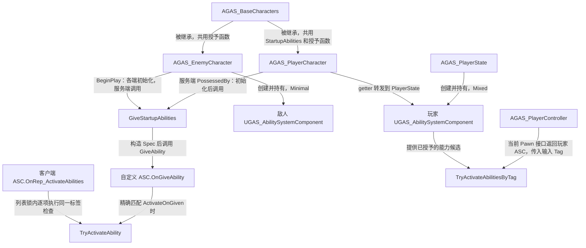

# GAS_StudyNotes

按参考项目 `..\GAS_Acquaintance` 当前类文件组织的 GAS 学习笔记。核对日期：2026-11-03；项目声明引擎版本：**Unreal Engine 5.6**。

## 类文件索引

下表路径以 `Source/GAS_Acquaintance` 为根；每个类均有同名 `.h` / `.cpp`。各类页面分别说明头文件中的继承、成员和函数，以及源文件的实现。

| 类文件 | 类 | 笔记 |
| --- | --- | --- |
| `Characters/GAS_BaseCharacters` | `AGAS_BaseCharacters` | [接口、构造设置与启动能力数组](Characters/CharacterBase.md) |
| `Characters/GAS_PlayerCharacter` | `AGAS_PlayerCharacter` | [摄像机、ASC 访问与两端初始化](Characters/PlayerCharacter.md) |
| `Characters/Enemy/GAS_EnemyCharacter` | `AGAS_EnemyCharacter` | [自身 ASC、BeginPlay 与服务端授予](Characters/EnemyCharacter.md) |
| `Player/GAS_PlayerState` | `AGAS_PlayerState` | [玩家 ASC 的创建与复制设置](Player/PlayerState.md) |
| `Player/GAS_PlayerController` | `AGAS_PlayerController` | [输入成员、绑定与能力激活](Player/PlayerController.md) |
| `AbilitySystem/GAS_AbilitySystemComponent` | `UGAS_AbilitySystemComponent` | [授予回调、复制回调与自动激活检查](AbilitySystem/AbilitySystemComponent.md) |
| `AbilitySystem/Abilities/GAS_GameplayAbility` | `UGAS_GameplayAbility` | [公共调试属性](AbilitySystem/GameplayAbility.md) |
| `AbilitySystem/Abilities/Player/GAS_Primary` | `UGAS_Primary` | [球形重叠查询与调试绘制](AbilitySystem/Primary.md) |
| `AbilitySystem/Abilities/Enemy/GAS_HitReact` | `UGAS_HitReact` | [类声明、继承及实现范围](AbilitySystem/HitReact.md) |

## 非类文件与关系索引

| 文件 / 范围 | 笔记 |
| --- | --- |
| `GameplayTags/GAS_Tags.h/.cpp` 命名空间 | [原生标签声明、定义与消费位置](Tags/GameplayTags.md) |
| `.uproject`、Build / Target、`Config` 和业务资源 | [配置文件与资源索引](Game/ProjectSetup.md) |
| `BP_GAS_Gamemode` 蓝图及默认配置 | [GameMode 配置关系](Game/GameMode.md) |
| 角色、PlayerState、ASC 与 Controller | [跨类授予及激活关系](AbilitySystem/StartupAbilities.md) |
| 标签、能力类、动画与通知资产 | [事件关系索引](AbilitySystem/GameplayEvents.md) |

## 类间职责关系

图中的回调分别对应本端授予和客户端能力列表复制，不表示服务端与客户端存在固定完成顺序。自动激活是尝试调用，仍受能力激活条件、上下文和网络设置约束。

## 内容依据

代码以参考项目的 `.h` / `.cpp` 为准，配置以 `.uproject` / `.ini` 为准。短代码注明源文件、函数与节选范围；跨类页面只索引关系，具体函数归入所属类说明。

资源路径已核对文件存在；本次没有通过 UE 编辑器核验蓝图父类、默认数组、事件图和动画通知。未核验的关系以虚线标注。当前业务能力资源为 `GA_GAS_Primary`、`GA_Secondary`、`GA_Teriary` 和 `GA_GAS_HitReact`，其中 `GA_Teriary` 是实际文件拼写。

源码涵盖自动激活检查与球形查询，但没有自定义 AttributeSet、GameplayEffect、伤害结算、UI 控制或 Gameplay Event 发送实现。球形查询的存在不等于伤害或受击链路已经完成。
