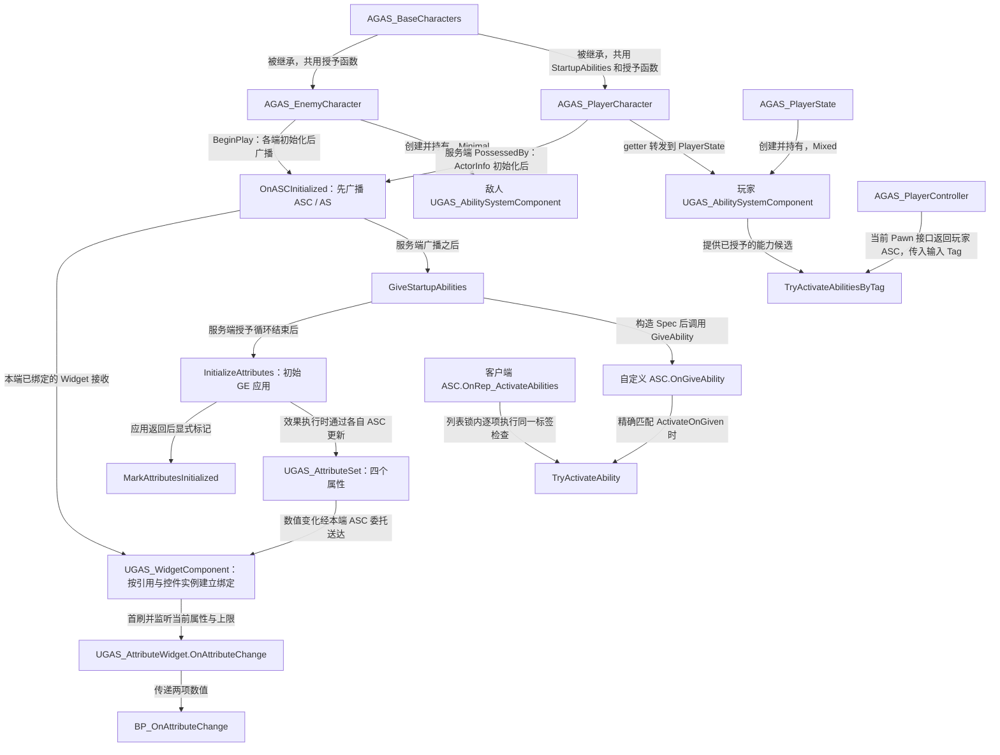

# GAS_StudyNotes

按参考项目 `..\GAS_Learning` 当前类文件组织的 GAS 学习笔记。核对日期：2026-11-09；项目声明引擎版本：**Unreal Engine 5.6**。

## 类文件索引

下表路径以 `Source/GAS_Learning` 为根；每个类均有同名 `.h` / `.cpp`。各类页面分别说明头文件中的继承、成员和函数，以及源文件的实现。

| 类文件 | 类 | 笔记 |
| --- | --- | --- |
| `Characters/GAS_BaseCharacters` | `AGAS_BaseCharacters` | [数据接口、委托、启动能力与初始属性效果](Characters/CharacterBase.md) |
| `Characters/GAS_PlayerCharacter` | `AGAS_PlayerCharacter` | [摄像机、ASC / AS 访问与两端初始化](Characters/PlayerCharacter.md) |
| `Characters/Enemy/GAS_EnemyCharacter` | `AGAS_EnemyCharacter` | [自身 ASC、BeginPlay 与服务端授予](Characters/EnemyCharacter.md) |
| `Player/GAS_PlayerState` | `AGAS_PlayerState` | [玩家 ASC / AS 的创建与复制设置](Player/PlayerState.md) |
| `Player/GAS_PlayerController` | `AGAS_PlayerController` | [输入成员、绑定与能力激活](Player/PlayerController.md) |
| `AbilitySystem/GAS_AttributeSet` | `UGAS_AttributeSet` | [属性访问器、数值复制与初始化标记](AbilitySystem/AttributeSet.md) |
| `UI/GAS_WidgetComponent` | `UGAS_WidgetComponent` | [引用缓存、属性监听与解绑](UI/WidgetComponent.md) |
| `UI/GAS_AttributeWidget` | `UGAS_AttributeWidget` | [属性对匹配与蓝图刷新事件](UI/AttributeWidget.md) |
| `AbilitySystem/GAS_AbilitySystemComponent` | `UGAS_AbilitySystemComponent` | [授予回调、复制回调与自动激活检查](AbilitySystem/AbilitySystemComponent.md) |
| `AbilitySystem/Abilities/GAS_GameplayAbility` | `UGAS_GameplayAbility` | [激活回调与公共调试属性](AbilitySystem/GameplayAbility.md) |
| `AbilitySystem/Abilities/Player/GAS_Primary` | `UGAS_Primary` | [命中查询、事件发送与调试绘制](AbilitySystem/Primary.md) |
| `AbilitySystem/Abilities/Enemy/GAS_HitReact` | `UGAS_HitReact` | [方向向量缓存与调用边界](AbilitySystem/HitReact.md) |
| `Utils/GAS_BlueprintLibrary` | `UGAS_BlueprintLibrary` | [方向枚举、判定与名称映射](Utils/BlueprintLibrary.md) |

## 非类文件与关系索引

| 文件 / 范围 | 笔记 |
| --- | --- |
| `GameplayTags/GAS_Tags.h/.cpp` 命名空间 | [原生标签声明、定义与消费位置](Tags/GameplayTags.md) |
| `.uproject`、Build / Target、`Config` 和业务资源 | [配置文件与资源索引](Game/ProjectSetup.md) |
| `BP_GAS_Gamemode` 蓝图及默认配置 | [GameMode 配置关系](Game/GameMode.md) |
| 角色、PlayerState、ASC 与 Controller | [跨类授予及激活关系](AbilitySystem/StartupAbilities.md) |
| 标签、能力类、动画与通知资产 | [事件关系索引](AbilitySystem/GameplayEvents.md) |

## 类间职责关系

图中的回调分别对应本端授予和客户端能力列表复制，不表示服务端与客户端存在固定完成顺序。自动激活是尝试调用，仍受能力激活条件、上下文和网络设置约束。

## 内容依据

代码以参考项目的 `.h` / `.cpp` 为准，配置以 `.uproject` / `.ini` 为准。短代码注明源文件、函数与节选范围；跨类页面只索引关系，具体函数归入所属类说明。

资源路径已核对文件存在；本次没有通过 UE 编辑器核验蓝图父类、默认数组、事件图和动画通知。未核验的关系以虚线标注。当前业务能力资源包含 `GA_GAS_Primary`、`GA_Secondary`、`GA_Teriary`、`GA_GAS_HitReact` 及其 Melee / Ranged 资源，其中 `GA_Teriary` 是实际文件拼写。

当前源码覆盖属性初始化、复制、控件刷新和生命值归零处理。初始效果资产、UI 资产和伤害相关资源已按磁盘文件核对。蓝图挂载、属性对、效果数值和伤害资产的调用关系需在编辑器核验。参见 [项目配置与资源索引](Game/ProjectSetup.md)。

业务资源和地图路径均使用 `GAS_Learning`，旧脚本包名称保留在重定向配置中。
