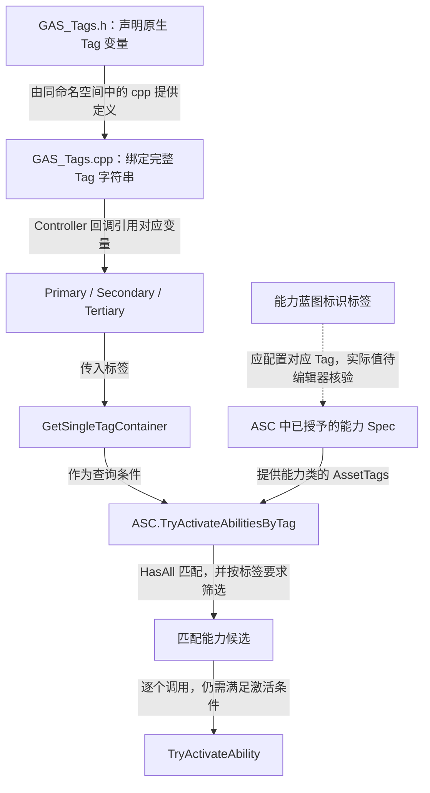
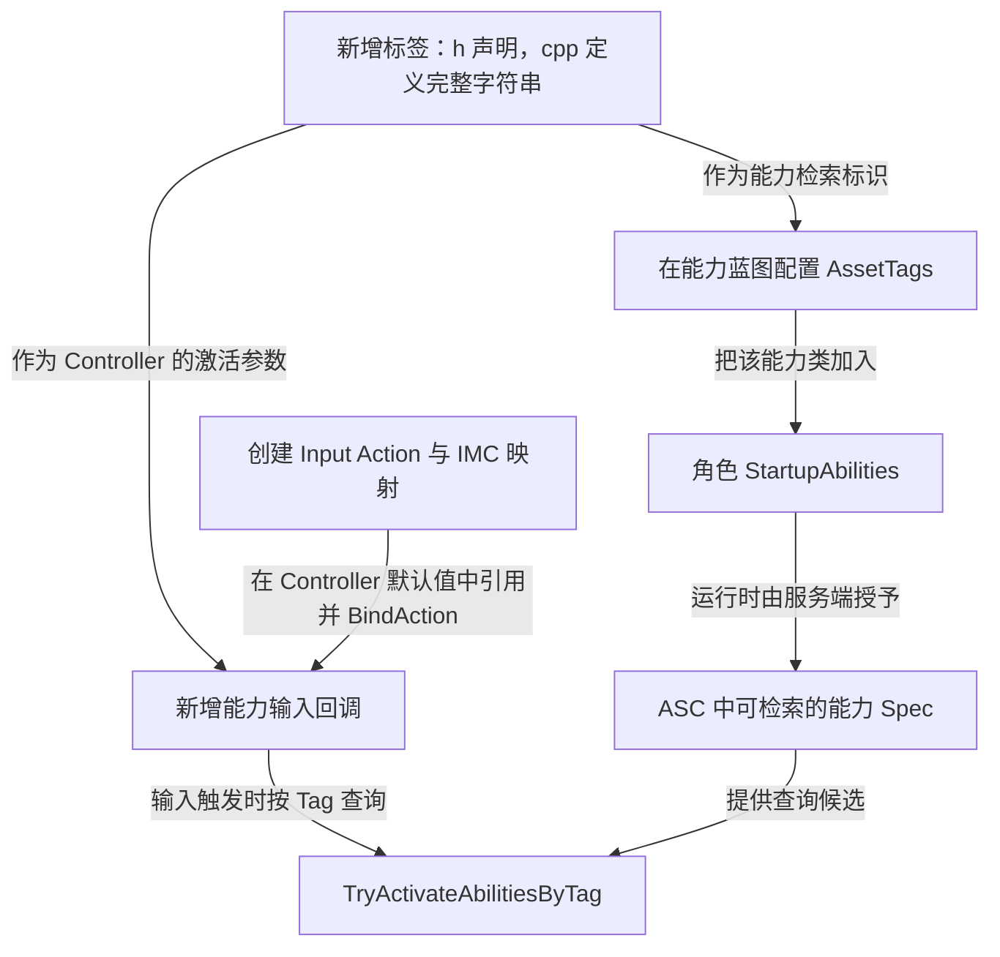

# Gameplay Tags：用标签查找能力

项目使用原生 Gameplay Tag，为三个能力输入提供稳定的标识。声明位于 `Source/GAS_Acquaintance/GameplayTags/GAS_Tags.h`，定义位于同目录的 `GAS_Tags.cpp`。

## 声明与定义

头文件包含 `NativeGameplayTags.h`，在命名空间中声明可被其他文件引用的标签变量：

```cpp
namespace GAS_Tags
{
    namespace GAS_Abilities
    {
        UE_DECLARE_GAMEPLAY_TAG_EXTERN(Primary);
        UE_DECLARE_GAMEPLAY_TAG_EXTERN(Secondary);
        UE_DECLARE_GAMEPLAY_TAG_EXTERN(Tertiary);
    }
}
```

以下摘自 `Source/GAS_Acquaintance/GameplayTags/GAS_Tags.cpp`，保留命名空间和三个原生标签定义，省略空行：

```cpp
namespace GAS_Tags
{
    namespace GAS_Abilities
    {
        UE_DEFINE_GAMEPLAY_TAG_COMMENT(Primary, "GAS_Tags.GAS_Abilities.Primary", "Tag for the Primary Ability");
        UE_DEFINE_GAMEPLAY_TAG_COMMENT(Secondary, "GAS_Tags.GAS_Abilities.Secondary", "Tag for the Secondary Ability");
        UE_DEFINE_GAMEPLAY_TAG_COMMENT(Tertiary, "GAS_Tags.GAS_Abilities.Tertiary", "Tag for the Tertiary Ability");
    }
}
```

该定义位于与声明相同的命名空间内。C++ 的 `::` 表示命名空间访问，标签字符串中的 `.` 表示标签层级，两者不能混写。

| C++ 变量 | 完整 Tag 字符串 | Controller 入口 |
| --- | --- | --- |
| `GAS_Tags::GAS_Abilities::Primary` | `GAS_Tags.GAS_Abilities.Primary` | `Primary()` |
| `GAS_Tags::GAS_Abilities::Secondary` | `GAS_Tags.GAS_Abilities.Secondary` | `Secondary()` |
| `GAS_Tags::GAS_Abilities::Tertiary` | `GAS_Tags.GAS_Abilities.Tertiary` | `Tertiary()` |

## 当前用途：检索已授予的能力

```cpp
ASC->TryActivateAbilitiesByTag(AbilityTag.GetSingleTagContainer());
```

Controller 把一个标签转换成 `FGameplayTagContainer`，让 ASC 尝试激活匹配的已授予能力。标签本身既不是能力类，也不会自动执行能力逻辑。

本机 UE 5.6 的 `AbilitySystemComponent_Abilities.cpp` 中，该 API 使用 `Spec.Ability->GetAssetTags().HasAll(GameplayTagContainer)` 检索能力，再逐个尝试激活。它不是“找到一个就停止”；多个能力具有匹配标签时可能有多个候选。项目当前每次只传一个标签。

在 UE 5.6 能力蓝图中，应核对用于能力自身标识的标签。引擎 `GameplayAbility.h` 的属性显示名为 `AssetTags (Default AbilityTags)`，提供 `GetAssetTags()` 访问接口；旧教程常称 `Ability Tags`。不要把它和激活所需标签、阻止标签或激活时附加给持有者的标签混为一谈。当前 C++ 没有给能力 Spec 写入额外的动态输入标签。



Tag 定义与能力授予是两条独立的前置条件，最终在 ASC 检索时汇合；定义标签不会自动把能力加入 ASC。

业务目录存在 `GA_Primary`、`GA_Secondary`、`GA_Teriary` 三项资产；它们是否已配置对应标签，需要在编辑器确认。尤其第三项**资产文件名**为 `GA_Teriary`，原生 Tag 则拼作 `Tertiary`；激活依据是标签匹配，不是文件名匹配。

## 扩展一个能力输入时



这些是后续扩展步骤，当前源码只定义了表中的三个入口。

参见：[PlayerController](../Player/PlayerController.md)、[启动能力与激活流程](../AbilitySystem/StartupAbilities.md)。
