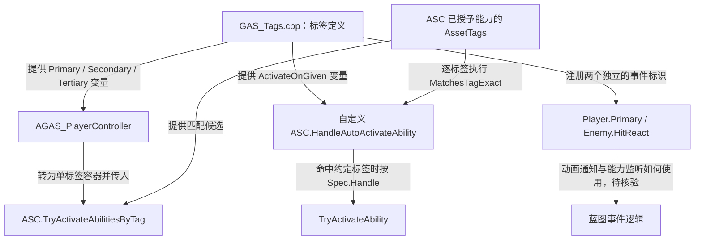

# GAS_Tags.h / GAS_Tags.cpp

这两个文件不定义 UObject 类。`GAS_Tags.h` 通过 `NativeGameplayTags.h` 声明原生标签变量，`GAS_Tags.cpp` 在相同命名空间内定义完整字符串。核对日期：2026-11-03。

源码目录：`Source/GAS_Acquaintance/GameplayTags`。

## GAS_Abilities：能力标识与自动激活约定

| C++ 变量（前缀 GAS_Tags::） | 完整注册字符串 | 当前 C++ 消费位置 |
| --- | --- | --- |
| `GAS_Abilities::ActivateOnGiven` | `GAS_Tags.GAS_Abilities.ActivateOnGiven` | ASC.HandleAutoActivateAbility 精确匹配 |
| `GAS_Abilities::Primary` | `GAS_Tags.GAS_Abilities.Primary` | PlayerController.Primary |
| `GAS_Abilities::Secondary` | `GAS_Tags.GAS_Abilities.Secondary` | PlayerController.Secondary |
| `GAS_Abilities::Tertiary` | `GAS_Tags.GAS_Abilities.Tertiary` | PlayerController.Tertiary |
| `GAS_Abilities::Enemy::HitReact` | `GAS_Tags.GAS_Abilities.Enemy.HitReact` | 已注册；自定义 C++ 没有直接引用该变量的调用 |

`ActivateOnGiven` 是 ASC 使用的约定，能力资产需在自身 AssetTags 中持有该标签才会匹配。其检查代码归入 [UGAS_AbilitySystemComponent](../AbilitySystem/AbilitySystemComponent.md)。

## GAS_Events：事件标识

| C++ 变量（前缀 GAS_Tags::） | 完整注册字符串 |
| --- | --- |
| `GAS_Events::Player::Primary` | `GAS_Tags.GAS_Events.Primary` |
| `GAS_Events::Enemy::HitReact` | `GAS_Tags.GAS_Events.Enemy.HitReact` |

摘自 `GAS_Tags.cpp`，仅保留外层 `GAS_Tags` 内部 `GAS_Events::Player` 的完整命名空间定义：

```cpp
namespace Player
{
    UE_DEFINE_GAMEPLAY_TAG_COMMENT(Primary, "GAS_Tags.GAS_Events.Primary", "Tag for the Player Primary Event");
}
```

这里定义本身只有四行，不填充无关代码。C++ 命名空间含 `Player`，实际注册字符串不含 `.Player`。事件 Primary 与能力 Primary 是不同标签；Enemy.HitReact 的能力和事件字符串也不同。

当前自定义 C++ 没有发送或等待上述 Gameplay Event 的代码。事件标签注册不会自动建立发送者、目标或接收者；资源关系见 [事件关系索引](../AbilitySystem/GameplayEvents.md)。

## 声明与定义的对应方式

头文件使用 `UE_DECLARE_GAMEPLAY_TAG_EXTERN`，源文件使用 `UE_DEFINE_GAMEPLAY_TAG_COMMENT`，定义保持相同命名空间。以下摘自 `GAS_Tags.cpp` 的 `GAS_Abilities::Enemy` 命名空间，保留该命名空间定义：

```cpp
namespace Enemy
{
    UE_DEFINE_GAMEPLAY_TAG_COMMENT(HitReact, "GAS_Tags.GAS_Abilities.Enemy.HitReact", "Tag for the Enemy HitReact Ability");
}
```

C++ 中的 `::` 用于访问变量，字符串中的 `.` 表示标签层级。定义标签的文件只负责标识，行为由消费它的类承担。

## 标签与所属类的调用关系



UE 5.6 的输入检索路径使用 `Spec.Ability->GetAssetTags().HasAll(...)`；自动激活路径则逐标签执行 `MatchesTagExact()`。两条路径的入口和匹配方式不同。能力标识属性在本机引擎 `GameplayAbility.h` 的显示名为 `AssetTags (Default AbilityTags)`，不要与激活所需、激活阻止或激活附加标签混淆。

具体输入逻辑见 [AGAS_PlayerController](../Player/PlayerController.md)，能力实现见 [UGAS_Primary](../AbilitySystem/Primary.md) 和 [UGAS_HitReact](../AbilitySystem/HitReact.md)。
