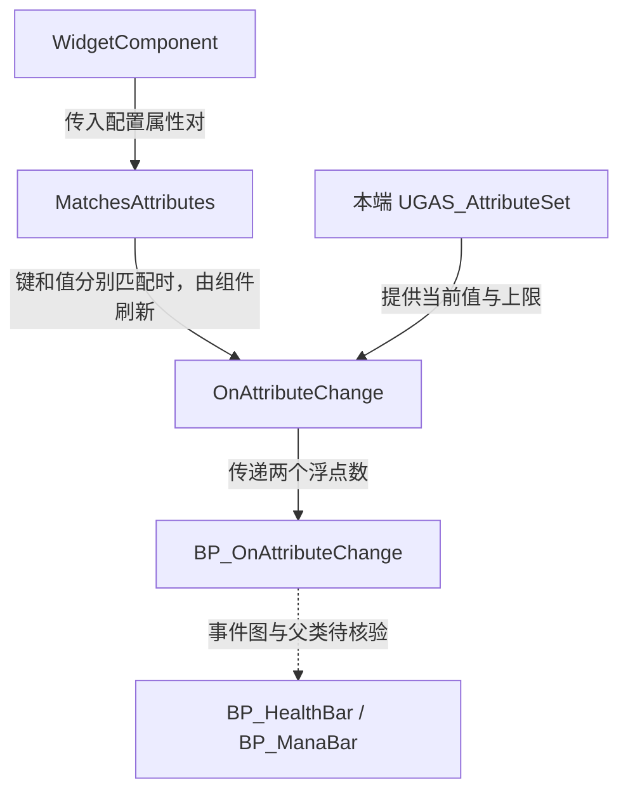

# UGAS_AttributeWidget

继承 `UUserWidget`，匹配一对属性并将当前值与上限交给蓝图事件。

源码为 `Source/GAS_Learning/UI/GAS_AttributeWidget.h` 与同名 `.cpp`。

| 公开声明 | 类型与职责 |
| --- | --- |
| Attribute、MaxAttribute | FGameplayAttribute，EditAnywhere、BlueprintReadOnly，用于配置当前值和上限 |
| MatchesAttributes(const TTuple<FGameplayAttribute, FGameplayAttribute>&) const | 同时比较当前属性与键、上限属性与值 |
| OnAttributeChange(const TTuple<FGameplayAttribute, FGameplayAttribute>&, UGAS_AttributeSet*) | 从传入属性集读取两个数值 |
| BP_OnAttributeChange(const float&, const float&) | BlueprintImplementableEvent，显示名 On Attribute Change |

以下摘自 `GAS_AttributeWidget.cpp` 的完整 `OnAttributeChange()`，省略空行。

```cpp
void UGAS_AttributeWidget::OnAttributeChange(const TTuple<FGameplayAttribute, FGameplayAttribute>& Pair,
    UGAS_AttributeSet* AttributeSet)
{
    const float AttributeValue = Pair.Key.GetNumericValue(AttributeSet);
    const float MaxAttributeValue = Pair.Value.GetNumericValue(AttributeSet);
    BP_OnAttributeChange(AttributeValue,MaxAttributeValue);
}
```

两个数值都取自本次传入的属性集。比例计算、文本格式与进度条显示属于蓝图事件的实现范围。



参见 [控件组件](WidgetComponent.md)。
