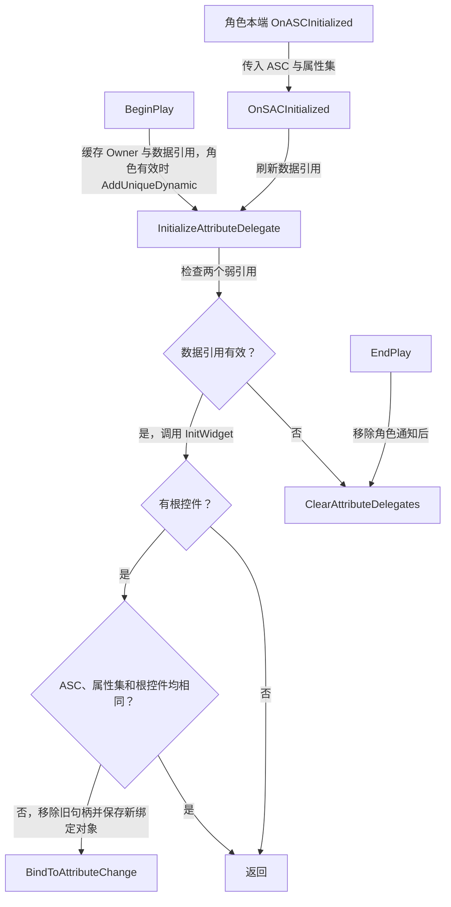
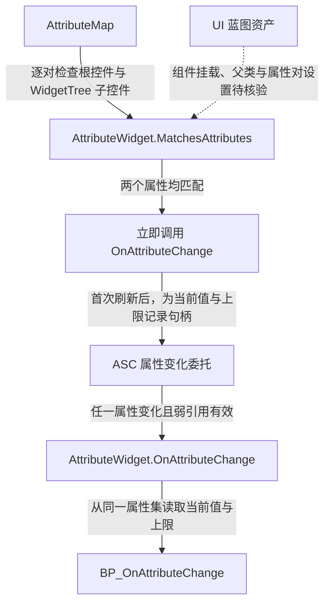

# UGAS_WidgetComponent

继承 `UWidgetComponent`，把角色 ASC 上的属性变化交给匹配的属性控件。

源码为 `Source/GAS_Learning/UI/GAS_WidgetComponent.h` 与同名 `.cpp`。

## 头文件中的成员与函数

| 成员 | 类型与职责 |
| --- | --- |
| AttributeMap | protected、EditAnywhere，TMap<FGameplayAttribute, FGameplayAttribute>，键为当前属性，值为上限属性 |
| GAS_Character | 弱引用，缓存转型后的 Owner |
| GAS_AbilitySystemComponent、GAS_AttributeSet | 弱引用，记录当前数据来源 |
| BoundAbilitySystemComponent、BoundAttributeSet、BoundWidget | 弱引用，记录已绑定的 ASC、属性集与根控件 |
| AttributeDelegateHandles | TArray<TPair<FGameplayAttribute, FDelegateHandle>>，记录解绑所需的属性与句柄 |

| 函数 | 职责 |
| --- | --- |
| BeginPlay / EndPlay | 注册与移除角色通知，建立与清理属性监听 |
| InitAbilitySystemData / IsASCInitialized | 转型并缓存引用，检查 ASC 与属性集是否有效 |
| OnSACInitialized | UFUNCTION，接收角色通知并更新引用，名称沿用源码拼写 |
| InitializeAttributeDelegate / ClearAttributeDelegates | 按对象身份去重，重绑前或结束时移除旧句柄 |
| BindToAttributeChange | UFUNCTION，按 AttributeMap 检查根控件及 WidgetTree 子控件 |
| BindWidgetToAttributeChanges | 匹配属性对，立即刷新，并订阅当前值与上限 |

## BeginPlay、OnSACInitialized 与重绑

`BeginPlay()` 从 Owner 取得角色及两个数据引用。角色有效时以 `AddUniqueDynamic` 持续监听 `OnASCInitialized`，随后尝试绑定。通知到达时，`OnSACInitialized()` 以广播参数更新数据来源，再调用同一个初始化函数。

`InitializeAttributeDelegate()` 以 ASC 与属性集弱引用的有效性为入口。它先调用 `InitWidget()`，根控件为空时返回。ASC、属性集和根控件均与已绑定记录相同时跳过重绑，其他情况先移除旧句柄，再缓存当前对象并遍历控件。若 ASC 或属性集无效，函数直接清理旧绑定。这个过程独立于属性集的初始化标记。



`ClearAttributeDelegates()` 对旧 ASC 按属性和句柄移除回调，再清空句柄数组与三项绑定记录。`EndPlay()` 在这些清理完成后执行父类回调。

## BindToAttributeChange 与属性刷新

对 `AttributeMap` 的每个属性对，组件先检查根控件，再通过 `WidgetTree->ForEachWidget` 检查子控件。匹配的 `UGAS_AttributeWidget` 会立即收到当前快照。以下摘自 `GAS_WidgetComponent.cpp` 的 `BindWidgetToAttributeChanges()`，省略空行和注释，保留匹配、初次刷新和弱引用建立部分。

```cpp
UGAS_AttributeWidget* AttributeWidget = Cast<UGAS_AttributeWidget>(WidgetObject);
if (!AttributeWidget) return;
if (!AttributeWidget->MatchesAttributes(Pair)) return;
AttributeWidget->OnAttributeChange(Pair,GAS_AttributeSet.Get());
const TWeakObjectPtr<UGAS_AttributeWidget> WeakWidget = AttributeWidget;
```

随后注册以组件为弱绑定对象的 Lambda，并弱引用目标控件。属性变化时，控件与属性集均有效才重新读取整对数值。源码保存两个属性的监听句柄，若键和值相同则只注册一次。



组件按本端可用的角色与控件实例建立监听。客户端属性更新可经属性集的数值复制通知进入本端 ASC，具体蓝图显示由属性控件的事件实现决定。参见 [属性集](../AbilitySystem/AttributeSet.md) 与 [属性控件](AttributeWidget.md)。
