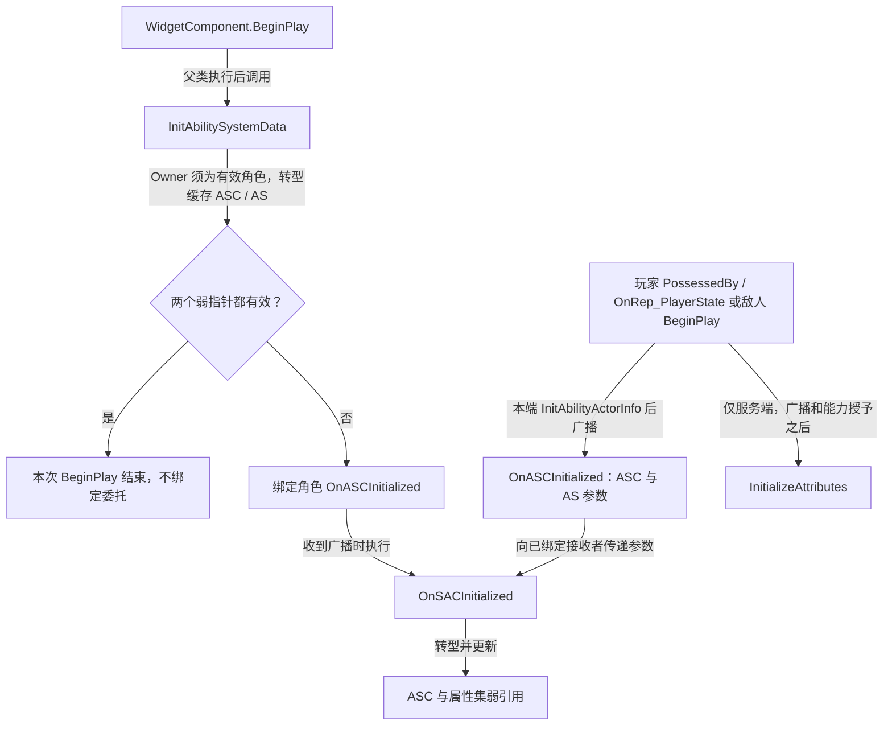

# UGAS_WidgetComponent

继承 `UWidgetComponent`，缓存角色、ASC 与属性集，并在初次取得数据不完整时监听角色初始化通知。

源码：`Source/GAS_Learning/UI/GAS_WidgetComponent.h`、`GAS_WidgetComponent.cpp`。核对日期：2026-11-05。

## 头文件：成员与函数

类标记为 `UCLASS(ClassGroup=(Custom), meta=(BlueprintSpawnableComponent))`。

| 可见性 | 声明 | 职责 |
| --- | --- | --- |
| protected override | BeginPlay() | 初次缓存与条件绑定通知 |
| private | TWeakObjectPtr<AGAS_BaseCharacters> GAS_Character | 弱引用组件 Owner 转型后的角色 |
| private | TWeakObjectPtr<UGAS_AbilitySystemComponent> GAS_AbilitySystemComponent | 弱引用自定义 ASC |
| private | TWeakObjectPtr<UGAS_AttributeSet> GAS_AttributeSet | 弱引用自定义属性集 |
| private | InitAbilitySystemData() | 从 Owner 和角色 getter 缓存引用 |
| private | IsASCInitialized() const | 检查 ASC 和属性集弱指针有效性 |
| private UFUNCTION | OnSACInitialized(UAbilitySystemComponent*, UAttributeSet*) | 从通知参数更新两个缓存 |

回调实际拼写为 **OnSACInitialized**；角色委托名为 **OnASCInitialized**。本类不创建 ASC 或属性集，弱引用也不承担它们的所有权。

## BeginPlay：初次缓存与通知绑定

摘自 `GAS_WidgetComponent.cpp`，保留完整函数，省略空行：

```cpp
void UGAS_WidgetComponent::BeginPlay()
{
    Super::BeginPlay();
    InitAbilitySystemData();
    if (!IsASCInitialized())
    {
        GAS_Character->OnASCInitialized.AddDynamic(this,&ThisClass::OnSACInitialized);
    }
}
```

初次缓存已能取得两个有效指针时，不绑定通知，也不显式调用 `OnSACInitialized()`。缓存不完整时，将当前组件回调加入角色动态多播委托；源码没有额外的一次性绑定、解绑或重试逻辑。

## InitAbilitySystemData 与 IsASCInitialized

摘自同一 `.cpp`，保留连续两个完整函数，省略空行：

```cpp
void UGAS_WidgetComponent::InitAbilitySystemData()
{
    GAS_Character = Cast<AGAS_BaseCharacters>(GetOwner());
    GAS_AbilitySystemComponent = Cast<UGAS_AbilitySystemComponent>(GAS_Character->GetAbilitySystemComponent());
    GAS_AttributeSet = Cast<UGAS_AttributeSet>(GAS_Character->GetAttributeSet());
}
bool UGAS_WidgetComponent::IsASCInitialized() const
{
    return GAS_AbilitySystemComponent.IsValid() && GAS_AttributeSet.IsValid();
}
```

Owner 需要是有效的 `AGAS_BaseCharacters` 派生对象；当前函数没有检查 `GAS_Character` 转型结果就继续解引用，绑定通知处也依赖该前提。

`IsASCInitialized()` 只判断两个派生类型缓存是否有效，不检查 ActorInfo、初始 GE 是否已应用、属性值是否就绪或 Widget 实例是否已经建立。

## OnSACInitialized：更新缓存

摘自同一 `.cpp`，保留函数逻辑，省略空行与 TODO 注释：

```cpp
void UGAS_WidgetComponent::OnSACInitialized(UAbilitySystemComponent* ASC, UAttributeSet* AS)
{
    GAS_AbilitySystemComponent = Cast<UGAS_AbilitySystemComponent>(ASC);
    GAS_AttributeSet = Cast<UGAS_AttributeSet>(AS);
}
```

函数只有四行，不补入示意实现。原注释留下“确认属性是否经过首个 GE 初始化，否则等待相应委托”的 TODO；当前代码没有实现这一步，也没有绑定属性变化委托或刷新 UI 数值。



图中数据就绪通知和应用初始 GE 的顺序来自角色 C++；通知只是本端委托，不是网络 RPC，也没有“属性值完成初始化”的保证。跨端属性更新由 [UGAS_AttributeSet](../AbilitySystem/AttributeSet.md) 的复制声明处理。

## 组件与资源关系

`BlueprintSpawnableComponent` 允许组件被蓝图使用，不能单独证明玩家或敌人蓝图已经挂载本组件。当前业务目录未发现独立的 WBP 资产；组件挂载、Widget Class、属性显示和监听需要在编辑器核验。

参见：[AGAS_BaseCharacters](../Characters/CharacterBase.md)、[AGAS_PlayerCharacter](../Characters/PlayerCharacter.md)、[AGAS_EnemyCharacter](../Characters/EnemyCharacter.md)。
