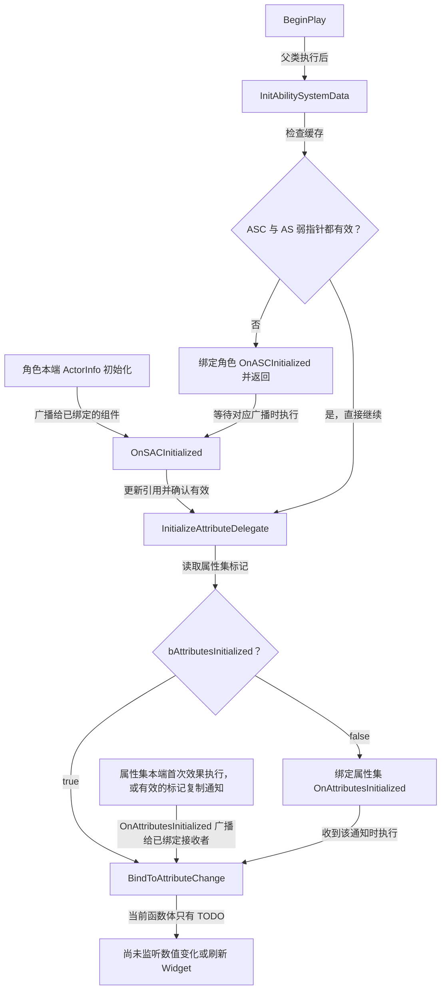

# UGAS_WidgetComponent

继承 `UWidgetComponent`，缓存角色、ASC 与属性集，依次处理“对象引用可用”和“属性集首次效果执行通知”两个阶段，再进入属性变化绑定入口。

源码：`Source/GAS_Learning/UI/GAS_WidgetComponent.h`、`GAS_WidgetComponent.cpp`。核对日期：2026-11-05。

## 头文件：成员与函数

类标记为 `UCLASS(ClassGroup=(Custom), meta=(BlueprintSpawnableComponent))`。

| 可见性 | 声明 | 职责 |
| --- | --- | --- |
| protected override | BeginPlay() | 初次缓存；引用不齐时监听角色，否则继续属性通知处理 |
| private | TWeakObjectPtr<AGAS_BaseCharacters> GAS_Character | 弱引用 Owner 转型后的角色 |
| private | TWeakObjectPtr<UGAS_AbilitySystemComponent> GAS_AbilitySystemComponent | 弱引用自定义 ASC |
| private | TWeakObjectPtr<UGAS_AttributeSet> GAS_AttributeSet | 弱引用自定义属性集 |
| private | InitAbilitySystemData() | 从 Owner 和角色 getter 缓存引用 |
| private | IsASCInitialized() const | 只检查 ASC 与属性集弱指针有效性 |
| private | InitializeAttributeDelegate() | 根据属性集标记选择等待通知或直接进入绑定入口 |
| private UFUNCTION | OnSACInitialized(UAbilitySystemComponent*, UAttributeSet*) | 从角色通知更新引用并继续初始化 |
| private UFUNCTION | BindToAttributeChange() | 属性变化监听与界面更新的入口，函数体当前只有 TODO |

回调实际拼写为 **OnSACInitialized**；角色委托名为 **OnASCInitialized**。本类不创建 ASC 或属性集，弱引用不承担它们的所有权。

## BeginPlay：取得引用或等待角色通知

摘自 `GAS_WidgetComponent.cpp` 的 `BeginPlay()`，保留完整函数体，省略函数外壳与空行：

```cpp
Super::BeginPlay();
InitAbilitySystemData();
if (!IsASCInitialized())
{
    GAS_Character->OnASCInitialized.AddDynamic(this,&ThisClass::OnSACInitialized);
    return;
}
InitializeAttributeDelegate();
```

引用不完整时绑定角色委托并返回；两个指针有效时直接调用 `InitializeAttributeDelegate()`。因此初始化并不完全依赖角色通知：Widget 启动较晚、已能取得引用时也有直接路径。

## InitAbilitySystemData 与 IsASCInitialized

摘自同一 `.cpp`，保留连续两个完整函数，省略空行：

```cpp
void UGAS_WidgetComponent::InitAbilitySystemData()
{
    GAS_Character = Cast<AGAS_BaseCharacters>(GetOwner());
    GAS_AbilitySystemComponent = Cast<UGAS_AbilitySystemComponent>(GAS_Character->GetAbilitySystemComponent());
    GAS_AttributeSet = Cast<UGAS_AttributeSet>(GAS_Character->GetAttributeSet());
}
bool UGAS_WidgetComponent::IsASCInitialized() const
{
    return GAS_AbilitySystemComponent.IsValid() && GAS_AttributeSet.IsValid();
}
```

Owner 必须是有效的 `AGAS_BaseCharacters` 派生对象；当前代码没有先检查角色转型结果就继续解引用，通知绑定处也依赖该前提。`IsASCInitialized()` 不检查 ActorInfo、属性初值或 Widget 实例。

## OnSACInitialized：回调中继续初始化

摘自同一 `.cpp`，保留完整函数，省略空行：

```cpp
void UGAS_WidgetComponent::OnSACInitialized(UAbilitySystemComponent* ASC, UAttributeSet* AS)
{
    GAS_AbilitySystemComponent = Cast<UGAS_AbilitySystemComponent>(ASC);
    GAS_AttributeSet = Cast<UGAS_AttributeSet>(AS);
    if (!IsASCInitialized()) return;
    InitializeAttributeDelegate();
}
```

先从角色广播参数更新缓存，检查两个派生类型引用，再进入与 BeginPlay 直接路径共用的处理函数。

## InitializeAttributeDelegate：按属性集标记选择路径

摘自同一 `.cpp` 的 `InitializeAttributeDelegate()`，保留完整函数体，省略函数外壳：

```cpp
if (!GAS_AttributeSet->bAttributesInitialized)
{
    GAS_AttributeSet->OnAttributesInitialized.AddDynamic(this,&ThisClass::BindToAttributeChange);
}
else
{
    BindToAttributeChange();
}
```

标记为 false 时监听属性集的 `OnAttributesInitialized`；标记已为 true 时直接调用 `BindToAttributeChange()`，无需等待一次可能已发生的广播。



这里的 `OnAttributesInitialized` 是本端委托，不是 RPC。属性集标记的复制注册以及“首次效果执行”的实际含义见 [UGAS_AttributeSet](../AbilitySystem/AttributeSet.md)；不能把图中候选复制通知入口理解为客户端已完成这条链路。

## BindToAttributeChange：当前实现范围

函数体只有“监听 Gameplay Attribute 变化并更新 Widget”的 TODO，没有属性变化委托绑定，也没有数值刷新代码。`InitializeAttributeDelegate()` 处理的是**进入绑定入口的时机**，不是已经实现了界面显示。

本类没有显式解绑、唯一绑定或防止重复进入的标记；角色回调重复执行时可能重复走到委托绑定或该入口。当前业务目录未发现独立 WBP 资产，组件挂载、Widget Class 和数值显示仍需编辑器核验。

参见：[AGAS_BaseCharacters](../Characters/CharacterBase.md)、[AGAS_PlayerCharacter](../Characters/PlayerCharacter.md)、[AGAS_EnemyCharacter](../Characters/EnemyCharacter.md)、[跨类关系索引](../AbilitySystem/StartupAbilities.md)。
