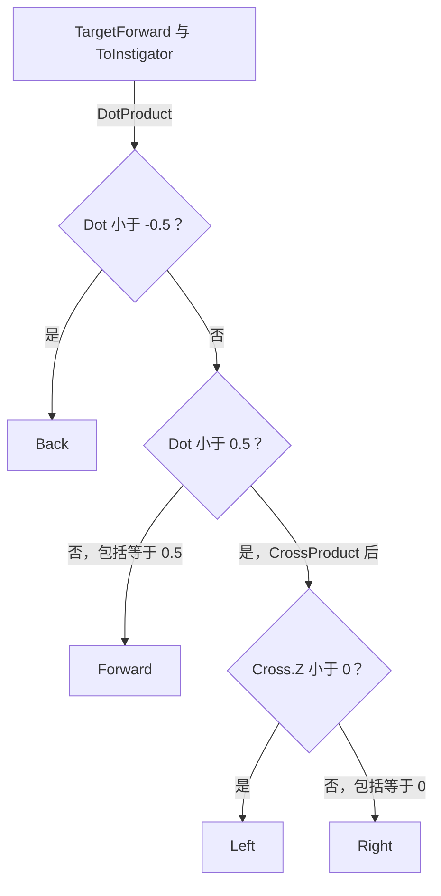
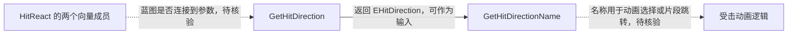

# UGAS_BlueprintLibrary 与 EHitDirection

源码：`Source/GAS_Acquaintance/Utils/GAS_BlueprintLibrary.h`、`GAS_BlueprintLibrary.cpp`。核对日期：2026-11-03。

## 头文件：枚举与类声明

`EHitDirection : uint8` 标记为 `UENUM(BlueprintType)`，枚举值依次为 Left、Right、Forward、Back。

`UGAS_BlueprintLibrary` 继承 `UBlueprintFunctionLibrary`，没有成员变量或自定义构造函数。两个 public 静态函数均为 `BlueprintPure`：

| 声明 | 输入与返回值 |
| --- | --- |
| `GetHitDirection(const FVector& TargetForward, const FVector& ToInstigator)` | 接收目标前向和指向发起者的向量，返回 EHitDirection |
| `GetHitDirectionName(const EHitDirection& HitDirection)` | 接收枚举，返回 FName |

函数本身不保存状态、不取得 Actor，也不播放动画。

## GetHitDirection：点积与前后判定

摘自 `GAS_BlueprintLibrary.cpp` 的 `GetHitDirection()`，仅保留点积和 Back 分支，省略行尾注释：

```cpp
const float Dot = FVector::DotProduct(TargetForward, ToInstigator);
if (Dot < -0.5f)
{
    return EHitDirection::Back;
}
```

函数直接使用传入向量，不在内部归一化或投影到水平面。方向解释应以有效、方向意义明确的输入为前提；向量长度会影响点积阈值的判断。

## GetHitDirection：叉积与左右判定

当 `Dot < 0.5f` 且未进入 Back 分支时，函数检查叉积。摘自同一函数，仅保留该分支内部代码，省略注释与空行：

```cpp
const FVector Cross = FVector::CrossProduct(TargetForward, ToInstigator);
if (Cross.Z < 0.f)
{
    return EHitDirection::Left;
}
return EHitDirection::Right;
```

不进入以上两个点积分支时返回 Forward。边界值按实际比较符处理：

| 条件（按执行顺序） | 返回 |
| --- | --- |
| Dot < -0.5 | Back |
| -0.5 ≤ Dot < 0.5，Cross.Z < 0 | Left |
| -0.5 ≤ Dot < 0.5，Cross.Z ≥ 0 | Right |
| Dot ≥ 0.5 | Forward |

所以 Dot 等于 -0.5 时进入左右分支，等于 0.5 时返回 Forward。零向量输入会得到 Dot = 0、Cross.Z = 0，按当前分支返回 Right；源码没有“无效方向”枚举或输入检查。



## GetHitDirectionName：枚举与名称映射

该函数使用 switch，映射 Left、Right、Forward、Back 为同名 `FName`。以下摘自该函数，仅保留 switch 内的 case 和 default：

```cpp
case EHitDirection::Left:
    return FName("Left");
case EHitDirection::Right:
    return FName("Right");
case EHitDirection::Forward:
    return FName("Forward");
case EHitDirection::Back:
    return FName("Back");
default:
    return FName("None");
```

None 是 default 分支返回的名称，不是 EHitDirection 的一个声明值。名称可供外部逻辑使用，但本类没有按名称查找动画或蒙太奇片段的实现。

## 与 UGAS_HitReact 的数据关系

[UGAS_HitReact](../AbilitySystem/HitReact.md) 的 `AvatarForward` 和 `ToInstigator` 在意义上对应这里的两个输入；缓存函数已归一化 ToInstigator，但同位置和输入有效性仍需调用者处理。



虚线关系未在当前 C++ 中直接调用，需在能力蓝图核验；两个静态函数可独立使用，不要求固定连续调用。
